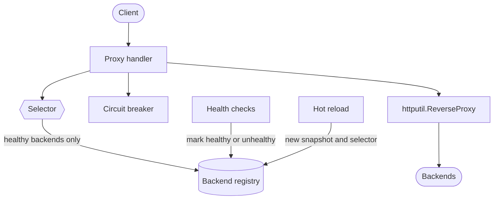

# l7LoadBalancer

A Layer 7 HTTP load balancer written in Go. It sits in front of several backend servers, reads each HTTP request, picks one healthy backend and returns that backend's answer to the client.

The request path uses the Go standard library (`net/http`, `net/http/httputil`). The one added dependency on that path is `golang.org/x/net/http2/h2c`, for HTTP/2 without TLS.

## Features

- **Four selection algorithms:** `round_robin`, `least_conn`, `consistent_hash` (with bounded loads) and `p2c_ewma` (power of two choices on latency).
- **Health checks:** active probes plus passive outlier detection.
- **Circuit breaker:** one per backend.
- **Hot reload:** change the backends or the algorithm with `SIGHUP` or `POST /admin/reload`. No restart, no dropped requests. Removed backends drain first.
- **Protocols:** HTTP/1.1, HTTP/2 over TLS (ALPN) and h2c.
- **Observability:** Prometheus metrics, structured JSON logs and a Grafana dashboard.
- **No retries:** a failed request returns 502 to the client ([ADR-0018](docs/adr/0018-no-retry-ever.md)).

## Quick start

You need Go 1.25 or newer.

```sh
make build   # builds bin/l7LoadBalancer
make test    # runs all tests
make run     # serves on :8080 with configs/example.yaml
```

`make run` needs the backends in `configs/example.yaml` to be reachable. Use `-config <path>` for a different file. `make help` lists all targets.

To run the load balancer with dummy backends, Prometheus and Grafana, run `docker compose up` in the repository root.

## Configuration

Only `backends` is required. [`configs/example.yaml`](configs/example.yaml) documents every key and default.

```yaml
listen: ":8080"
algorithm: "round_robin"   # round_robin | least_conn | consistent_hash | p2c_ewma
backends:
  - name: "backend-a"
    url: "http://127.0.0.1:9001"
  - name: "backend-b"
    url: "http://${BACKEND_HOST}:9002"   # environment variables are resolved at load
```

A reload can change only `backends` and `algorithm`. Any other key needs a restart.

## How it works



The selector picks only from healthy backends whose circuit is not open. Health checks and reloads update the registry on the side, so the request path never waits for them. See the [architecture document](docs/architecture.md) for details.

## Local demo

One load balancer in front of four backends, with skewed traffic and a Grafana dashboard. Change the algorithm in the config, send `SIGHUP` and watch the traffic move.

```sh
make demo-up
make demo-down
```

The control page is at `http://127.0.0.1:8095` and the dashboard at `http://127.0.0.1:3000`. The demo and the benchmark both use port 8080, so do not run them together. See [`demo/README.md`](demo/README.md).

## Benchmarks

This load balancer is **slower than Nginx** in the matched round-robin test over HTTP/1.1 (each side at its own peak rate):

| Response | Proxy | Peak (req/s) | p50 | p99 |
|---|---|---|---|---|
| 200 B | Nginx | 11,500 | 0.246 ms | 2.329 ms |
| 200 B | This load balancer | 8,000 | 0.510 ms | 20.757 ms |
| 10 KiB | Nginx | 6,000 | 0.255 ms | 18.747 ms |
| 10 KiB | This load balancer | 4,500 | 0.499 ms | 28.611 ms |
| 1 MiB | Nginx | 350 | 2.592 ms | 44.730 ms |
| 1 MiB | This load balancer | 275 | 5.762 ms | 49.417 ms |

**Why is it slower?** We do not know yet. Nobody has profiled the proxy, so there is no measurement that shows the cause. These are hypotheses, not findings:

- **Go runtime.** Nginx is C with an event loop. This load balancer runs a goroutine per connection, and the garbage collector shares the two cores with the proxy.
- **Per-request bookkeeping.** The load balancer counts requests in flight, records latency, checks the circuit, updates the outlier window and writes metrics. Nginx keeps none of that state in this test.
- **General-purpose proxy code.** `httputil.ReverseProxy` copies headers and bodies through the Go HTTP stack.

The data fits these ideas only loosely. The p99 gap is largest at 200 B, where per-request cost matters most, and smallest at 1 MiB. That pattern does not prove any one of them. Profiling (`net/http/pprof` is already exposed) and an ablation run with the bookkeeping turned off would settle it.

**Caveats**
- The numbers come from one noisy, incomplete run (67 of 71 result sets) on one machine, at commit `8c2b7d4`. Read them as an order, not a ratio.
- The two sides ran at different rates, so their latencies are not for the same load.
- The Nginx 200 B peak did not meet the harness's own 95% delivery rule (10,192 req/s delivered against a target of 11,500).
- At 10 KiB and 1 MiB the load generator limits the peaks.

[RESULTS.md](RESULTS.md) has the full tables, other scenarios and limits. [`bench/README.md`](bench/README.md) explains how to reproduce them with `make bench-repro`.

## Known limits

- The admin endpoint and `pprof` have no authentication. Keep them on a private network ([ADR-0005](docs/adr/0005-scope-of-production-grade.md)).
- A reload that replaces every backend leaves a short window of 503 responses.

## Read more

- [Architecture](docs/architecture.md): request path, interfaces, YAML schema and concurrency rules.
- [Design decisions](docs/design-decisions.md) and [what I'd do differently](docs/what-id-do-differently.md).
- [ADR index](docs/adr/INDEX.md): all architecture decision records.
- [Glossary](CONTEXT.md): the terms this project uses.

## Licence

MIT. See [`LICENSE`](LICENSE).
