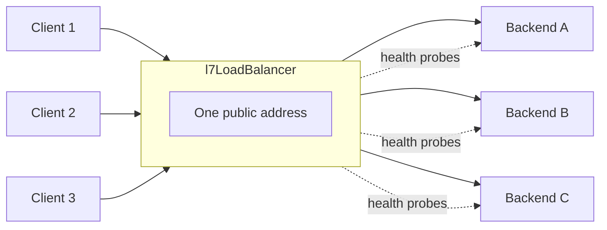
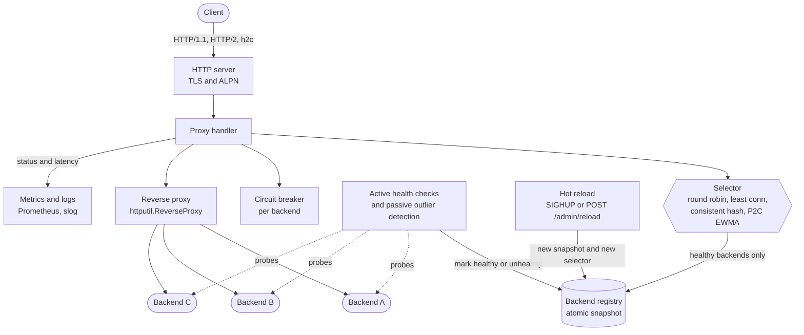
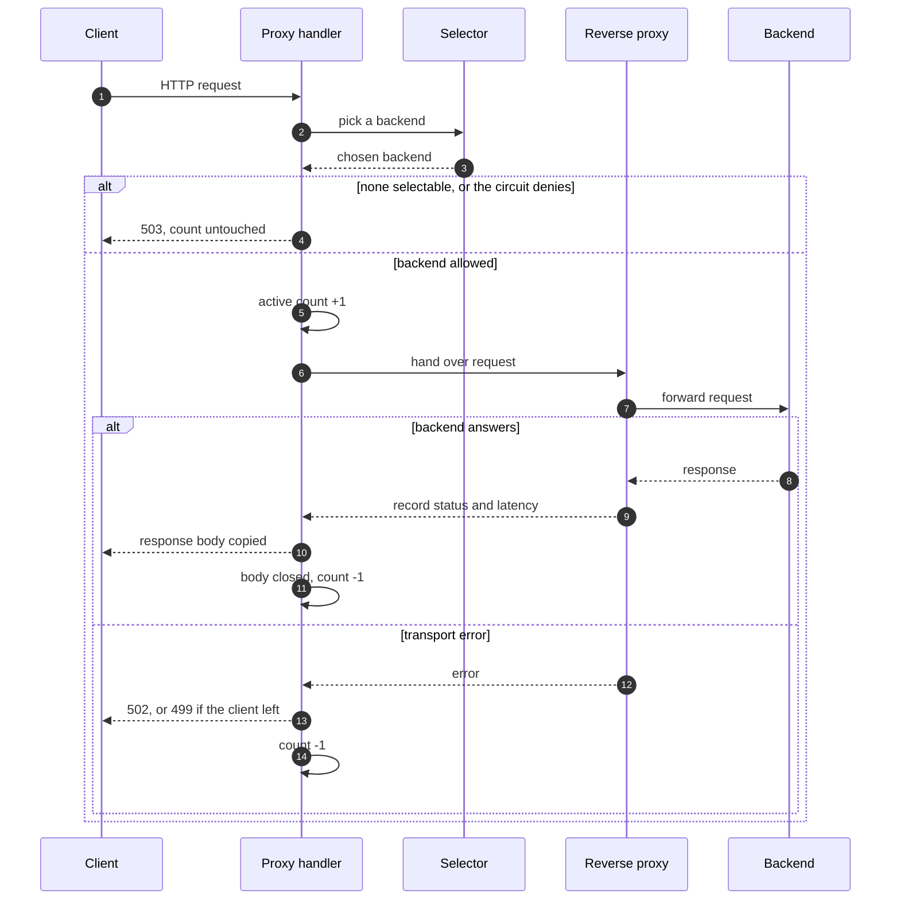

# l7LoadBalancer

l7LoadBalancer is a Layer 7 HTTP load balancer written in Go. It stands in front of several backend servers. It reads each HTTP request and picks one healthy backend. It sends the request to that backend and returns the answer to the client.

The request path uses the Go standard library (`net/http` and `net/http/httputil`). It has one added dependency on that path: `golang.org/x/net/http2/h2c`, for HTTP/2 without TLS.

## At a glance

| Item | Value |
|---|---|
| Code | About 5,100 lines of Go, and about 16,400 lines of tests |
| Test coverage | 88% to 100% in each package under `internal/` |
| Race detector | `go test -race` passes in all packages |
| Algorithms | Four: round robin, least connections, consistent hash with bounded loads, P2C with EWMA latency |
| Resilience | Active and passive health checks, circuit breaker, drain, hot reload |
| Benchmark | Slower than Nginx at all tested sizes. The numbers are public, with their limits |
| Known gaps | The admin endpoint has no authentication. The benchmark run is noisy. Nobody profiled the proxy yet |

**Contents:** [What it does](#what-a-load-balancer-does), [Layer 7](#what-layer-7-means), [Features](#features), [Request flow](#how-a-request-flows), [Hot reload](#hot-reload), [Quick start](#quick-start), [Configuration](#configuration), [Demo](#local-live-demo), [Testing](#how-it-was-tested), [Results](#benchmark-results), [Nginx gap](#why-the-results-differ-from-nginx), [Limits](#honest-limits), [More docs](#read-more).

## What a load balancer does

A load balancer stands between clients and a group of backend servers. Clients talk to one address. The load balancer shares the requests among the backends. If a backend fails, the load balancer stops sending requests to it. Clients do not see the failure.



A load balancer gives you three things:

- **More capacity.** Many backends share the load.
- **Better uptime.** A broken backend leaves the pool. The pool keeps serving.
- **Easy change.** You add, remove or replace backends without a change for the clients.

### What is inside this load balancer



Read the diagram from top to bottom. The request enters on the top. The selector uses the registry to pick a backend. The circuit breaker can deny a backend. The reverse proxy sends the request. The health checks and the reload feed the registry on the side, so the request path never waits for them.

## What "Layer 7" means

Network software has seven layers (the OSI model). Layer 4 is the transport layer: TCP and UDP. Layer 7 is the application layer: HTTP.

- A **Layer 4 load balancer** sees only IP addresses, ports and bytes. It cannot read the request. It picks a backend for each TCP connection and then copies bytes. It is fast and simple. It cannot tell one request from another.
- A **Layer 7 load balancer** ends the client connection and reads the whole HTTP request. It opens its own connection to a backend. It can then decide for each request, not for each connection.

Because it reads the request, this load balancer can do things that a Layer 4 balancer cannot do:

- It picks a backend for each request. One long client connection can use many backends.
- It sends the same client IP to the same backend each time (consistent hashing).
- It reads HTTP status codes. A run of 5xx answers from one backend opens the circuit of that backend. This works even when the TCP connection is fine.
- It speaks HTTP/2 to clients and HTTP/1.1 to backends, or the other way round.
- It counts requests, requests in flight and latency for each backend. It exports these as metrics.

This work has a cost. The load balancer parses every request. It holds two connections for each proxied request. This is one reason why a Layer 7 proxy is slower than a Layer 4 proxy. [Below](#why-the-results-differ-from-nginx) we show how it compares with Nginx.

## Features

- **Four selection algorithms.**
  - `round_robin` takes the backends in turn.
  - `least_conn` picks the backend with the fewest requests in flight.
  - `consistent_hash` sends the same client IP to the same backend. It uses bounded loads. A hot key spills to the next backend, so one backend does not take all the load.
  - `p2c_ewma` compares two random backends. It picks the one with the lower moving average of latency.
- **Active health checks.** The checker probes each backend every 5 s with a 2 s timeout. Three failed probes in a row eject the backend. Two good probes bring it back.
- **Passive outlier detection.** A backend is ejected after 5 failures in its last 10 requests. Only active probes bring it back.
- **Circuit breaker.** Each backend has its own circuit. Three failures in a row open it. After a 30 s cooldown, one trial request decides if the circuit closes again.
- **Hot reload.** A new backend list or a new algorithm applies without a restart and without dropped requests. See [Hot reload](#hot-reload).
- **Drain.** A reload can remove a backend. That backend finishes its requests in flight first. The drain window is 30 s by default.
- **No retries.** A failed request goes back to the client as a 502. The client sees a 499 if it left first. A retry could run a non-idempotent request two times ([ADR-0018](docs/adr/0018-no-retry-ever.md)).
- **Protocols.** Plain HTTP/1.1, TLS with HTTP/2 through ALPN, or h2c (HTTP/2 without TLS). The scheme of a backend sets its protocol. `https://` negotiates HTTP/2. `http://` uses HTTP/1.1.
- **Metrics and logs.** Prometheus metrics are on `/metrics` at `:9090`. Logs are structured JSON from `log/slog`. The probes `/livez`, `/readyz` and `/startupz` are on `:8081`. A Grafana dashboard is included.
- **Container image.** The image holds a static binary in a distroless base. It has a built-in health check.

## How a request flows



The selector picks only from backends that are healthy and whose circuit is not open. The count of requests in flight goes up when the proxy hands over the request. It goes down exactly one time, when the response body closes or the round trip fails. The [architecture document](docs/architecture.md) explains each step.

## Hot reload

A reload changes the running process. It does not start a new process.

**How to start a reload.** Edit the config file and send `SIGHUP`. For example, run `docker kill -s HUP <container>`. You can also send the new YAML to `POST /admin/reload` on the metrics port. `GET /admin/reload/last` shows the result of the last reload. One lock makes the two triggers run one at a time.

**What a reload can change.** A reload can change only `backends` and `algorithm`. A change to any other key rejects the whole reload. The message names the keys. Those keys (listen address, TLS, timeouts and so on) need a restart.

**How it works.**

1. The system loads and validates the new config first. If anything is wrong, nothing changes.
2. The system builds the new algorithm before it uses it. One atomic store then swaps it in. A request in flight keeps its backend. The next request uses the new algorithm.
3. The list of backends is an immutable snapshot behind one atomic pointer. A reload builds a new snapshot and swaps the pointer. Request code reads the pointer without a lock.
4. The name and the URL together identify a backend. A backend that does not change keeps the same object. Its health, circuit state, count of requests in flight and latency estimate stay. A backend with a new URL counts as one removal and one addition. State from the old host never moves to a new host.
5. New backends start unhealthy. They join after one passing probe. A typo in a new URL cannot send errors to clients.
6. A removed backend gets a "removed" mark first, so it gets no new requests. Then it drains. One goroutine checks its in-flight count every 100 ms. If the count does not reach zero in `reload.drain_window` (30 s by default), the system cancels the requests of that backend. A request that waits for headers gets a 502. A request that streams its body is cut.

**Measured result.** The load test ran for 60 s and fired a reload at second 29. A reload that changed nothing had **zero** failed requests. A reload that drained a backend also had **zero**. For the no-op reload, p99 was 1.752 ms before and 1.762 ms after. For the drain reload, p99 was 1.856 ms before and 2.140 ms after. The removed backend got no request after the reload applied. See [RESULTS.md](RESULTS.md#failure-and-reload-under-load).

**Limits.** A reload that replaces every backend leaves a short time with no selectable backend. Requests get a 503 in that time. The admin endpoint has no authentication. Keep it on a private network.

## Quick start

You need Go 1.25 or newer.

```sh
make build   # builds bin/l7LoadBalancer
make test    # runs all tests
make run     # serves on :8080 with configs/example.yaml
```

`make run` needs the backends in `configs/example.yaml` to be reachable. Use `-config <path>` to give a different file. `make help` lists all targets.

To run the load balancer with three dummy backends, Prometheus and Grafana, run `docker compose up` in the repository root.

## Configuration

This is a minimal example. All keys other than `backends` are optional. [`configs/example.yaml`](configs/example.yaml) documents every key and default.

```yaml
listen: ":8080"
algorithm: "round_robin"   # round_robin | least_conn | consistent_hash | p2c_ewma
# tls: { cert_file: server.crt, key_file: server.key }   # or h2c: true
health:
  probe_interval: "5s"
  probe_timeout: "2s"
circuit:
  cooldown: "30s"
metrics:
  listen: ":9090"
reload:
  drain_window: "30s"
backends:
  - name: "backend-a"
    url: "http://127.0.0.1:9001"
  - name: "backend-b"
    url: "http://${BACKEND_HOST}:9002"   # environment variables are resolved at load
```

## Local live demo

The demo runs on your machine only. It starts one load balancer in front of four backends. It sends skewed traffic and shows the result on a Grafana dashboard. You change the algorithm when you edit a file and send `SIGHUP`. Then you watch the traffic move with no errors. A control page adds delay, jitter or failures to a backend ([ADR-0023](docs/adr/0023-local-live-demo.md)).

```sh
make demo-up    # the first build takes a few minutes
make demo-down
```

Open the control page at `http://127.0.0.1:8095` and the dashboard at `http://127.0.0.1:3000`. The benchmark and the demo both use port 8080. Do not run them together. See [`demo/README.md`](demo/README.md) and [`demo/DEMO-SCRIPT.md`](demo/DEMO-SCRIPT.md).

Demo video: <!-- VIDEO-LINK-SLOT: owner fills in after recording -->

## How it was tested

**Unit and integration tests.** Every package has table-driven tests. Integration tests start real backends with `httptest.NewServer`. `make test-race` runs all tests under the Go race detector.

**Property tests for the algorithms.** One test sends 10,000 skewed requests. Plain consistent hashing put 40% of the load on the busiest backend. Bounded loads put 31.3% there. In another test, P2C with EWMA sent about 51% of the requests to the one fast backend among four.

**Chaos tests** (`test/chaos`). These tests build the whole system in one process and then break it:
- Inject 5xx answers on one backend. The circuit must open, and routing must stop.
- Stop a backend. The system must eject it within the health threshold and bring it back after a restart.
- Kill a backend while a response body streams.
- Send 1000 `SIGHUP` reloads under load to the real binary. No request may fail.

**Soak test.** `make soak` runs load, cancelled requests, backend deaths and reloads for one hour. The test passes if goroutines stay within the baseline plus 10 and the heap stays within the baseline plus 8 MB. The one-hour run sent 59.66 million requests with 12 reloads. Goroutines went from 35 to 30.

**Benchmark against Nginx.** `make bench-repro` rebuilds every number below from a clean checkout. It takes about 2 to 2.5 hours.
- **One tool.** [vegeta](https://github.com/tsenart/vegeta) is the load generator for HTTP/1.1 and HTTP/2. It sends at a fixed rate. It measures from the planned send time, so it does not hide queueing.
- **A fair Nginx.** Nginx runs the same algorithm, the same four backends and the same connection pool. Nobody tuned Nginx to its best.
- **Fixed cores.** The load balancer and Nginx get two cores each. Each backend gets one core. The load generator gets two cores. The rig is an Apple M3 with 8 vCPUs and 8 GiB given to Docker.
- **Peak rate.** A rate counts only if p99 stays under 100 ms, fewer than 1% of requests fail, and the generator delivered at least 95% of the target. The search steps up by 500 req/s (25 req/s at 1 MiB).
- **Three response sizes:** 200 B, 10 KiB and 1 MiB.
- **Scenarios:** peak throughput, latency at 30%, 50%, 70% and 90% of peak, a backend stopped mid-run, reloads under load, a degraded backend and a hot key.

A script builds the tables from raw output. The script fails if a number in the text does not match a table cell. [`bench/README.md`](bench/README.md) has the details.

## Benchmark results

All numbers come from one run at commit `8c2b7d4`. The run was noisy and incomplete. It produced 67 of 71 result sets. Read the numbers as an **order, not a ratio**. [RESULTS.md](RESULTS.md) has the full tables and limits.

**Round robin over HTTP/1.1.** Each side runs at its own peak rate. Both sides use the same algorithm.

| Response | Proxy | Peak (req/s) | p50 | p99 |
|---|---|---|---|---|
| 200 B | Nginx | 11,500 | 0.246 ms | 2.329 ms |
| 200 B | This load balancer | 8,000 | 0.510 ms | 20.757 ms |
| 10 KiB | Nginx | 6,000 | 0.255 ms | 18.747 ms |
| 10 KiB | This load balancer | 4,500 | 0.499 ms | 28.611 ms |
| 1 MiB | Nginx | 350 | 2.592 ms | 44.730 ms |
| 1 MiB | This load balancer | 275 | 5.762 ms | 49.417 ms |

Nginx is ahead at all three sizes. It handles more requests each second. Its median latency is about half. The two sides ran at different rates, so these latencies are not for the same load. The p99 gap is large at 200 B. It is small at 1 MiB, where the backend and the body copy take most of the time.

**Other results:**

- **Least connections over HTTP/2.** The load balancer peaked at 6,000 req/s at 200 B and 3,000 req/s at 10 KiB. Nginx peaked at 5,000 and 2,500. Nginx led at 1 MiB (200 against 150 req/s). The four backends were the same, so a near-tie is the expected result.
- **P2C with EWMA over HTTP/2.** At 10 KiB the load balancer had p99 8.2 ms. Nginx (`random two least_conn`) had p99 289.9 ms. Nginx had the higher peak (5,000 against 4,000 req/s). The two are not the same algorithm. Nginx has no latency signal.
- **Hot key.** The load generator has one address, so every consistent-hash run is a hot key. The hash of Nginx sent at least 97.97% of requests to one backend in every main HTTP/2 run. At 10 KiB peak load, the bounded ring sent 82.27% to the owner and 17.19% to a second backend. At low load there was no spill.
- **Backend stopped mid-run.** One of four backends stopped at second 29. Three requests failed, all inside 9 ms. They reached the client because the load balancer never retries. The p99 was 2.354 ms.
- **Reload under load.** Zero failed requests. See [Hot reload](#hot-reload).
- **Degraded backend.** We do not quote this result. A 50 ms delay was for one backend. It seems to have reached all four backends. No algorithm had a fast backend to prefer.

## Why the results differ from Nginx

Nginx is faster in the matched round-robin test, and its latency is lower. This is expected. The reasons below are likely, but nobody has profiled them yet. Treat them as an informed explanation, not as a measurement.

- **Language and runtime.** Nginx is C code. It uses an event loop and a small fixed set of worker processes. This load balancer is Go. It runs one goroutine for each connection. The garbage collector uses CPU and can add latency spikes. Both sides had two cores, so the collector competed with the proxy. This fits the larger p99 gap at small responses, where the cost of each request matters most.
- **Work for each request.** The load balancer does more than forward bytes. It counts requests in flight for each backend. It records the latency of each round trip. It checks the circuit, updates the outlier window and writes metrics. Nginx keeps none of that state in this test.
- **A general proxy.** `httputil.ReverseProxy` copies headers and the body through general code and the Go HTTP stack. Nginx has tuned buffers and a C parser.
- **Different features.** Nginx has no exact match for consistent hashing and P2C. Its hash has no bounded loads, so the owner of a hot key takes all the load. Its two-choice algorithm compares connection counts, not latency. Part of the difference in those rows comes from the design, not from speed. The load balancer looks better in these rows: its P2C p99 at 10 KiB is lower, and its hot-key spread is better.
- **The rig.** The generator, the shared virtual machine and a noisy run affect both sides. The size of the gap is not certain. The order held at all three sizes.

The design costs speed and gives safety: health checks, a circuit breaker, drain, per-backend metrics and algorithms that react to load. [Design decisions](docs/design-decisions.md) gives the trade-offs.

## Honest limits

- The load balancer is slower than Nginx. The p99 at 200 B is about nine times higher (20.757 ms and 2.329 ms), at a lower rate.
- The server already exposes `net/http/pprof`, but nobody has used it to find the cause. This is the first next step. [What I'd do differently](docs/what-id-do-differently.md) lists more.
- The benchmark is one noisy run on one machine. Two HTTP/2 round-robin runs through the load balancer were skipped. The HTTP/2 round-robin figures for Nginx are below its HTTP/1.1 figures, which is the wrong direction. Those figures are the least reliable.
- At 10 KiB and 1 MiB, the load generator limits the peaks. It has two vCPUs. The peaks are lower bounds.
- The cores sit inside a virtual machine, so the ceiling is soft.
- The admin endpoint and `pprof` have no authentication. Security hardening is out of scope ([ADR-0005](docs/adr/0005-scope-of-production-grade.md)).
- The system never retries a failed request. This is a choice, not a missing feature.

## Read more

- [Architecture](docs/architecture.md): the request path, interfaces, YAML schema and concurrency rules.
- [Design decisions](docs/design-decisions.md): the main choices and their cost.
- [What I'd do differently](docs/what-id-do-differently.md): known weaknesses.
- [ADR index](docs/adr/INDEX.md): all architecture decision records.
- [Benchmark results](RESULTS.md) and [how to run the benchmarks](bench/README.md).
- [Glossary](CONTEXT.md): the terms this project uses.

## AI-assisted development

<!-- AI-DISCLOSURE-SLOT: owner writes this section -->

## Licence

MIT. See [`LICENSE`](LICENSE).
