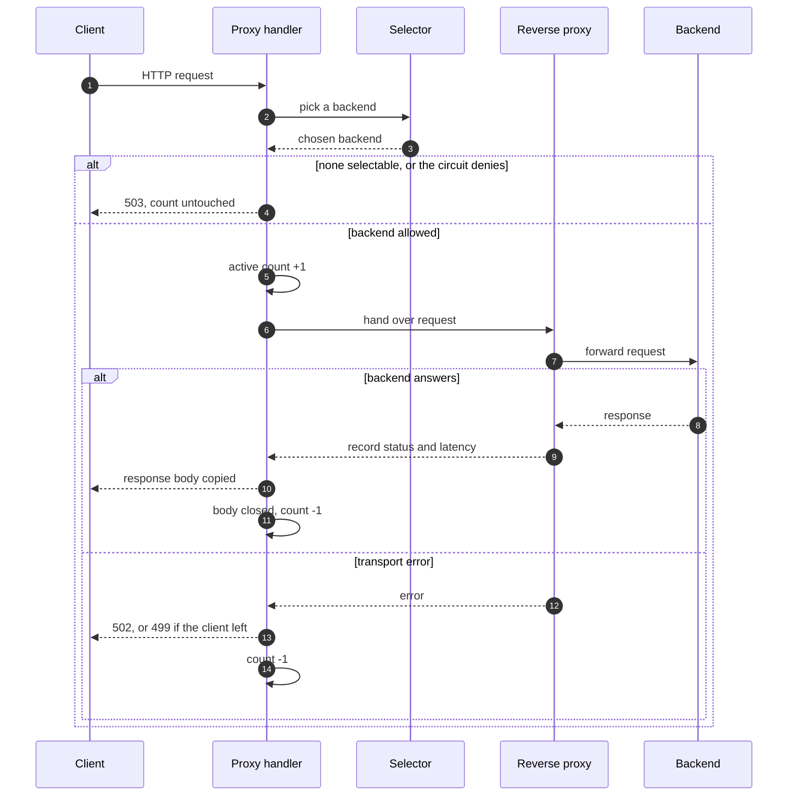

# l7LoadBalancer

A Layer 7 HTTP load balancer in Go. It reads each HTTP request and sends it to one of several backends through a reverse proxy built on `net/http/httputil`. The request path uses only the standard library, except `golang.org/x/net/http2/h2c` for h2c.

## Features

- **Four selection algorithms.** `round_robin` takes the backends in turn. `least_conn` picks the backend with the fewest requests in flight. `consistent_hash` sends the same key to the same backend, with bounded loads to spill a hot key. `p2c_ewma` compares two random backends and picks the one with the lower moving average of latency.
- **Health checks.** An active checker probes each backend every 5 s with a 2 s timeout. Three failed probes in a row eject the backend. Passive outlier detection ejects a backend after 5 failures in its last 10 requests.
- **Circuit breaker.** Each backend has its own circuit. Three failures in a row open it. After a 30 s cooldown, one trial request decides if it closes again.
- **Hot reload.** `SIGHUP` or `POST /admin/reload` applies a new backend list or a new algorithm without dropping requests. `GET /admin/reload/last` shows the result of the last reload.
- **Drain.** A reload that removes a backend lets its in-flight requests finish. It sends no new requests to that backend. The drain window is 30 s by default.
- **No retries.** A failed request goes back to the client as a 502 ([ADR-0018](docs/adr/0018-no-retry-ever.md)).
- **Protocols.** Plain HTTP/1.1, TLS with HTTP/2 through ALPN, or h2c (HTTP/2 without TLS). The backend scheme sets the backend protocol: `https://` negotiates HTTP/2, `http://` uses HTTP/1.1.
- **Metrics.** Prometheus metrics on `/metrics` at `:9090`. Orchestrator probes `/livez`, `/readyz` and `/startupz` on `:8081`.

## How a request flows



The [architecture document](docs/architecture.md) explains each step.

## Quick start

You need Go 1.25 or newer.

```sh
make build   # builds bin/l7LoadBalancer
make test    # runs all tests
make run     # serves on :8080 with configs/example.yaml
```

`make run` expects the backends in `configs/example.yaml` to be reachable. Use `-config <path>` to give a different file. `make help` lists all targets.

## Configuration

A minimal example. All keys other than `backends` are optional. [`configs/example.yaml`](configs/example.yaml) documents every key and default.

```yaml
listen: ":8080"
algorithm: "round_robin"   # round_robin | least_conn | consistent_hash | p2c_ewma
# tls: { cert_file: server.crt, key_file: server.key }   # or h2c: true
health:
  probe_interval: "5s"
  probe_timeout: "2s"
circuit:
  cooldown: "30s"
metrics:
  listen: ":9090"
reload:
  drain_window: "30s"
backends:
  - name: "backend-a"
    url: "http://127.0.0.1:9001"
  - name: "backend-b"
    url: "http://${BACKEND_HOST}:9002"   # environment variables are resolved at load
```

A reload can change only `backends` and `algorithm`. A change to any other key rejects the whole reload.

## Local live demo

The demo runs on your machine only. It starts load balancers in front of four backends, sends skewed traffic, and shows the result on a Grafana dashboard ([ADR-0023](docs/adr/0023-local-live-demo.md)).

```sh
make demo-up    # the first build takes a few minutes
make demo-down
```

Open the control page at `http://127.0.0.1:8095` and the dashboard at `http://127.0.0.1:3000`. The benchmark and the demo both use port 8080, so do not run them together. See [`demo/README.md`](demo/README.md) and [`demo/DEMO-SCRIPT.md`](demo/DEMO-SCRIPT.md).

Demo video: <!-- VIDEO-LINK-SLOT: owner fills in after recording -->

## Benchmark headlines

All numbers come from one run of `make bench-repro` at commit `8c2b7d4`. The run was noisy and incomplete: it produced 67 of 71 result sets. The rig was an Apple M3 with 8 vCPUs and 8 GiB given to Docker, with fixed cores for each role. Full tables and caveats are in [RESULTS.md](RESULTS.md).

A peak is the highest rate with p99 under 100 ms, fewer than 1% errors, and at least 95% of the target rate delivered. Peaks for large responses are limited by the load generator, so treat them as lower bounds.

**Against Nginx, HTTP/1.1, round-robin (same algorithm on both sides).** Nginx is ahead at all three sizes. This is one run, so read it as an order, not a ratio.

| Response size | Nginx peak (req/s) | Load balancer peak (req/s) | Search step (req/s) |
|---|---|---|---|
| 200 B | 11500 | 8000 | 500 |
| 10 KiB | 6000 | 4500 | 500 |
| 1 MiB | 350 | 275 | 25 |

- **Reload under load.** A no-op reload and a reload that drained a backend both passed under 60 s of HTTP/2 load. Neither had a non-2xx response or a transport error. The removed backend got no requests after the reload applied.
- **Backend stopped mid-run.** One of four backends stopped at second 29. Three requests failed, all inside 9 ms. They reached the client because the load balancer never retries.
- **Hot key.** Nginx's consistent hash sent at least 97.97% of requests to one backend in every main HTTP/2 run. The bounded-load hash spilled: at 10 KiB peak load, 82.27% went to the owner and 17.19% to a second backend.
- **Degraded backend.** This scenario is not quoted. The 50 ms delay seems to have reached all four backends.

## Read more

- [Architecture](docs/architecture.md): the request path and package dependencies.
- [Design decisions](docs/design-decisions.md): the main choices and their cost.
- [What I'd do differently](docs/what-id-do-differently.md): known weaknesses.
- [ADR index](docs/adr/INDEX.md): all architecture decision records.
- [Benchmark results](RESULTS.md) and [how to run the benchmarks](bench/README.md).

## AI-assisted development

<!-- AI-DISCLOSURE-SLOT: owner writes this section -->

## Licence

MIT. See [`LICENSE`](LICENSE).
