# l7LoadBalancer: The Study Guide

A book for students who want to understand this project from the ground up.

> **Line numbers:** every `file:line` reference in this book was checked against commit `53504fc`. If the code has changed since then, the line numbers may be a few lines off. Search for the function name to find it.

## How to read this book

The chapters are in the order you need them. Concepts come first, then the Go tools we used, then each part of the system in the order a request meets it, then the algorithms, then extras.

## Table of contents

**Part 1: Concepts**
1. What this project is
2. What "L7" means
3. Types of load balancers
4. What an L7 balancer does with a request

**Part 2: The tools**

5. Go and the tech stack (and why we chose them)

**Part 3: The architecture**

6. The big picture: packages and glossary
7. YAML config
8. App wiring and startup
9. The client and the HTTP server
10. The proxy handler
11. Backend servers and the registry
12. The selector interface
13. Active health checker
14. Passive outlier detection
15. Circuit breaker
16. Metrics, logging and admin endpoints
17. One request, end to end
18. Hot reload without downtime
19. Switching the selector algorithm at runtime
20. Graceful shutdown

**Part 4: The algorithms**

21. The four selector algorithms
22. Algorithms not in this project

**Part 5: Wrap-up**

23. Demo, tests and benchmarks
24. Known limitations
25. Glossary and further reading

---

<!-- CHAPTER-1-START -->
## Chapter 1: What this project is

### The problem: one server is not enough

Imagine a small food truck. On a quiet day, one person can take orders, cook, and take payment. On a busy day, the line is long and people leave. And if that one person gets sick, the truck is closed.

Websites have the same problem. One server can only handle so many visitors at once. If it slows down, visitors wait. If it crashes, the whole site goes down. And when you want to update the software, you may have to turn the server off for a while.

The usual fix is to run **several** servers with the same website on each one. But then a new question appears: when a visitor arrives, which server should answer? And what if one of them is broken?

That is the job of a **load balancer**.

### What a load balancer is

A **load balancer** is a program that stands in front of several servers. Visitors talk only to the load balancer, using one address. For each request, it picks one healthy server, sends the request there, and passes the answer back to the visitor. The visitor never needs to know how many servers exist. If a server breaks, the load balancer notices after a few failed checks and then stops sending traffic to it.

**Example.** Say three servers are running and backend 2 breaks:

- Backend 2 stops answering.
- Requests sent to backend 2 fail with `502 Bad Gateway` for a short time.
- After 3 failed health checks in a row (a health check is a test request the balancer sends on a timer), backend 2 is marked unhealthy. This is called **ejection**.
- From then on, traffic goes only to backends 1 and 3.

This project, **l7LoadBalancer**, is a load balancer for **HTTP** traffic. HTTP is the language web browsers and web servers use to talk. The project is written in **Go**, a programming language made by Google. The "L7" part means the balancer reads the HTTP request itself, not just the network connection underneath. Chapter 2 explains "Layer 7" fully.

The project is built to show how the pieces of a load balancer work inside. It is not hardened against hostile traffic, and security work is out of scope (see `docs/adr/0005-scope-of-production-grade.md`). Nginx and HAProxy are mature tools, widely used in production, that do this job for real companies.

### What it can do

Each feature below is explained in later chapters. The file and line numbers show where the code lives in the repository.

| Feature | What it does, in one line | Where it lives |
|---|---|---|
| Selection algorithms | Decides which backend gets each request. Four methods: round robin (take turns), least connections (fewest active requests), consistent hash (the same client goes to the same backend) and P2C with EWMA (pick the faster of two random backends). | `internal/balancer/selector.go:19` (the `Selector` interface), `internal/balancer/selector.go:41` (picks the algorithm from the config) |
| Active health checks | Sends a test request to each backend on a timer, to see if it is alive. | `internal/health/checker.go:61` (the `Checker`) |
| Passive outlier detection | Watches real traffic, and removes a backend whose recent requests fail too often. | `internal/health/outlier.go:55` (the `OutlierDetector`) |
| Circuit breaker | Stops sending traffic to a backend after several failures in a row, then tries again later. | `internal/circuit/circuit.go:37` (the `Breaker`) |
| Hot reload | Re-reads the config file and updates the backend list while the program keeps running. | `cmd/l7LoadBalancer/main.go:191` (SIGHUP signal), `internal/app/app.go:226` (`Reload`) |
| Graceful drain | Lets requests already in progress finish on a backend that was removed, before cutting it off. | `internal/app/drain.go:43` (`drainBackend`) |
| TLS, HTTP/2 and h2c | Supports encrypted HTTPS (TLS is the encryption behind HTTPS), the newer HTTP/2 protocol, and h2c, which is HTTP/2 without encryption. | `internal/app/app.go:402` (chooses TLS or plain serving), `internal/app/app.go:131` (h2c wrapper) |
| Metrics | Counts requests, errors and backend states, and exposes them for Prometheus (a monitoring tool). | `internal/metrics/metrics.go:85` (`NewCollector`) |
| Health endpoints | Gives monitoring or container tools simple `/livez`, `/readyz` and `/startupz` URLs. | `internal/health/endpoint.go:16` to `:18` (paths) |
| Graceful shutdown | Stops the program cleanly on Ctrl+C, or when it is sent SIGTERM (what `docker stop` sends), giving work time to finish. | `internal/app/app.go:342` (`Run`), `cmd/l7LoadBalancer/main.go:184` (signal setup) |

The drain window is 30 seconds by default (set by `reload.drain_window` in `configs/example.yaml:19`-`23`). A removed backend may finish its requests that are already running during that time. After the window, any request still running is cancelled.

### What it does not do

Knowing the limits is just as useful as knowing the features.

- **No retries.** If a backend fails a request, the client gets a `502 Bad Gateway` error. If no backend can take traffic at all, the client gets `503 Service Unavailable`. The load balancer does not try the request again on another backend. The error mapping is in `internal/proxy/proxy.go:292`-`299` (502 by default, 503 when no backend can take the request) and `internal/proxy/proxy.go:423` (502 for a failed backend round trip). The README explains this choice.
- **No fancy routing.** It does not send `/images` to one group of servers and `/api` to another. Every request goes to the same pool.
- **No built-in login or access control.** The admin endpoint for reloading (`POST /admin/reload` on the metrics port) has no authentication, as the README notes.
- **It is slower than Nginx in the tested benchmark.** The README says this plainly. The benchmark numbers came from one noisy, incomplete benchmark run on an older commit (`8c2b7d4`), so treat them as a rough picture, not a final result. See `RESULTS.md`.

### A simple picture

Here is the simplest picture of the system. Mermaid is a text format that many tools draw as a diagram. If your viewer does not draw it, use the ASCII version below it.

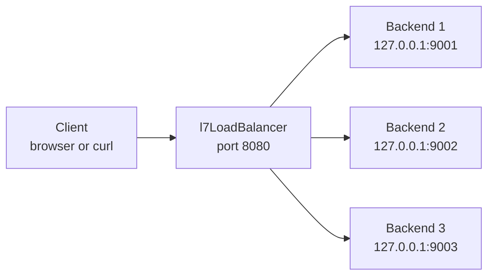

The same picture in plain text:

```
+--------+     +-----------------+     +-----------+
| Client |---->| l7LoadBalancer  |---->| Backend 1 |  127.0.0.1:9001
+--------+     |   port 8080     |     +-----------+
               |                 |
               |                 |---->+-----------+
               |                 |     | Backend 2 |  127.0.0.1:9002
               |                 |     +-----------+
               |                 |
               |                 |---->+-----------+
               +-----------------+     | Backend 3 |  127.0.0.1:9003
                                       +-----------+
```

The client sends one request. The load balancer picks one backend, forwards the request, and returns the answer. The backend addresses shown are the ones in `configs/example.yaml:83`-`89`.

### Where the program starts

The program starts at `func main()` in `cmd/l7LoadBalancer/main.go:138`. The startup steps, in order, are:

1. Set up the logger (`cmd/l7LoadBalancer/main.go:139`-`140`).
2. Check for the `probe` subcommand. This is a small helper used by container health checks (`cmd/l7LoadBalancer/main.go:147`-`149`). A **container** is a packaged, isolated program, such as one run by Docker.
3. Read the flags. There is one flag, `-config`, which defaults to `configs/example.yaml` (`cmd/l7LoadBalancer/main.go:151`).
4. Load and check the config file (`cmd/l7LoadBalancer/main.go:154`-`162`).
5. Build the application (`cmd/l7LoadBalancer/main.go:164`) and run it (`cmd/l7LoadBalancer/main.go:197`).

After `make build`, you can run the program directly and name the config file yourself: `bin/l7LoadBalancer -config configs/example.yaml`.

When it runs, `App.Run` at `internal/app/app.go:342` starts three servers:

- The **client server** on the `listen` address from the config (for example `:8080`). This is where visitors connect.
- The **metrics server** on `:9090` by default, which also serves the admin endpoints (for example `POST /admin/reload`) and pprof (a Go profiling tool).
- The **health server** on `:8081` by default, which serves the health endpoints.

The program listens for these signals:

- **SIGINT** (Ctrl+C) and **SIGTERM** (a normal stop request, and what `docker stop` sends): start a graceful shutdown.
- **SIGHUP** (a "hang up" signal, often used to mean "reload"): re-read the config file and apply the changes.

Other signals are not handled in code.

### Folder map

| Folder | What is inside |
|---|---|
| `cmd/l7LoadBalancer/` | The program's entry point. Flags, file reading and signals. |
| `internal/app/` | Wiring. It builds everything, runs the servers, and handles reload and drain. |
| `internal/proxy/` | The HTTP handler that forwards each request to a backend. |
| `internal/backend/` | The `Backend` type, the registry of backends, and each backend's state. |
| `internal/balancer/` | The `Selector` interface and the four selection algorithms. |
| `internal/health/` | Active health checks, outlier detection and health endpoints. |
| `internal/circuit/` | The per-backend circuit breaker. |
| `internal/config/` | Reading, checking and defaults for the YAML config file. YAML is a plain-text format for settings, written as simple `key: value` lines. |
| `internal/metrics/` | Prometheus measurements. |
| `internal/logger/` | Logging setup and field names. |
| `configs/` | Example config files, such as `configs/example.yaml`. |
| `deployments/docker/` | Dummy backends, a comparison with Nginx, chaos tests and monitoring setup. |
| `demo/` | A small live demo you can run on your own machine. |
| `bench/` | Benchmark scripts and results. |
| `docs/` | Architecture notes and decision records (ADRs). |
| `scripts/` | Helper scripts. |
| `test/` | Larger tests, such as the chaos tests in `test/chaos`. |
| `certs/` | A generated TLS certificate and key for HTTPS (made by `scripts/generate-cert.sh`; not committed to git). |
| `bin/` | Build output from `make build`, which is the program `bin/l7LoadBalancer`. |

### How to build and run it

You need **Go 1.25 or newer**. Open a terminal in the repository folder and run:

```
make build    # builds the program into bin/l7LoadBalancer
make test     # runs all the tests
make run      # builds and starts the balancer with configs/example.yaml
```

Other useful commands are `make test-race` (tests with Go's race detector, which looks for bugs where two parts of the program touch the same data at once), `make vet` (a quick code check) and `make help` (lists every command).

When you run `make run`, the program prints structured log lines and waits for requests on port `8080`. A **port** is a numbered door on a computer, and `8080` is the door this balancer uses. The example config sends traffic to three backends on `127.0.0.1:9001` to `9003`. (`127.0.0.1` is the address that means "this same computer", also called localhost.) If nothing is listening there, requests will fail with `502 Bad Gateway`. At startup every backend is treated as healthy, so the balancer keeps trying them until the health checks notice (after 3 failed probes). The outlier detector or the circuit breaker can stop them sooner.

To see it work:

1. Start three small test servers, one on each of ports `9001`, `9002` and `9003`. Open three terminals and run one command in each (each one keeps running until you stop it):
   - `go run ./deployments/docker/dummy-backend -name backend-a -addr :9001`
   - `go run ./deployments/docker/dummy-backend -name backend-b -addr :9002`
   - `go run ./deployments/docker/dummy-backend -name backend-c -addr :9003`

   The `deployments/docker/dummy-backend/` folder holds this small dummy backend. Its `README.md` also explains a Docker option (`docker compose up -d --build` from `deployments/docker/`).
2. In another terminal, run `make run`.
3. Open `http://127.0.0.1:8080` in your browser, or run `curl http://127.0.0.1:8080` several times.
4. Watch the answers come from different backends. Each answer says which backend sent it, for example `{"backend":"backend-a"}`.

### Words you will meet

| Word | Meaning |
|---|---|
| **Backend** | A server the load balancer can send requests to. |
| **Selector** | The policy that picks a backend for each request. |
| **Selectable** | A backend that can take traffic right now: it is healthy and its circuit is not open. |
| **Probe** | One test request that the health checker sends to a backend. |
| **Outlier** | A backend whose recent real requests fail too often. |
| **Ejection** | Marking a backend unhealthy so no traffic goes to it. |
| **Circuit breaker** | A gate per backend that stops traffic after repeated failures. |
| **Drain** | Letting requests in progress finish on a removed backend. |
| **Reload** | Updating the backend list and settings from the config file, without a restart. |
| **Backend identity** | The pair of a backend's name and URL. Change the URL, and it is a different backend. |

Most of these words come from `CONTEXT.md` in the repository, which is the project's glossary. The Drain entry is the chapter's plain-English version of CONTEXT.md's "Draining".

### What you learned

- A load balancer spreads visitors across several servers, so one slow or broken server does not take the whole site down.
- l7LoadBalancer is an HTTP load balancer written in Go, built to show how the pieces work inside.
- It has real features (health checks, circuit breaker, hot reload, graceful drain), and it has clear limits (no retries, slower than Nginx in the tested benchmark).
- The program starts in `cmd/l7LoadBalancer/main.go`, and its folders split the work into packages such as `balancer`, `health` and `proxy`.

### Next chapter

Chapter 2, "What L7 means", explains what "Layer 7" is, and why reading the HTTP request matters for a load balancer.
<!-- CHAPTER-1-END -->

<!-- CHAPTER-2-START -->
## Chapter 2: What "L7" means

Chapter 1 said that l7LoadBalancer reads the HTTP request itself. This chapter explains what that means. To understand "L7", you first need to know why networking talks about **layers** at all.

### Why we need layers

Sending a web page from one computer to another is a big job. The data has to become signals on a cable or radio waves. Those signals have to reach the right computer. The two computers have to agree on how to start and end the talk. At the end, the web page has to be understood by the program that asked for it.

If one big rule tried to do all of this, it would be hard to build, hard to fix and hard to change. So engineers split the job into **layers**. A layer is one part of the job. Each layer does one kind of work and relies on the layer below it. Because each layer has its own job, one layer can change without the others having to change.

**Postal analogy (an analogy, not a fact about networks).** Think about mailing a letter. You write the letter. You put it in an envelope and write an address on it. The post office sorts it by the address. A truck carries the bag. A road carries the truck. Nobody in the chain needs to know how the others work. Networks use the same idea: each layer does its own job and trusts the layers around it.

### The OSI model: seven layers

**OSI** stands for "Open Systems Interconnection". It is a model, which means a picture that helps people think and talk about a system. The OSI model splits networking into seven layers. The International Organization for Standardization (ISO) published the basic model in 1984 as ISO 7498.

Layers are numbered from the bottom (1) to the top (7). TCP is Transmission Control Protocol, UDP is User Datagram Protocol, IP is Internet Protocol, DNS is the Domain Name System, and HTTPS is HTTP over TLS. The table lists each one.

| Layer | Name | Job, in one line | Example protocols |
|---|---|---|---|
| 7 | Application | Rules for the task the program does, such as showing a web page | HTTP, DNS |
| 6 | Presentation | Turns data into an agreed format (encoding, compression, encryption) | TLS, the encryption behind HTTPS (explained below), as a loose fit |
| 5 | Session | Starts, keeps and ends a conversation between two programs | Few clean examples |
| 4 | Transport | Moves data between two programs, reliably (TCP) or quickly (UDP) | TCP, UDP |
| 3 | Network | Gives each computer an address and finds a route across networks | IP |
| 2 | Data link | Moves data across one direct link, such as one local network | Ethernet, Wi-Fi |
| 1 | Physical | Sends raw bits as electrical, light or radio signals | Cables, radio |

Here is the same stack as a Mermaid diagram. Mermaid is a text format that many tools turn into a picture. If your viewer does not draw it, use the ASCII version below.

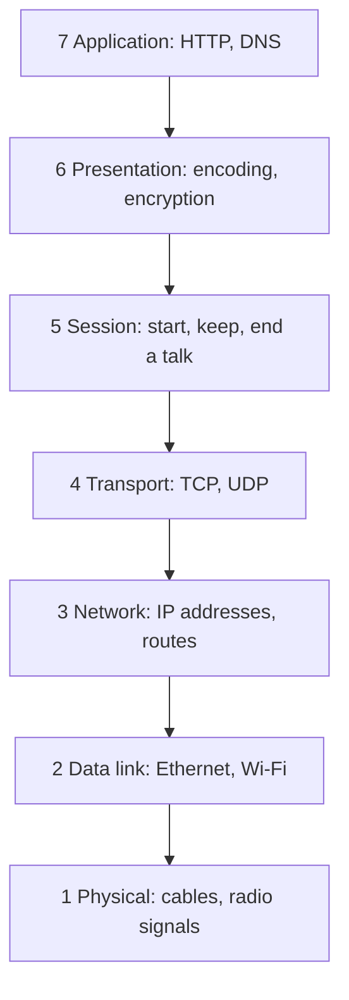

The same stack in plain text:

```
+--------------------------------------------+
| 7  Application    HTTP, DNS                |
+--------------------------------------------+
| 6  Presentation   encoding, encryption     |
+--------------------------------------------+
| 5  Session        start, keep, end a talk  |
+--------------------------------------------+
| 4  Transport      TCP, UDP                 |
+--------------------------------------------+
| 3  Network        IP addresses, routes     |
+--------------------------------------------+
| 2  Data link      Ethernet, Wi-Fi          |
+--------------------------------------------+
| 1  Physical       cables, radio signals    |
+--------------------------------------------+
```

### OSI is a teaching model

The OSI model is useful, but it is not the rule the real internet follows. The real internet mostly uses the **TCP/IP model**, which has four layers: Link, Internet, Transport and Application. The two models roughly match:

- TCP/IP **Application** covers OSI layers 5, 6 and 7.
- TCP/IP **Transport** matches OSI layer 4.
- TCP/IP **Internet** matches OSI layer 3.
- TCP/IP **Link** covers OSI layers 1 and 2.

The match is rough, not exact. Wikipedia notes that the internet's protocol work "is not concerned with strict layering", and that some protocols "may not fit cleanly into the OSI model."

So why do people still say "L4" and "L7"? Because the numbers are a shared shorthand. "L4" means the transport layer. "L7" means the application layer. Engineers use these words even though the real protocols are built on TCP/IP.

**TLS is an awkward fit.** TLS is the encryption behind HTTPS. It makes data private while it travels. In the OSI model, encryption belongs to layer 6, but TLS also sets up parts of the connection, which is a job for layer 5 or 4. Wikipedia says that TLS "does not strictly fit inside the model either." QUIC, which HTTP/3 uses, also mixes layers, because it includes TLS inside it.

### What HTTP is

**HTTP** stands for HyperText Transfer Protocol. A **protocol** is a set of rules that two computers follow so they can understand each other. HTTP is the protocol that web browsers and web servers use. It is a **client-server** protocol. The **client** (usually a browser, or a tool like `curl`) sends a **request**. The **server** sends back a **response**.

A request has these parts:

- **Method**: a verb that says what the client wants. `GET` asks for something and should only read data. `POST` sends data to the server, often to change something. Other methods include `PUT` (replace), `DELETE` (remove) and `HEAD` (like `GET`, but with no body in the answer).
- **Path** (part of the **URL**, the web address): the address of the resource on the server, such as `/index.html` or `/api/orders`.
- **HTTP version**: for example `HTTP/1.1`.
- **Headers**: extra information, written as `Name: value` lines. Examples are `Host` (which website name the client wants), `User-Agent` (which program is asking) and `Cookie` (small notes the server gave the client before).
- **Body**: the data itself. `GET` usually has no body. `POST` often does.

A response has a **status line** (the HTTP version and a **status code**), headers and an optional body. The status code is a three-digit number that says how things went. The codes are grouped into five classes:

| Class | Range | Meaning | Example |
|---|---|---|---|
| 1xx | 100-199 | Information | (rarely seen by people) |
| 2xx | 200-299 | Success | `200 OK`: the request succeeded |
| 3xx | 300-399 | Redirection | the resource is somewhere else |
| 4xx | 400-499 | Client error | `404 Not Found`: the server cannot find it |
| 5xx | 500-599 | Server error | `500 Internal Server Error`, `502 Bad Gateway`, `503 Service Unavailable` |

Here is a small, made-up example of one exchange. It is written the way it appears on the wire, with each line ending in a line break.

```
GET /index.html HTTP/1.1
Host: example.com
User-Agent: curl/8.4.0
Accept: */*

```

```
HTTP/1.1 200 OK
Content-Type: text/html
Content-Length: 31

<html><body>Hello</body></html>
```

The first line of the request says the method, the path and the version. The next lines are headers. A blank line ends the headers. Since `GET` has no body, the request ends there. The response starts with the version and the status code, then its headers, then a blank line and the body. The `Content-Length: 31` header tells the client that the body is 31 bytes long.

The diagram shows the same exchange as a conversation between two machines:

```
  Client                                Server
  |                                          |
  |  1. GET /index.html HTTP/1.1             |
  |     Host: example.com                    |
  |----------------------------------------->|
  |                                          |
  |  2. HTTP/1.1 200 OK                      |
  |     Content-Type: text/html              |
  |<-----------------------------------------|
  |     <html>...the web page...</html>      |
```

### HTTP/1.1, HTTP/2 and HTTP/3

There are three versions you will meet. They all carry the same kind of request and response. They differ in how the bytes travel.

- **HTTP/1.1** is the classic text version. Requests and responses are plain text, and a connection carries them one after another.
- **HTTP/2** is a newer version. It is commonly described as a binary format, and it can send several requests at once over one connection. This project supports HTTP/2 in two ways. Over TLS, HTTP/2 is negotiated by ALPN (a step in the TLS handshake where the client and server agree on the protocol), which `net/http` does automatically once the TLS config is set (`internal/app/app.go:445`, with the comment at `internal/app/app.go:419-420`). Without encryption, it uses h2c (HTTP/2 sent as plain text, with no TLS), through the wrapper at `internal/app/app.go:131` (see Chapter 1).
- **HTTP/3** uses a transport called **QUIC** instead of TCP. QUIC sends its packets inside **UDP**, a simpler transport that promises neither delivery nor order. QUIC adds those guarantees itself. QUIC also includes the TLS handshake.

HTTP/1.1 and HTTP/2 are sent over TCP. HTTP/3 is sent over QUIC, which runs on UDP. All three are still application-layer (L7) protocols, because they define what a request and a response mean. The changes are in how the bytes travel.

### What a device can see: L4 vs L7

A **device** here means a box in the network that looks at traffic. A load balancer is one. The question is: how much of the message can it read?

An L4 device works on the transport layer. It can see the **envelope** of each packet: the IP addresses, the port numbers and some TCP details. A **port** is a numbered door on a computer. For example, HTTPS usually uses port 443.

An L7 device works on the application layer. It can read the HTTP request itself.

| Information | L4 device | L7 device |
|---|---|---|
| Source and destination IP address | Yes | Yes |
| Source and destination port | Yes | Yes |
| Protocol (TCP or UDP) | Yes | Yes |
| Method (`GET`, `POST`) | No | Yes |
| Path (`/api/orders`) | No | Yes |
| Headers (`Host`, `User-Agent`) | No | Yes |
| Cookies | No | Yes |
| Body (the data sent) | No | Yes |
| Status code in a response | No | Yes |

An L4 device also cannot read what is inside an encrypted connection, because it does not decrypt anything. An L7 device that ends the encryption can read it.

This ASCII diagram shows the same request as each kind of device sees it. The data is the same. What each device can read is different.

```
  The same request, two views

  L4 device (transport layer)          L7 device (application layer)
  +--------------------------------+   +--------------------------------+
  | Source IP    203.0.113.5       |   | Source IP    203.0.113.5       |
  | Dest IP      10.0.0.10         |   | Dest IP      10.0.0.10         |
  | Source port  51234             |   | Source port  51234             |
  | Dest port    8080              |   | Dest port    8080              |
  | Protocol     TCP               |   | Protocol     TCP               |
  |                                |   | Method       POST              |
  | (stops here: no words,         |   | Path         /api/orders       |
  |  no request line)              |   | Host         shop.example.com  |
  |                                |   | Cookie       session=abc123    |
  |                                |   | Body         {"item": "tea"}   |
  +--------------------------------+   +--------------------------------+
```

The L4 device stops at the envelope. The L7 device opens it and reads the letter. This comparison has a limit. A real post office does not normally open letters, but an L7 load balancer does open them, because it ends the client's connection and reads the request. That is what makes it L7.

### So what does "L7 load balancer" mean?

An **L7 load balancer** is a load balancer that reads HTTP. Because it can read each request, it can make a choice for each request. It can also react to the status codes the backends send back.

An L4 load balancer picks a backend from the IP address and port, before any HTTP is read. It can spread connections fairly, and it can check whether a backend's port answers. But it cannot tell a request for `/images` from a request for `/api`, and it cannot tell that a backend sent a `500` error.

Here are three things only an L7 device can do:

1. **Route by path.** Send requests for `/api/...` to one group of servers and requests for `/images/...` to another group.
2. **Route by a header or cookie.** For example, send every request with the same session cookie to the same server, so a user's shopping cart stays on one machine.
3. **React to a status code.** If a backend answers `503` again and again, count those answers as failures and stop sending it traffic. An L4 device cannot see the `503` in the HTTP response, so it does not know the backend answered with an error. It can still notice a refused connection.

Only the first two examples are about routing. The third is about failure detection, and it is also something L7 can do and L4 cannot.

### How this project is L7

Here is where the project does its L7 work. Each point gives the file and line in commit `53504fc`.

**The listener and HTTP server.** The project never opens a network port itself with the low-level `net.Listen` call. The HTTP server is built in `buildClientServer` (`internal/app/app.go:134`), with `Addr` set from the config (`internal/app/app.go:434`). `serve` (`internal/app/app.go:400-412`) calls `ListenAndServeTLS` or `ListenAndServe`, which are parts of Go's standard `net/http` library. So `net/http` opens the port and parses each request. The first project code a request reaches is `Proxy.ServeHTTP` (`internal/proxy/proxy.go:287`).

**Where TLS ends.** The certificate and key are loaded at `internal/app/app.go:441` and installed on the server at `internal/app/app.go:445`. This means the client's TLS connection ends at the balancer. After that, the balancer reads the HTTP request in plain form. The metrics and health servers are plain HTTP.

**The selector gets the whole request.** The `Selector` interface is declared at `internal/balancer/selector.go:19-21`, and its `Select` method takes `r *http.Request` at line 20. The proxy calls it at `internal/proxy/proxy.go:292` with `p.sel.Load().Select(r.Context(), r)`. The selector receives a parsed HTTP request, not raw TCP bytes.

**The balancer opens its own connection to the backend.** The outbound transport is built in `buildTransport` (`internal/app/app.go:498-516`) and installed with `SetTransport` (`internal/proxy/proxy.go:251-253`). The client's connection and the backend's connection are two separate connections. The `director` method (`internal/proxy/proxy.go:339-347`, wired as `Director` at `internal/proxy/proxy.go:199`) rewrites only the scheme and host of the outgoing request. The path is forwarded unchanged. The standard library's `httputil.ReverseProxy` (the reverse proxy the project builds on) still removes hop-by-hop headers (headers that apply only to one connection, such as `Connection`, so they are not passed on) and adds `X-Forwarded-For`, a header that tells the backend the client's IP address. The project's own code does not set or read `X-Forwarded-For`.

**The balancer uses status codes.** At `internal/proxy/proxy.go:373`, the response status is stored, and at line 375 a `5xx` response is counted as a failed round trip. The circuit breaker (a switch that stops traffic to a failing backend) counts failures in `ObserveRoundTrip` (`internal/circuit/circuit.go:103`), and it opens after 3 failures in a row (`internal/circuit/circuit.go:16`). The outlier detector (a part that takes a backend out of rotation when it keeps failing, `internal/health/outlier.go:110`) keeps a window of 10 outcomes (`outlier.go:21`) and ejects a backend after 5 failures within its last 10 outcomes (`outlier.go:29`). The metrics also group status codes into classes such as `2xx` and `5xx` (`internal/proxy/proxy.go:579-581`).

**The balancer writes its own HTTP answers.** When no backend can take traffic, the proxy returns `503` (`internal/proxy/proxy.go:296`), and it also returns `503` when a circuit breaker denies a request (`internal/proxy/proxy.go:305-308`). A failed backend round trip becomes `502` (`internal/proxy/proxy.go:423` and `internal/proxy/proxy.go:444`).

**The honest part.** The selector receives the whole request, so the design can route by path or header. But today, the only request field any selector reads is the client's address. The consistent hash (a way to send the same client to the same backend every time) builds its key with `requestHashKey` (`internal/balancer/consistent_hash.go:120`), and that function reads only `r.RemoteAddr`, the client's IP and port, with the port removed (`internal/balancer/hashkey.go:26-32`). It ignores the path, the headers and the `Host` name. In the selectors checked, round robin, least connections and P2C with EWMA do not read the request at all. The project also does not read `X-Forwarded-For`. A comment at `internal/balancer/hashkey.go:25` says this is deliberate, so if another proxy sits in front, the hash uses that proxy's address.

So this project is L7 in its plumbing and in how it detects failures. It reads HTTP, it ends TLS, it uses status codes, and it writes its own HTTP errors. But it does not yet route by path, host or header. Chapter 1 said the same thing in its "What it does not do" section.

One more detail: `Select` is called once for each request (`internal/proxy/proxy.go:292`), not once for each connection. Two requests that share one client connection can therefore go to two different backends. The consistent hash is the only selector that keeps a client on the same backend, and it does so per client IP, not per request.

### What L7 costs

An L7 device has more work to do than an L4 device. It must receive the bytes, parse the request, read the headers, decide, and then open or reuse a second connection to the backend. That takes more CPU and adds some delay. HAProxy, the load-balancer software and the company behind it, says the processing cost is "not that much: less than a millisecond," although L7 "seems slow." L4 is faster and simpler, because it does less. The trade-off is simple: L7 makes smarter decisions for a small extra cost. Chapter 3 compares the types of load balancer in more detail.

### What you learned

- Networking is split into **layers**, so each layer can do one job. The OSI model has seven layers. The real internet uses the four-layer TCP/IP model.
- **L4** means the transport layer (IP addresses, ports, TCP). **L7** means the application layer (HTTP). A device at each layer can see different things.
- An HTTP request has a method, a path, headers and a body. A response has a status code, headers and a body.
- An **L7 load balancer** reads HTTP, so it can route each request and react to status codes. This project does both, but its routing does not yet use the path, host or headers.
- L7 costs more CPU and time than L4, and the trade-off is smarter decisions.

### Quiz: check yourself

1. In the OSI model, which layer number is the application layer?
2. What does "L4" mean, and what does "L7" mean?
3. Why can an L4 device not route a request by its URL path?
4. What is the difference between a `4xx` and a `5xx` status code?
5. In this project, what value does the consistent hash use to pick a backend?

<details>
<summary>Answers</summary>

1. Layer 7.
2. L4 is the transport layer. L7 is the application layer.
3. The URL path is inside the HTTP request. An L4 device works only on IP addresses, ports and TCP, so it never reads the request.
4. A `4xx` code means the client made a mistake, such as asking for a page that does not exist (`404`). A `5xx` code means the server failed to handle a valid request, such as `500` or `503`.
5. The client's IP address, with the port removed. `requestHashKey` uses `r.RemoteAddr` and removes the port (`internal/balancer/hashkey.go:26-32`).

</details>

### Sources

- OSI model, Wikipedia: https://en.wikipedia.org/wiki/OSI_model
- Internet protocol suite (TCP/IP), Wikipedia: https://en.wikipedia.org/wiki/Internet_protocol_suite
- Network layers, Cloudflare: https://developers.cloudflare.com/fundamentals/reference/network-layers/
- HTTP overview, MDN: https://developer.mozilla.org/en-US/docs/Web/HTTP/Guides/Overview
- HTTP request methods, MDN: https://developer.mozilla.org/en-US/docs/Web/HTTP/Reference/Methods
- HTTP status codes, MDN: https://developer.mozilla.org/en-US/docs/Web/HTTP/Reference/Status
- HTTP Semantics, RFC 9110: https://www.rfc-editor.org/rfc/rfc9110.html
- HTTP/3, RFC 9114: https://www.rfc-editor.org/rfc/rfc9114
- QUIC, RFC 9000: https://www.rfc-editor.org/rfc/rfc9000.html
- Layer 4 vs layer 7 load balancing, HAProxy: https://www.haproxy.com/blog/layer-4-vs-layer-7-load-balancing

### Next chapter

Chapter 3, "Types of load balancers", compares the kinds of load balancer, including L4 and L7, and explains when each one fits.
<!-- CHAPTER-2-END -->

<!-- CHAPTER-3-START -->
## Chapter 3: Types of load balancers

Chapters 1 and 2 gave you the main idea. A load balancer sits in front of several servers and picks one for each visitor. Chapter 2 also said that layers matter: a balancer can work at layer 4 or at layer 7. But that is only one way to sort load balancers. In real systems you will meet many kinds, and they often work together. This chapter sorts them out, so you know which kind does what, and where l7LoadBalancer fits.

### The one question behind every type

Every load balancer answers two questions:

1. **Where in the journey do we pick the server?** The journey starts when a name is looked up, then an address is chosen, then a connection is opened, then a request is sent.
2. **How much of the message do we read?** The balancer can look only at the address and port, or it can read the whole HTTP request.

A **health check** is a regular test the balancer runs to see whether a backend is still alive.

Most of the differences between load balancer types come from these two answers. A balancer that picks early and reads little is fast and simple. A balancer that picks late and reads everything is slower, but it can make smarter choices.

### An analogy (an analogy, not a fact about networks)

Think about a big hospital.

- **The signpost at the entrance** points cars to the right car park. It only sees the car, not the patient. It works like a layer 4 balancer: it decides from the outside.
- **The receptionist at the desk** reads your form, asks what your problem is, and sends you to the right clinic. She reads the request. She works like a layer 7 balancer.
- **The phone book** lists the hospital under several city areas. Callers are sent to the nearest branch. This is like DNS (the system that turns a name into an address, explained below) and global load balancing, which act before any building is reached.

Each helper is useful. The question is which one the job needs.

### A map of the types

Load balancers can be grouped in two ways. By **layer**: layer 3 (network), layer 4 (transport) and layer 7 (application). By **place**: where the balancer runs, such as in DNS, in a box in the data center, in software on a normal server, in the cloud, inside the client, or next to each app.

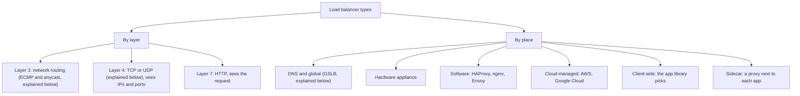

The same map in plain text:

```
Load balancer types
|
+-- By layer
|     +-- Layer 3   network routing: ECMP and anycast (explained below)
|     +-- Layer 4   transport: TCP/UDP, sees IPs and ports
|     +-- Layer 7   application: HTTP, sees the request
|
+-- By place
      +-- DNS and global (GSLB)     picks a region before any connection
      +-- Hardware appliance        a dedicated box in a data center
      +-- Software                  HAProxy, nginx, Envoy on normal servers
      +-- Cloud-managed             the cloud provider runs it
      +-- Client-side               the app's own library picks a server
      +-- Sidecar                   a small proxy next to each app
```

Notice that "by place" and "by layer" are not separate choices. A software balancer can work at layer 4 or layer 7. A cloud balancer can be either too. The place describes who runs it. The layer describes what it reads.

### Layer 4: moving connections

A **layer 4** (transport) balancer works on TCP or UDP. TCP is the reliable transport used by most web traffic. UDP is a simpler one. A layer 4 balancer chooses a backend from the connection data it can see: the IP addresses and the port numbers. It does not read the messages inside. A **backend** is a server the balancer can send requests to.

#### How it works

The balancer keeps a small table. When a new connection arrives, the balancer picks a backend and writes down the choice. Every later packet with the same details goes to the same backend. The balancer does not need to understand the data. It only needs to keep the table right.

Three common ways exist to move the packets. Each one is a different trick.

- **NAT (network address translation).** The balancer rewrites the destination address on each packet so it reaches the chosen server. The server's reply comes back through the balancer, which rewrites the address again before it goes to the client. NAT is simple. The downside is that every packet, in both directions, passes through the balancer. It can become a bottleneck.
- **Tunneling.** The balancer wraps each packet inside a new packet addressed to the server. The server must understand this wrapping and unwrap it. The reply can often go straight back to the client.
- **Direct server return (DSR).** The balancer handles only the incoming half. The server replies straight to the client, so the reply never passes through the balancer. This saves the balancer a lot of work, because replies are often much bigger than requests. The usual rule is that the balancer and the servers sit on the same network segment (a part of the network where devices can reach each other directly). The servers also need some setup, so they accept traffic addressed to the balancer's IP.

#### What it sees, and what it cannot do

A layer 4 balancer can see the source and destination IP addresses, the ports, and the protocol (TCP or UDP). That is enough to pick a backend and keep one connection on that backend.

It cannot see the HTTP method, the path (such as `/api/orders`), the headers, the cookies (small pieces of data a website stores in the browser) or the `Host` name. So it cannot route by path. It also cannot count a `500` error from a backend, because it never reads the response. It sees a refused connection, but not a bad answer.

A layer 4 balancer also keeps the whole TCP connection on one backend. A connection can carry many requests, and they all go to the same place. Pinning is the word for this.

Another point: a layer 4 balancer usually does not **terminate** a connection. To terminate a connection means to end it at the balancer, which then opens its own connection to the next hop. A layer 4 balancer passes the connection through. Some products do decrypt, though. AWS Network Load Balancer can use a TLS listener (a port that decrypts encrypted traffic) and terminate it, so check the listener type rather than assume. The client talks to the backend itself, through the balancer's forwarding.

#### Pros and cons

Pros:

- **Fast and light.** It does not parse messages, so it does less work per packet.
- **Works for any TCP or UDP protocol.** Databases, SSH, mail, game traffic and DNS all fit.
- **Can pass encrypted traffic through.** Because it does not decrypt anything, it can pass TLS (the encryption behind HTTPS) straight to the backend.
- **Keeps the client's IP address.** Google's passthrough type keeps the original client IP, so the backend sees the real visitor (Google's documentation, see Sources).

Cons:

- **Blind to content.** It cannot route by URL or header, and it cannot rewrite headers.
- **Some setups need extra work.** DSR, for example, needs the servers to be configured in a special way.
- **Limited features.** Commonly, layer 4 products offer fewer features for managing failed backends than layer 7 products do.

#### Real examples

- **AWS Network Load Balancer.** Commonly described as AWS's layer 4 product. It handles TCP, UDP and TLS.
- **HAProxy in TCP mode.** HAProxy is a widely used open-source balancer. In TCP mode it acts as a plain relay.
- **nginx `stream` module.** nginx can proxy raw TCP and UDP through this module. It is not always built in, so you may need to enable it when compiling nginx.
- **LVS (Linux Virtual Server).** A layer 4 balancer built into the Linux kernel. It supports NAT, tunneling and direct routing.

#### One connection through a layer 4 balancer

This diagram follows one TCP connection. The balancer never reads the bytes inside.

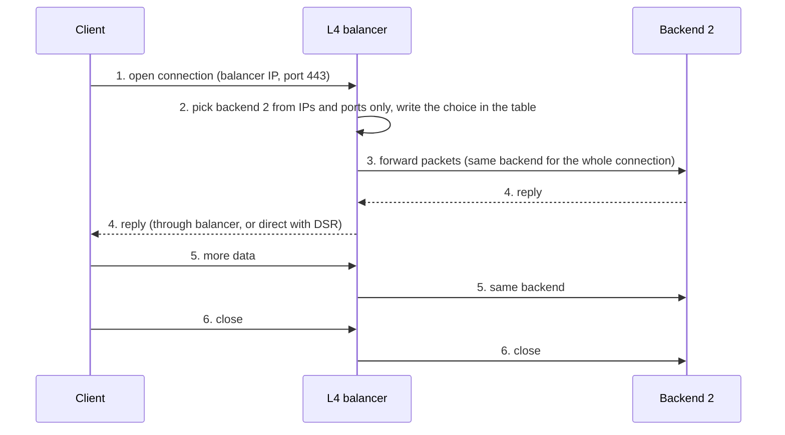

The same steps in plain text:

1. The client opens a connection to the balancer's IP address, port 443.
2. The balancer picks backend 2 from the IP addresses and ports only. It writes the choice in its table.
3. The balancer forwards the packets to backend 2. Every packet of this connection goes there.
4. Backend 2 replies. The reply goes back through the balancer, or straight to the client with DSR.
5. More data follows the same path to backend 2.
6. The connection closes. The balancer closes its side too.

### Layer 7: reading the request

A **layer 7** (application) balancer understands the application protocol, usually HTTP. It reads each request, and it can pick a backend for each request. Chapter 2 introduced this idea. Here we look at the work it does and the price it pays.

#### How it differs from layer 4

- **It is a proxy.** A proxy stands in the middle. A layer 7 balancer ends the client's connection, reads the request, and then opens its own connection to the backend. The two connections are separate.
- **It routes per request, not per connection.** One client connection can carry several requests. A layer 7 balancer can send each one to a different backend.
- **It can match many things.** The path, the `Host` name, other headers, the method, the query string and the source IP can all be used to choose.

#### What it adds

- **Content routing.** Send `/api` to one group of servers and `/static` to another.
- **TLS termination.** The balancer decrypts HTTPS. The backends then receive plain HTTP. This means the certificate lives in one place.
- **Header changes and redirects.** The balancer can add, remove or rewrite headers, and send redirects.
- **Checks on the request.** Some layer 7 products reject requests that break the HTTP rules.
- **Status-code awareness.** The balancer can see a `500` or `503` answer and count it as a failure. This is what makes health tracking smarter.

#### What it costs

A layer 7 balancer does more work per request. It must receive the bytes, parse the request, decide, and then open or reuse a second connection. It may also decrypt the traffic. All of this takes more CPU, adds some delay, and uses memory for buffers and connection state.

Google's documentation notes that proxy load balancers do not keep the client's IP by default. The client's address is hidden behind the proxy. The usual fix is a header such as `X-Forwarded-For`, which the proxy adds to tell the backend who the client was.

#### Real examples

- **AWS Application Load Balancer.** Commonly described as AWS's layer 7 product for HTTP and HTTPS. It uses listener rules with conditions.
- **nginx `http` and `upstream`.** nginx can route HTTP requests on many fields. Its default method is weighted round robin, which means taking turns with some servers getting more turns.
- **HAProxy in HTTP mode.** A common setup for web traffic.
- **Envoy.** A layer 7 proxy often used as a sidecar (see below) or at the edge. It has circuit breaking, retries and outlier detection built in.

#### One request through a layer 7 balancer

This diagram follows one HTTP request. Notice that there are **two connections**. One runs from the client to the balancer. The other runs from the balancer to the backend. The balancer sits in the middle and joins them.

```
  Client                    L7 balancer                      Backend 1
    |                            |                               |
  1 |== connection A opened ====>|  (TCP, and TLS if HTTPS)      |
    |                            |                               |
  2 |-- GET /api/orders -------->|                               |
    |   Host: shop.example.com   |  reads method, path, headers  |
    |                            |                               |
  3 |                            | 3. picks Backend 1 for THIS   |
    |                            |    request (chooses per req.) |
    |                            |                               |
  4 |                            |== connection B (pooled) =====>|
    |                            |-- GET /api/orders ----------->|
    |                            |                               |
  5 |                            |<------------- 200 OK ---------|
    |                            |  counts the status code       |
  6 |<-- 200 OK -----------------|                               |
    |                            |                               |
  7 |  (connection A stays open for the next request)            |
```

Two details matter here. First, connection B may be **pooled**. A pool keeps a connection open after a request, so the next request can reuse it instead of opening a new one. Second, at step 5 the balancer looks at the status code. This is how it learns that a backend is failing.

### Side by side: layer 4 vs layer 7

The table compares the two layers. A **summary** mark means the row is a general summary of common practice, not a value taken from one specific product. The notes behind this table come from vendor documents and general knowledge, so treat the rows as a guide, not a fact sheet.

| Feature | Layer 4 (TCP/UDP) | Layer 7 (HTTP) | Note |
|---|---|---|---|
| What it sees | IP addresses, ports, protocol | The whole request: method, path, headers, host, cookies | Summary |
| Speed | Fast, little work per packet | Slower, more CPU and delay | Summary |
| TLS (encryption) | Usually passes through, not decrypted | Usually ends it (terminates) and reads the request | Summary |
| Routing | Per connection | Per request, by path, host or header | Summary |
| Health checks | Can check that a port answers | Can check a URL and read status codes | Summary |
| Retries | Usually none, at this layer | Possible, but this project does not do them | Summary |
| Connections | One client connection to one backend | Two connections: client to balancer, balancer to backend | Summary |
| Client IP | Kept by default (passthrough) | Hidden unless a header is added | Partly from Google docs |
| Typical use | Databases, SSH, games, non-HTTP traffic | Web apps, APIs, microservices | Summary |

### DNS, global balancing (GSLB) and anycast

These work above or before the other types. They choose a region, a data center or a route. They do not usually see the request at all.

**DNS** is the Domain Name System. It turns a name such as `shop.example.com` into an IP address. A **resolver** is the service that asks DNS on your behalf, and your browser or operating system keeps its own cache too.

**DNS load balancing** returns several IP addresses for one name, or changes the order of them, so different users get different servers. This is an old idea, and it has no health checks of its own.

**Global server load balancing (GSLB)** uses DNS to pick among data centers in different parts of the world. Common features are:

- **Geo steering:** send users to the nearest region.
- **Health-based failover:** remove a region that is down.
- **Fallback pools:** a second group to use when the first one is full or broken.

#### The TTL limit

Every DNS answer has a **TTL** (time to live). This is the number of seconds that resolvers and browsers may keep the answer before asking again. The TTL is the main limit of DNS balancing.

Suppose a data center fails and DNS is changed to point elsewhere. Clients that cached the old answer keep going to the dead address until their cached answer expires. A short TTL helps, but not every resolver obeys it perfectly, and some clients cache for longer. So DNS failover is usually slower than a layer 4 or layer 7 balancer that sees the failure directly.

```
  Time in seconds --->

  t=0   DNS says:  shop.example.com = 198.51.100.1  (data center A, TTL 30 s)
  t=1   Data center A fails.
        DNS is updated: shop.example.com = 198.51.100.2  (data center B)
  t=1   Client's resolver still holds the OLD answer (cached at t=0).
  t=1   Client keeps trying 198.51.100.1 ... nothing answers.
  t=30  Cached answer expires. Resolver asks again. Gets 198.51.100.2.
  t=30+ Client now reaches data center B.
```

Geo steering has a related limit. It usually guesses the user's location from the resolver's location, not from the user's own address, unless the resolver passes on part of the client's address (EDNS Client Subnet, a DNS extension that sends part of the client's address along). If the resolver is far away, the guess is wrong.

#### Anycast

**Anycast** means several servers, often in different cities, announce the same IP address. The internet's routing system then sends each user's packets to one of them, usually the closest by network path. The choice follows the cheapest route that the network's routing rules find, which is not always the closest by distance. If one site fails and stops announcing, the routes move to the next nearest site.

Anycast works at layer 3, the routing layer. It is not a load balancer on its own. It spreads users across sites by routing, not by picking a server per request. Its limits include route changes that move users unexpectedly, and the need for a network setup that can announce the same address from many places.

```
  Europe user ----> London site   (announces 203.0.113.10)
  Asia user   ----> Tokyo site    (announces 203.0.113.10)

  London goes down: it stops announcing, so
  European users are routed to the next nearest site.
```

### Hardware, software and cloud-managed balancers

These three names describe who runs the balancer and how it is delivered.

| Type | What it is | Good for | Trade-offs |
|---|---|---|---|
| Hardware appliance | A dedicated box, such as an F5 BIG-IP, with many built-in features (firewall, TLS offload) | Large companies with their own data centers | Usually costly (a vendor view, not measured here). Growing means buying and installing more boxes. |
| Software | A program such as HAProxy, nginx or Envoy, run on normal servers or virtual machines | Teams that want control and low cost | You run, update and scale it yourself. Support depends on the project or a paid vendor. |
| Cloud-managed | The provider runs it, such as AWS Elastic Load Balancing or Google Cloud Load Balancing | Teams in the cloud who want scaling without managing servers | You pay for use. You depend on the provider's features and limits. |

The claims about cost and scale in the sources are vendor views, and they have not been tested here. Check current prices before you rely on them.

### Client-side balancing and sidecars

Most balancers sit in the middle, between the client and the backends. These two types do not.

**Client-side load balancing.** The client's own library picks a server from a list it has. There is no middle box at all. gRPC (a remote-call system) is one example. Its default policy is `pick_first`, which uses the first working server. You can set `round_robin` to take turns instead. The good side is that there is no extra hop, and the client knows about each request. The bad side is that every language needs this logic, and each client forms its own view of which servers are healthy.

**Service-mesh sidecar.** A **sidecar** is a small proxy that runs next to each app. In many service meshes (groups of sidecars managed together), such as Istio (a popular mesh product), the proxy is usually Envoy. Special network rules send the app's traffic through its sidecar. The sidecar then does layer 7 work: balancing, retries, health checks and encryption between the proxies. The app code does not change. The cost is an extra hop for each call, and more memory and CPU for every sidecar.

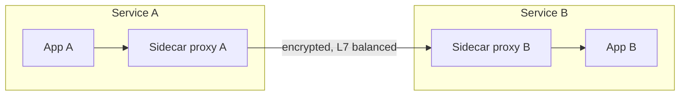

```
  Service A                                 Service B
  +----------------------+                  +----------------------+
  |  App A               |                  |  App B               |
  |    |                 |                  |    ^                 |
  |    v                 |                  |    |                 |
  |  Sidecar proxy A ----+----------------->+-- Sidecar proxy B    |
  +----------------------+  encrypted,      +----------------------+
                            L7 balanced
```

### Layer 3 and ECMP

At layer 3, a router can spread traffic over several equal paths. This is called **ECMP** (equal-cost multi-path). The router usually runs a hash (a fixed scrambling of the input, so the same input always gives the same output) over some header fields of each packet, and uses the result to pick a path. The same flow therefore keeps using the same path. Some large layer 4 designs use ECMP in front of a group of balancer nodes, so the traffic is spread across several balancers. RFC 2992 is the document that analyzes this method, if you want the details later. For now, the idea is all you need.

### How real systems stack them

Real systems rarely use only one type. Each type handles a different part of the job. A common stack looks like this:

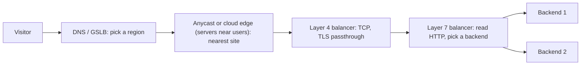

```
  Visitor
    |
    | 1. DNS: "shop.example.com is at region EU"
    v
  +----------------------+
  | DNS / GSLB           |   chooses the region (slow, TTL-based)
  +----------------------+
    |
    | 2. Anycast or cloud edge (servers near users): nearest site
    v
  +----------------------+
  | Layer 4 balancer     |   TCP only, fast, no HTTP reading
  +----------------------+
    |
    | 3. Layer 7 balancer
    v
  +----------------------+
  | Layer 7 balancer     |   reads HTTP, routes, counts 5xx
  +----------------------+
    |            |
    v            v
  Backend 1   Backend 2
```

Here is a rough guide to choosing. These are honest trade-offs, not rules.

- **Choose layer 4** when the protocol is not HTTP (a database, SSH, a game), when you need the lowest delay, or when the backend must see the real client IP without a proxy in between. Choose it also when you must pass TLS through without decrypting it.
- **Choose layer 7** when you need routing by path, host or header, when you want TLS ended in one place, or when you want per-request balancing, retries or header rewrites.
- **Choose both** for a large web system. The layer 4 part is fast and handles raw connections. The layer 7 part makes the smart choices. The cost is two places to manage.
- **Choose DNS or GSLB** when you have several regions. Accept that failover is slower because of the TTL.

Stacking is common enough that cloud guides show it. A layer 4 balancer can sit in front of a layer 7 balancer. In Kubernetes (a system that runs copies of an app on many machines), a cloud layer 4 balancer often forwards to nodes (the machines), and then a component called kube-proxy (the Kubernetes piece that routes traffic on each node) picks a pod (the smallest unit that runs a copy of an app).

### Where this project fits

l7LoadBalancer is a **software** balancer that works at **layer 7**. It runs as one Go program. It reads each HTTP request and uses the status codes of the responses. It does not do DNS, anycast, hardware or layer 4 forwarding. Here is what the code shows, using the commit `53504fc` line numbers.

**Two connections, not one.** The client side is a plain Go `http.Server`. `buildClientServer` builds it (`internal/app/app.go:432-459`), and `serve` starts it (`internal/app/app.go:402-407`). The client's TCP connection ends at this server. The backend side is a different connection. `internal/proxy/proxy.go:198-202` builds an `httputil.ReverseProxy`, which makes its own outgoing request (Go's standard helper for passing requests on to a backend). The two connections are separate, as the layer 7 diagram showed.

**One shared transport, with pooling.** `internal/app/app.go:114` sets the transport, and `internal/proxy/proxy.go:251-252` installs it. `buildTransport` (`internal/app/app.go:498-516`) builds it. It keeps a pool of idle connections per backend. The default is 100 idle connections per host (`internal/config/config.go:108`). The idle timeout is 90 seconds by default (`internal/config/config.go:112`). The same transport handles `http://` backends with HTTP/1.1 and `https://` backends with HTTP/2 through ALPN, the negotiation step in the TLS handshake.

**Selection happens per request.** `Proxy.ServeHTTP` calls `Select` once for each incoming request (`internal/proxy/proxy.go:287`, and the call at line 292). So one client connection that carries several requests can reach several backends. The `director` method (`internal/proxy/proxy.go:339-347`, the function that rewrites where the outgoing request goes) does not choose anything. It only copies the scheme and host from the backend already chosen. The selector interface is at `internal/balancer/selector.go:20`.

**Status codes count as failures.** A passive health check watches real traffic. A circuit breaker stops sending to a backend after repeated failures, and tries again later. `internal/proxy/proxy.go:375` treats a response with `StatusCode < 500` as a success, so any `5xx` is a failure. Two parts use that signal. The outlier detector keeps a window of 10 outcomes (`internal/health/outlier.go:21`) and ejects (removes from rotation) a backend after 5 failures in that window (`internal/health/outlier.go:29`). The circuit breaker opens after 3 failures in a row (`internal/circuit/circuit.go:16`). Both are L7 features, because they need to see the response.

**Who sets `X-Forwarded-For`?** The project's own code does not set it. A search of the non-test code finds the header only in comments, such as `internal/balancer/hashkey.go:23-25`. The Go standard library's `ReverseProxy` documentation says it adds this header by default, so the header is probably added by the library. This is an inference from the library's documentation, not something the project checks. The same documentation warns that when a Director is used, a client's own `X-Forwarded-For` header is kept and the client IP is added to it, so a client could fake its address. The project's director does not remove that header. No project test checks this header.

**What the project does not do.**

- **No DNS or GSLB.** No DNS logic is in the request path. Backends are fixed URLs from the config (`internal/config/config.go:612-632`).
- **No hardware or vendor integration.** Not found.
- **No layer 4 mode.** Every backend connection goes through `ReverseProxy` (`internal/proxy/proxy.go:176`, `198`). Not found in the code or the docs.
- **No path or host routing.** The selectors receive the request, but only the consistent hash reads it, and only the client's IP is used (`internal/balancer/hashkey.go:26-32`). The round robin, least connections and P2C (power of two choices: pick two backends at random and keep the better one) selectors do not read the request at all.
- **No cookies or sticky sessions.** Not found in non-test code. The only stickiness is by client IP, through consistent hashing (a method that sends the same key, here the client IP, to the same backend) (`internal/balancer/consistent_hash.go:14-20`).
- **No retries.** This is a choice, not a missing feature. The proxy never retries a failed round trip (one request sent to a backend and its reply received) (`docs/adr/0018-no-retry-ever.md`, status Accepted). A failed request becomes `502`, and a request with no healthy backend becomes `503` (`internal/proxy/proxy.go:292-299`).

**The Nginx comparison, stated honestly.** The benchmark compares this balancer with Nginx 1.27.x. Both sit in front of four dummy backends (`bench/README.md:3`). The Nginx configs are in `bench/nginx/`, not in `deployments/docker/`. Note that `deployments/docker/` has no Nginx config. The docs disagree on the result. `README.md:251` says Nginx is ahead at all three sizes, in the prose under the round-robin table. `RESULTS.md:56` says the balancer led for least connections at 200 bytes and 10 KiB, and Nginx led at 1 MiB. The README also says the balancer is slower than Nginx (`README.md:276`). These numbers come from one noisy run on an older commit (`8c2b7d4`), as Chapter 1 said. Treat them as a rough picture.

### What you learned

- A load balancer can work at **layer 3, 4 or 7**, and it can run in many **places**, such as DNS, hardware, software, the cloud, the client or a sidecar.
- A **layer 4** balancer picks a backend from IP addresses and ports, and it keeps a connection on one backend. It is fast, but it cannot route by path or read a `500` error.
- A **layer 7** balancer reads each HTTP request, so it can route per request and count status codes. It uses two connections and costs more CPU.
- **DNS and GSLB** choose a region, but TTL caching makes failover slow. **Anycast** routes users to the nearest site by network routing.
- l7LoadBalancer is a **software, layer 7** balancer. It reads HTTP, counts `5xx` answers, and does not do DNS, path routing, cookies or retries.

### Quiz: check yourself

1. What does a layer 4 balancer look at to choose a backend?
2. Why can a layer 4 balancer not send `/api` to one group of servers and `/images` to another?
3. How many connections does a layer 7 balancer use for one request, and where does each one run?
4. Why does a DNS change take time to reach every user?
5. Does l7LoadBalancer's own code set the `X-Forwarded-For` header? Who probably does?

<details>
<summary>Answers</summary>

1. The IP addresses, the port numbers and the protocol (TCP or UDP). It does not read the messages.
2. The path is inside the HTTP request. A layer 4 balancer never reads the request, so it cannot see the path.
3. Two. One runs from the client to the balancer. The other runs from the balancer to the backend.
4. Resolvers and browsers cache a DNS answer for its TTL. Until the cached answer expires, some users keep using the old address.
5. No. The project's own code does not set it. The Go standard library's `ReverseProxy` probably adds it, based on its documentation. The project does not test this.

</details>

### Sources

These are the pages that were opened and checked for this chapter.

- Google Cloud, "Choose a load balancer": https://docs.cloud.google.com/load-balancing/docs/choosing-load-balancer
- nginx, stream upstream module: https://nginx.org/en/docs/stream/ngx_stream_upstream_module.html

Other claims in this chapter, such as the AWS product descriptions, the HAProxy and LVS details, the DNS and anycast behavior, and the RFC 2992 ECMP idea, come from search results or general knowledge. They are worded as common practice. Check the current vendor documentation before you rely on them.

### Next chapter

Chapter 4, "What an L7 balancer does with a request", follows one request step by step through this project's code, from the moment it arrives to the moment the answer goes back.
<!-- CHAPTER-3-END -->

<!-- CHAPTER-4-START -->
## Chapter 4: What an L7 balancer does with a request

Chapters 1 to 3 showed you the parts. This chapter follows one request through all of them, from the moment it reaches the balancer to the moment the answer goes back. It is an overview. Each step names the function and the line where it lives, so you know where to look. Later chapters go deep into each part. Where a later chapter covers a step, the step says so.

Every `file:line` in this chapter is from commit `53504fc`, as in the rest of the book. Some code is in Go's standard library (the packages that ship with Go), not in this repository. For those steps this chapter describes the behaviour in words and gives no line numbers, because the line numbers depend on the Go version.

### The big idea

An L7 balancer is a middleman. It takes a request from the client, picks one backend, sends the request to that backend on a second connection, and copies the answer back. The client talks only to the balancer. The backend talks only to the balancer. Neither side talks to the other directly.

Every request goes through the same steps, in the same order. Most steps are quick, like picking a backend. Some take longer, like waiting for the backend to answer. A few steps can stop the request early, for example when no backend is ready. Those early stops are the failure branches, and they are covered later in this chapter.

**Restaurant host (an analogy, not how the code works).** A guest walks into a busy restaurant. The host at the door looks at the room, picks a free table, and walks the guest there. The guest never walks into the kitchen. The host also keeps a count of how many guests sit at each table, so the host knows when a table is free again. In this project, the host is `Proxy.ServeHTTP` and each table is a backend. The kitchen stands for the work the backend does after it receives the request.

### The journey at a glance

The diagram shows the parties and the order of their messages. The numbers match the walk below.

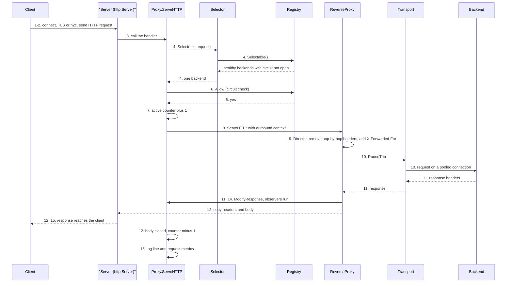

The same journey in plain text. The boxes run top to bottom in time order. The step numbers match the walk below. Steps 5, 6 and 13 can end the request early, and they are explained in "When things go wrong".

```
  +------------------------------------------------+
  | 1-2  Client connects and sends a request       |
  +------------------------------------------------+
  |      http.Server reads and parses HTTP         |
  +------------------------------------------------+
  | 3    Proxy.ServeHTTP starts                    |
  +------------------------------------------------+
  | 4    Select picks one backend                  |
  +------------------------------------------------+
  |      (from Registry.Selectable)                |
  +------------------------------------------------+
  | 5    No backend? Write 503 and stop            |
  +------------------------------------------------+
  | 6    Circuit allows the request? (Allow)       |
  +------------------------------------------------+
  | 7    Active counter +1                         |
  +------------------------------------------------+
  | 8    Outbound context, drain hook attached     |
  +------------------------------------------------+
  | 9    ReverseProxy rewrites the request         |
  +------------------------------------------------+
  | 10   Pooled connection, round trip             |
  +------------------------------------------------+
  | 13   Round trip failed? errorHandler (502)     |
  +------------------------------------------------+
  | 11   Headers arrive: ModifyResponse runs       |
  +------------------------------------------------+
  | 14   Observers run (latency, outlier, circuit) |
  +------------------------------------------------+
  | 12   Copy body; active -1 when body closes     |
  +------------------------------------------------+
  | 15   Log line and request metrics              |
  +------------------------------------------------+
```

Step 14 runs inside step 11, the moment the headers arrive. It is numbered separately because it is a separate job.

### The walk, step by step

Each step below names what happens, the function that does it, where it lives, what goes in, and what comes out.

### Step 1: accept the TCP connection

**What happens.** The operating system accepts a TCP connection. TCP is the reliable, two-way pipe that most web traffic uses. Go's `net/http` server takes the connection and starts a goroutine (a light-weight thread in Go) that reads HTTP requests from it. That accept loop is part of the standard library, so it is not in this repository.

**Where.** `internal/app/app.go:400` is `serve`, which starts the server. It calls `ListenAndServeTLS` or `ListenAndServe` at `internal/app/app.go:402-408`.

**In.** A TCP connection on the `listen` address from the config, for example `:8080`.

**Out.** A goroutine that reads requests from this connection.

**Timeouts set here.** Every connection gets a `ReadHeaderTimeout` of 5 seconds and an `IdleTimeout` from the config (`internal/app/app.go:436-437`). Plain mode also sets a `ReadTimeout` (`internal/app/app.go:456`). A timeout is a time limit: if the client is too slow, the server gives up. Chapter 9 explains this in detail.

### Step 2: parse the HTTP, and handle TLS or h2c

**What happens.** Three cases exist.

- **Plain HTTP/1.1.** The standard library reads the request line (method, path and version) and then the headers. HTTP/1.1 is the classic text form of HTTP.
- **TLS (HTTPS).** The TLS handshake runs before any HTTP is read. TLS is the encryption behind HTTPS. During the handshake, the client and server agree on the protocol with ALPN (a step where they pick HTTP/2 or HTTP/1.1). The certificate and key are loaded at `internal/app/app.go:440-446`. The client's encryption ends at the balancer, so from here on the balancer reads plain HTTP.
- **h2c (HTTP/2 without encryption).** If the config turns on `H2C`, the handler is wrapped at `internal/app/app.go:131-133` with `h2c.NewHandler`. The wrapper accepts HTTP/2 on a plain connection and passes each stream to the proxy as an ordinary request. The inside of the wrapper is in another package, so this chapter only confirms the wrap itself. Chapter 9 explains it.

One side note, with care. The Go documentation for `golang.org/x/net/http2/h2c` marks that package as deprecated. It says that `net/http` now supports unencrypted HTTP/2 directly, through `http.Server.Protocols`. This project still uses the `x/net` wrapper, as `CLAUDE.md` says. This book describes commit `53504fc`. A later version of the project may have changed this.

**Where.** `internal/app/app.go:131-133` (the h2c wrap), `internal/app/app.go:440-446` (TLS). The protocol label used for metrics is set in `protocolLabel` at `internal/proxy/proxy.go:590-598`. It reads `h2` for TLS, `h2c` for plain HTTP/2 and `http/1.1` for the rest.

**In.** The bytes from step 1.

**Out.** A `*http.Request`. It carries the protocol version, the `TLS` details (nil on plain HTTP), the client's address (`RemoteAddr`) and a `Context`. A context is Go's object for cancellation and time limits. It travels with the request.

### Step 3: enter Proxy.ServeHTTP

**What happens.** The first code in this project that touches the request is `Proxy.ServeHTTP`, the Go method that handles one request (Go calls such a method a handler). It starts a timer, creates a small per-request record, and sets a `defer`. A `defer` is a line that runs when the function exits, however it exits. That means the logging and metrics always run, even on the error path.

**Where.** `internal/proxy/proxy.go:287` (the function). The timer is at `:288`. The per-request record, `reqState`, is at `:289` and is defined at `proxy.go:50-86`. The `defer` is at `:290`.

**In.** A `ResponseWriter` (the object the handler writes the answer to) and the `*http.Request`.

**Out.** Nothing yet. It hands the request to the next steps. The `reqState` is used only by this one goroutine (ADR-0007, an architecture decision record: a short file that explains why a design choice was made), so it needs no lock.

Chapter 10 explains this in detail.

### Step 4: select a backend

**What happens.** The proxy asks the selector to pick one backend. The selector is a small interface, which is a list of methods that any policy can implement. The call is `p.sel.Load().Select(r.Context(), r)`. The selector sits in an atomic pointer: a single value that can be read or swapped in one step, with no lock. A reload that changes the algorithm swaps this pointer, so each request sees either the whole old selector or the whole new one.

**Where.** `internal/proxy/proxy.go:292` (the call). `internal/proxy/proxy.go:175` (the atomic pointer). `internal/balancer/selector.go:20` (the `Select` method of the `Selector` interface).

The round-robin selector shows the pattern (`internal/balancer/roundrobin.go:37-43`):

- It asks the registry for the list of selectable backends (`:38`).
- If the list is empty, it returns `ErrNoHealthyBackends` (`:39-40`).
- It adds one to its counter (`:42`).
- It returns the backend at position `counter % length` (`:43`). The `%` (modulo) sign gives the remainder, so the choice wraps back to the start of the list.

The list comes from `Registry.Selectable` (the registry is the proxy's table of backends and their state; Chapter 11 explains it) (`internal/backend/registry.go:141-145`). That function keeps the backends that are healthy and whose circuit is not open. It reads the backend list with one atomic load and takes no lock. It uses the circuit's `Open` check, not `Allow`, so it never uses up the one trial request that a half-open circuit allows.

**Why here, and not in the director.** The proxy selects in `ServeHTTP` because the director cannot write a `503` answer (`internal/proxy/proxy.go:277-281`). Step 9 explains the director.

**In.** The request's context and the request. Round robin does not read the request at all.

**Out.** A `*backend.Backend`, or `balancer.ErrNoHealthyBackends` (`internal/balancer/selector.go:27`).

Chapters 11, 12 and 21 explain this in detail.

### Step 5: the no-backend check

**What happens.** If the selector returned `ErrNoHealthyBackends`, the proxy writes `503 Service Unavailable` and stops. A 503 means the server cannot take the request right now. Any other error would become `502`, but the selectors in this repository return only `ErrNoHealthyBackends` (a fixed error value that callers check for), so this code path does not produce a 502 from selection.

**Where.** `internal/proxy/proxy.go:293-301`. The status is stored at `:298`, and `http.Error` writes it at `:299`.

**In.** The error from step 4.

**Out.** A 503 response to the client. The request stops here, with no retry on another backend.

See "When things go wrong" for the full table.

### Step 6: the circuit check

**What happens.** A circuit breaker is a switch that stops traffic to a backend after repeated failures. A half-open circuit lets one trial request through to test whether the backend has recovered. The proxy asks the registry `Allow(b)`. If no circuit breaker is set up, the answer is always yes. If one is set up, the check may take the one trial slot. If the circuit denies the request, the proxy writes `503` and stops. It does not increase the active counter, and it does not try another backend.

**Where.** `internal/proxy/proxy.go:304`, the check. `internal/backend/registry.go:156-161` (`Allow`). `internal/circuit/circuit.go:77` (the breaker's `Allow`). `internal/proxy/proxy.go:305-309` (the 503 write).

**In.** The backend chosen in step 4.

**Out.** Yes or no. On no, a 503 response.

Chapter 15 explains this in detail.

### Step 7: active-request counter plus one

**What happens.** The backend keeps a count of requests that have started but not yet finished. A request is "in flight" from now until its body closes. The proxy adds one to that count. The count is an atomic counter, so many goroutines can change it at once. The metrics gauge (a number that can go up and down, shown on dashboards) is changed at the same time, so the two cannot drift apart.

**Where.** `internal/proxy/proxy.go:312` calls `state.activate()`. The method is at `internal/proxy/proxy.go:93-98`. The counter add is `Backend.IncActive` (`internal/backend/backend.go:162`). The metrics gauge is at `internal/metrics/metrics.go:192`.

**In.** The chosen backend.

**Out.** The count is one higher. This slot is given back by `release()`, in step 12 or step 13.

Chapter 11 explains the backend in detail. The least-connections selector (Chapter 21) uses this same count to send each request to the backend with the fewest requests in progress.

### Step 8: build the outbound context

**What happens.** The proxy makes a new context for the backend call. This context is a child of the client's context, so if the client leaves, the backend call is cancelled too.

The context also carries a drain hook (a function that runs when the drain ends). Each backend has a "retired" context that is cancelled only when a removed backend's drain window ends. A drain window is the grace period that lets requests already in progress finish on a backend that was removed from the config. `context.AfterFunc` links the request's context to the retired one, so no extra goroutine is needed. When the window ends, the request is cancelled with the cause `backend.ErrDrainWindowExpired`. ADR-0016 describes this choice.

The proxy also attaches its per-request record to the context, so later functions can find it. Then it hands the request to the `ReverseProxy` (`internal/proxy/proxy.go:332`).

**Where.** `internal/proxy/proxy.go:323-332`. The retired context is `backend.RetiredContext` at `internal/backend/backend.go:216`.

**In.** The client's request and its context.

**Out.** A request with a new context, passed to step 9.

Chapters 18 and 20 explain drain and shutdown.

### Step 9: ReverseProxy rewrites the request

**What happens.** The `ReverseProxy` from the standard library (`net/http/httputil`) does most of the forwarding work. It makes a copy of the request for the backend. The copy is called the outbound request. Then it calls the project's director (a function that edits the outgoing request before it is sent), which fills in the backend's address.

The project's director does two things. It sets the scheme (`http` or `https`) and the host from the chosen backend's URL. It also records the time the dispatch started. Dispatch means sending the request on to the chosen backend. It does not change the path, the query string, the `Host` header, or any other header. As a side note, the Go documentation marks `Director` as deprecated and recommends `Rewrite`, which arrived in Go 1.20. Hop-by-hop headers are removed after `Director` returns, and a client-sent `X-Forwarded-For` is kept. This project still uses `Director`, so treat this as a point to understand, not a bug; Chapter 10 covers the proxy handler.

After the director, the standard library does three more things.

- **Removes hop-by-hop headers.** A hop-by-hop header applies to one connection only, such as `Connection`, `Keep-Alive` or `Upgrade`. The proxy must not pass these on, so the client's `Connection` header is removed here.
- **Adds `X-Forwarded-For`.** Backends see the balancer's address, not the client's, so the balancer adds a header that carries the client's IP. The standard library's documentation says it sets or appends this header. If the client sent its own `X-Forwarded-For`, the client's value is kept and the real IP is added after it. That is a spoofing risk (spoofing means faking an address or identity). A client can lie about its address, so only trust the values that your own trusted proxy added. The project's own code does not set or read this header, and no project test checks it.
- **Keeps the rest.** Everything else goes to the backend as the client sent it, with one exception: if the client sent no `Accept-Encoding`, Go's transport adds `Accept-Encoding: gzip` (see the example below).

**Where.** `internal/proxy/proxy.go:339-347` (the director). The director is wired at `internal/proxy/proxy.go:198-202`. The standard library does the cloning, the header work and the call to the director.

**In.** The outbound request, with the client's path and headers.

**Out.** An outbound request with the backend's scheme and host, and without hop-by-hop headers.

Chapter 10 explains this in detail.

### Step 10: send over a pooled connection

**What happens.** The standard library calls `RoundTrip` on the transport. A round trip is one request sent to a backend and one response received back. The transport keeps a connection pool, which is a set of open connections kept ready for reuse. A connection is kept open after one response so the next request can reuse it. This is called keep-alive. Reusing a connection saves the time of opening a new one, and of a new TLS handshake too for `https` backends.

The transport is built by `buildTransport` and installed on the proxy. It sets these limits:

- a dial timeout, which limits how long opening a connection may take (`internal/app/app.go:501-503`);
- a response header timeout, which limits how long the backend may take to send its headers (`internal/app/app.go:504`);
- a per-host idle pool, which keeps spare connections for each backend (`internal/app/app.go:505-507`);
- `ForceAttemptHTTP2`, which lets `https` backends use HTTP/2 (`internal/app/app.go:508`);
- an option to skip TLS certificate checks, which is for tests and staging only (`internal/app/app.go:510-514`).

**Where.** `internal/app/app.go:114` installs the transport. `internal/app/app.go:498-516` builds it.

**In.** The outbound request from step 9.

**Out.** A response, with its headers, or an error. An error goes to the error path in step 13.

Chapter 8 covers the wiring. Chapter 10 covers the proxy's use of the transport.

### Step 11: response headers arrive, and ModifyResponse runs

**What happens.** When the backend's headers arrive, the standard library calls the project's `ModifyResponse` hook (a function the library calls at a set point in its work). The hook does five things.

1. It gets the per-request record from the response's context (`:369-372`).
2. It stores the status code (`:373`).
3. It stores the backend's protocol, which goes into the log (`:374`).
4. It calls `observe`, which feeds the observers (step 14) (`:375`).
5. It wraps the response body in a `releaseBody` (`:376-384`). The wrapper is a small object that does the bookkeeping when the body is read and closed.

The hook never returns an error (`internal/proxy/proxy.go:385`). The active counter is not decreased here. It stays up until the body is closed, because the request is still in progress while the body is sent to the client (`internal/proxy/proxy.go:352-354`, and step 12).

**Where.** `internal/proxy/proxy.go:368-386`.

**In.** The backend's response.

**Out.** The same response, with a wrapped body.

Chapter 10 explains this in detail.

### Step 12: copy headers and body to the client

**What happens.** The standard library copies the response headers to the client, writes the status code, and then copies the body. Streaming means sending the body in pieces as it arrives, instead of waiting for all of it. A flush interval sets how often buffered data is pushed out. This project does not set it, so it stays at zero (no periodic flush). Server-sent event responses, and responses whose length is not known in advance, are flushed straight away.

The body passes through `releaseBody.Read`, which counts the bytes. If the backend breaks the connection in the middle of the body, that function logs a WARN line (`internal/proxy/proxy.go:491-503`).

When the copy is done, the standard library closes the body. That calls `releaseBody.Close` (`internal/proxy/proxy.go:517-520`), which does three things:

- it calls `release()`, which decreases the backend's active counter (`Backend.DecActive`, `internal/backend/backend.go:168`) and the metrics gauge (`internal/metrics/metrics.go:198`);
- it closes the real body underneath;
- `release()` is wrapped in a `sync.Once`, which means it runs only once, even if two places ask for it.

**Where.** `internal/proxy/proxy.go:491-520`.

**In.** The response from step 11.

**Out.** The bytes sent to the client, and a counter that is back to where it was.

Chapters 10 and 11 explain this in detail.

### Step 13: the error path

**What happens.** If the round trip fails, the standard library calls the project's `errorHandler`. It checks three cases in order: the drain window expired, the client went away, or the transport failed. Each case sets its own status code. The first two also set a `reason` for the log line. The transport case logs no reason. Then it releases the counter, writes a log line, and writes the error response. The full table is in "When things go wrong".

**Where.** `internal/proxy/proxy.go:418-451`.

**In.** The error from step 10.

**Out.** A 502, or an internal 499 (a code that means the client left first; it goes to logs and metrics, never to the client), depending on the case.

Chapter 10 explains this in detail. Chapter 15 covers how the circuit breaker learns from these failures.

### Step 14: observers learn from the round trip

**What happens.** When the headers arrive (step 11), `observe` calls each registered observer. An observer is a small object that learns from the round trip. The observers are skipped for a backend that has been removed (`internal/proxy/proxy.go:267-274`, and `internal/backend/backend.go:193` for the removed check). Three observers are registered at `internal/app/app.go:117-120`.

- **Latency average.** This keeps an EWMA (exponentially weighted moving average), which is a running average where recent samples count more. The p2c selector (power of two choices: it compares two random backends and takes the faster one) uses it. The update is a compare-and-swap loop, which is a retry loop on an atomic value, so no mutex (a lock that only one goroutine can hold at a time) is needed (`internal/proxy/proxy.go:142-144`, `internal/backend/backend.go:237`). This latency runs from dispatch to headers (`internal/proxy/proxy.go:346` and `:375`). It does not include selection or the body copy.
- **Outlier detector.** It keeps a sliding window (the most recent outcomes) for each backend, and it can take out of rotation a backend that fails too often (`internal/health/outlier.go:110`). Chapter 14 explains this in detail.
- **Circuit breaker.** On a success, it closes a half-open circuit. On a failure, it counts the failure and can open the circuit (`internal/circuit/circuit.go:103`). Chapter 15 explains this in detail.

A round trip counts as a success when the status code is below 500 (`internal/proxy/proxy.go:375`). So a 5xx answer counts as a failure for the outlier detector and the circuit breaker, even though the backend did send a response.

**Where.** `internal/proxy/proxy.go:267-274` (`observe`), `internal/app/app.go:117-120` (registration).

**In.** The status code, the round-trip time and the backend.

**Out.** Updated averages and counters inside each observer.

### Step 15: the response reaches the client

**What happens.** The client's answer is complete once the body copy in step 12 ends. The proxy sets no headers of its own on the success path. So the client gets the backend's status line, headers and body, minus the hop-by-hop headers.

After `ServeHTTP` returns, the deferred `completeRequest` runs (`internal/proxy/proxy.go:529-532`). It does two jobs.

- **Metrics.** It records the whole request's duration in a metric (`internal/proxy/proxy.go:556-561`, `internal/metrics/metrics.go:139`). This time starts at the top of `ServeHTTP`, so it includes selection and the body copy. It is not the same as the latency average in step 14.
- **Log.** It writes one `request complete` line with the backend, method, status, `latency_ms`, client address and path (`internal/proxy/proxy.go:603-624`). The level is WARN for a status of 500 or more, and INFO otherwise.

**Where.** `internal/proxy/proxy.go:529-624`.

**In.** The finished request.

**Out.** One log line and one metric sample.

Chapter 16 explains metrics and logging. Chapter 17 follows one request end to end.

### What each side sees on the wire

Here is one request as the client sends it, and as the backend receives it. The example is made up, but the rules come from the code and the standard library's documented behaviour.

The client sends:

```
GET /api/orders?id=7 HTTP/1.1
Host: shop.example.com
User-Agent: curl/8.4.0
Connection: keep-alive
Accept: */*
```

The backend receives:

```
GET /api/orders?id=7 HTTP/1.1
Host: shop.example.com
User-Agent: curl/8.4.0
Accept: */*
Accept-Encoding: gzip
X-Forwarded-For: 203.0.113.5
```

What changed, and why:

| Part | Client sends | Backend receives | Who does it |
|---|---|---|---|
| Method, path, query | `GET /api/orders?id=7` | the same | nobody changes it |
| `Host` | `shop.example.com` | the same | the project does not change it |
| `Connection` | `keep-alive` | removed | standard library (hop-by-hop) |
| `X-Forwarded-For` | not sent | `203.0.113.5` | standard library adds the client IP |
| `Accept-Encoding` | not sent | `gzip` | Go's transport adds it when the client sent none |
| Where the bytes go | to the balancer, over the client's connection | to the chosen backend, over a pooled connection | director sets scheme and host; transport opens or reuses the connection |

Here is the spoofing case. If the client had sent `X-Forwarded-For: 10.9.9.9`, the backend could receive `X-Forwarded-For: 10.9.9.9, 203.0.113.5`. The first value came from the client, so it cannot be trusted.

The backend's answer goes back the same way:

```
HTTP/1.1 200 OK
Content-Type: application/json
Content-Length: 23

{"backend":"backend-a"}
```

The `Content-Length` line is needed on a keep-alive connection, so the client knows where the body ends. The body is 23 bytes.

The client receives the same status and body, minus hop-by-hop headers. There is one exception: when the client sent no `Accept-Encoding` and the backend gzips its answer, the transport unzips it for the client and removes `Content-Encoding` and `Content-Length`. The balancer adds no header of its own on the success path.

### What the client never sees, and what the backend never sees

**The client never sees the choice.** No header names the backend that answered. The client sees only the answer. It also does not see the circuit state, the active counter or the drain window. If something goes wrong, it sees only the status code and a short text such as `Bad Gateway`.

**The client never sees a retry, because there are none.** If a backend fails a request, the client gets a 502. If no backend can take the request, the client gets a 503. The balancer does not send the request again to another backend. The decision is recorded in `docs/adr/0018-no-retry-ever.md`.

**The backend never sees the client's connection.** The backend's connection comes from the balancer. The backend sees the balancer's address as the remote address. The client's real address reaches the backend only through `X-Forwarded-For` (step 9).

**The backend never sees TLS, if its URL is plain `http://`.** TLS ends at the balancer (`internal/app/app.go:440-446`). The backend then receives plain HTTP, even if the client used HTTPS.

**The backend never sees the selector.** It does not know that it is one of several backends, or which policy picked it.

### When things go wrong

Five places can end a request early. A sixth case, a body that breaks mid-copy, happens after the answer has started. The diagram shows them all in one picture.

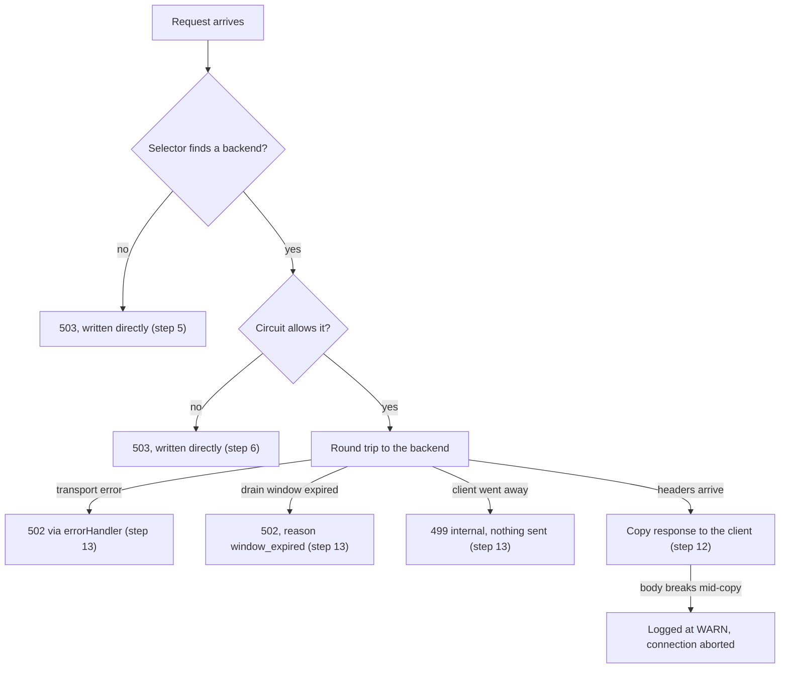

The same picture in plain text:

```
  Request arrives
        |
        v
  Selector finds a backend? --- no ---> 503 (written directly)
        |
       yes
        v
  Circuit allows it? ---------- no ---> 503 (written directly)
        |
       yes
        v
  Round trip to the backend
        |
        +-- transport error ----------> 502 (via errorHandler)
        +-- drain window expired -----> 502 (reason window_expired)
        +-- client went away ---------> 499 internal, nothing sent
        +-- headers arrive
              |
              v
            Copy response to the client
              |
              +-- body breaks mid-copy -> logged at WARN, connection aborted
```

The table gives the details:

| Situation | What the client gets | Where in the code | Other facts |
|---|---|---|---|
| No selectable backend | `503 Service Unavailable` | `internal/proxy/proxy.go:293-301` | written directly, not through `errorHandler` |
| Circuit denies the request | `503 Service Unavailable` | `internal/proxy/proxy.go:304-309` | no active counter increase, no retry |
| Transport error (backend unreachable, bad reply) | `502 Bad Gateway` | `internal/proxy/proxy.go:443-445` via `errorHandler` at `:418-451` | counted as a failure with a fixed 2 second penalty (`internal/proxy/proxy.go:31`) |
| Drain window expired | `502 Bad Gateway` | `internal/proxy/proxy.go:430-433` | reason `window_expired`; no observer is written |
| Client cancelled | nothing (the client is gone); internal status 499 | `internal/proxy/proxy.go:434-442` | the half-open trial slot is returned (`RearmTrial`), so it is not stuck |
| Body breaks after headers | the status stays what the backend sent, such as `200` (already sent); the connection is cut | `internal/proxy/proxy.go:494-501` | logged at WARN; the standard library aborts the connection |

Two details help you read the table. First, the 503 cases never reach `errorHandler`, so they do not count as backend failures. Second, a 502 is for a backend that answered badly or not at all. A short rule of thumb: garbage or a dropped connection gives 502. No healthy backend to try gives 503. This is this project's convention; HTTP defines 503 as "not ready to handle the request". A timeout that gives no response gives 504 in general HTTP, but this project's error handler writes 502 for every transport error, so the project does not return 504.

### A timeline in milliseconds (illustrative)

These numbers are made-up round numbers for learning. They are not measured. Real numbers depend on the machine, the network and the backend. One `#` stands for 1 ms.

```
  parse request                 #                               1 ms
  select backend                                          under 1 ms
  circuit check and counter                               under 1 ms
  connect (new) or reuse (pooled)              0 ms reused, 2 ms new
  backend work                  ############                   12 ms
  copy response                 ##                              2 ms
  ------------------------------------------------------------------
  total, with a reused connection                        about 15 ms
```

The lesson is simple. Most of the time goes to the backend's own work, and the balancer does not control that. The balancer's share is small, and it grows only when it opens a new connection. Chapter 2 said L7 costs a little extra, and this timeline shows how little.

The timing numbers also have different meanings. The request-duration metric covers the whole request, from the top of `ServeHTTP` to the end. The latency average used by p2c covers only dispatch to headers. Both are correct for their own jobs, so do not mix them up when you read a graph.

### What you learned

- A request follows one fixed path: accept, parse, select, check the circuit, count, rewrite, send, copy, and then log.
- The proxy chooses a backend once per request, not once per connection, so one client connection can reach several backends.
- The active counter goes up at dispatch and goes down when the response body closes, or when the error handler runs if the round trip failed. That is why it measures requests still in progress.
- The balancer never retries. A failed request becomes a 502, and a request with no healthy backend becomes a 503.
- Observers learn from the status code and the round-trip time, so a 5xx counts as a failure even though the backend answered.
- The client never sees which backend answered, and the backend never sees the client's real connection. `X-Forwarded-For` is the only bridge.

### Quiz: check yourself

1. Which function chooses the backend, and which list does it choose from?
2. Why does a request with no healthy backend get a 503 and not a 502?
3. When does the active-request counter go down, and why not when the headers arrive?
4. Which header tells the backend the client's IP address, and does the project's own code add it?
5. Does the balancer send a failed request to a second backend?

<details>
<summary>Answers</summary>

1. `Proxy.ServeHTTP` calls `Select` on the selector (`internal/proxy/proxy.go:292`). The selector chooses from the list returned by `Registry.Selectable`, which holds backends that are healthy and whose circuit is not open.
2. A 503 is written when the selector returns `ErrNoHealthyBackends` (`internal/proxy/proxy.go:293-301`). A 502 is for a round trip that failed. The two cases are different, so they get different codes.
3. On the success path it goes down when the response body is closed (`releaseBody.Close`, `internal/proxy/proxy.go:517-520`). On the error path it goes down in the error handler instead (`internal/proxy/proxy.go:447`). It stays up while the body is sent, because the request is still in progress until then.
4. `X-Forwarded-For`. The standard library's `ReverseProxy` adds it, as its documentation describes. The project's own code does not set it. A client can also send a fake value, so only trust the values your own trusted proxy added.
5. No. The proxy does not retry (`docs/adr/0018-no-retry-ever.md`). A failed round trip becomes a 502 for the client.

</details>

### Sources

These are the pages this chapter relies on. The 503 rule of thumb is this project's convention, not a formal rule.

- Go `net/http/httputil` (ReverseProxy, Director, Rewrite, ModifyResponse, ErrorHandler, FlushInterval): https://pkg.go.dev/net/http/httputil
- Go `golang.org/x/net/http2/h2c` (deprecation note): https://pkg.go.dev/golang.org/x/net/http2/h2c
- MDN, `Connection` header (keep-alive and hop-by-hop headers): https://developer.mozilla.org/en-US/docs/Web/HTTP/Reference/Headers/Connection
- MDN, `X-Forwarded-For` header (format and spoofing): https://developer.mozilla.org/en-US/docs/Web/HTTP/Reference/Headers/X-Forwarded-For
- MDN, 502 Bad Gateway: https://developer.mozilla.org/en-US/docs/Web/HTTP/Reference/Status/502
- MDN, 503 Service Unavailable: https://developer.mozilla.org/en-US/docs/Web/HTTP/Reference/Status/503
- MDN, 504 Gateway Timeout: https://developer.mozilla.org/en-US/docs/Web/HTTP/Reference/Status/504

### Next chapter

Chapter 5, "Go and the tech stack", explains the language and the libraries this balancer is built with, and why they were chosen.
<!-- CHAPTER-4-END -->

<!-- CHAPTER-5-START -->
## Chapter 5: Go and the tech stack

Chapters 1 to 4 described what the balancer does. This chapter describes what it is built with. The program is written in Go. It uses the standard library for most of its work, a few outside libraries, and some tools around the code. For each choice, this chapter asks what the piece does and why it was picked over the other options.

If you already know some Go, use this chapter to revise the language. Each Go concept uses the same five labels, so you can jump to the one you need. If you are new to Go, read from the top. Every term is explained the first time it appears.

Every `file:line` here was checked against commit `53504fc`. Claims from Go web pages are listed in the Sources section at the end. Claims that are our own reading say so.

### Why Go for a load balancer

A load balancer spends most of its time waiting: for clients, for backends, for timers. It must also handle many of these waits at once. The Go FAQ says Go was "intended as a language for writing server programs that would be easy to maintain over time" (https://go.dev/doc/faq). Four features matter most here.

- **Goroutines.** A goroutine is a function that runs at the same time as others. Go starts one with the word `go`. The FAQ says it is "practical to create hundreds of thousands of goroutines in the same address space", so the balancer can serve many clients without a system thread for each one.
- **A standard library for networking.** `net/http` has a complete HTTP server and client. `net/http/httputil` has a reverse proxy. The request path uses both, so the program needs few outside libraries.
- **A static binary.** The Go linker "creates statically-linked binaries by default" (https://go.dev/doc/faq). The Dockerfile builds with `CGO_ENABLED=0` (`Dockerfile:35`), which turns off linking to C libraries, to get one file with no other library to install. The FAQ does not present this as a deployment advantage. Our reading is that it keeps a container image simple.
- **One command.** The project builds with `make build` (`Makefile:13-15`).

**Trade-offs.** The garbage collector, which frees memory nobody uses, can pause the program. The FAQ says pauses "often" fall below a millisecond. "Often" is not "always", so measure a load balancer rather than trust it. There is also a speed cost. The project's README says: "Nginx has tuned buffers and a C parser" (`README.md:268`). A Go proxy on the standard library pays a small price against a mature C program. Our reading is that the project accepts that, because its goal is to show how the balancer works. The project declares no generic functions or types of its own. The generic code it uses comes from the standard library, for example `atomic.Pointer[T]`, `slices` and `cmp`. A type in square brackets, such as `atomic.Pointer[registrySnapshot]`, is a generic type: the brackets name the type it holds.

Some well-known server software is written in Go. Caddy describes itself as "written in Go" (https://caddyserver.com/docs/). This book names only Caddy, because it is the one example we could confirm from a source.

### Project structure in Go terms

#### The module

A Go **module** is a folder tree with a `go.mod` file at its root. Here `go.mod:1` reads:

```
module github.com/DMJain/l7LoadBalancer
```

This name starts every import path. For example, `internal/app/app.go:33` imports `github.com/DMJain/l7LoadBalancer/internal/backend`. The line `go 1.25.1` (`go.mod:3`) is the minimum Go version, and the Dockerfile uses the same patch version (`Dockerfile:16`), so the build never downloads another Go toolchain (the compiler and tools). The `require` block at `go.mod:5-11` lists the five outside libraries the project uses directly. The block at `go.mod:13-24` lists the libraries those need, marked `// indirect`. There is only one `go.mod`, so the demo and test helpers share the module. The file `go.sum` sits beside it and holds a checksum (a fingerprint that proves a download is unchanged) for each dependency version. `make tidy` (`Makefile:62-64`) runs `go mod tidy`, which adds or removes requirements to match the imports.

#### Packages and the internal/ rule

A **package** is a folder of `.go` files compiled together under one package name. The folder `internal/backend/` holds package `backend`. Its description sits in a comment above the `package` line (`internal/backend/doc.go:1-4`).

The folder name `internal` has a special meaning. Code inside it can be imported only by code rooted at its parent, which here is the module. The official layout guide gives the reason: "Since other projects cannot import code from our `internal` directory, we're free to refactor its API" (https://go.dev/doc/modules/layout). The Go tool enforces the rule, so the library packages of this project can change without breaking anyone outside.

Other rules between packages are kept by hand. The main one is `AGENTS.md:42` (the project's contributor guide): `internal/backend` must not import `internal/balancer`, because a `Backend` does not know how it is selected. `docs/architecture.md:112` shows a `go list` command that prints the imports, so you can check. No test checks the rule automatically.

#### The cmd/ folder and the binary

`cmd/l7LoadBalancer/` holds the entry point. A runnable Go program is a `package main` with a `func main()`, here at `cmd/l7LoadBalancer/main.go:138`. The convention is one folder per program under `cmd/`, with most of the code in `internal/`. `make build` runs `go build -o bin/l7LoadBalancer ./cmd/l7LoadBalancer` (`Makefile:13-15`). The `-o` flag names the output file. The Dockerfile builds the same package as `/out/l7lb` (`Dockerfile:35-38`) and sets `main.version` and `main.commit` at link time with `-X` flags (`cmd/l7LoadBalancer/main.go:25-26`, where `-X` writes a string variable).

### The Go concepts we use

Each concept has five parts: **What it is**, **Tiny example**, **Where this project uses it**, **Why here** and **Common mistake**. The last one appears only when a mistake is well known.

### Pointers and nil

**What it is.** A **pointer** holds the memory address of a value, so a function can reach the same value rather than a copy. `&n` takes the address of `n`, and `*p` reads or writes the value at address `p`. A **nil** pointer points at nothing, and reading or writing through it panics.

**Tiny example** (generic, not from the project):

```go
n := 5
p := &n    // p points at n
*p = 7     // changes n through the pointer
var q *int // nil: points at nothing
fmt.Println(n, q == nil) // prints 7 true
```

**Where this project uses it.** Backends are passed around as `*Backend`, and the struct itself is at `internal/backend/backend.go:113`. `*Proxy` is the proxy type (`internal/proxy/proxy.go:173`). `flag.String` returns a pointer too (`cmd/l7LoadBalancer/main.go:151`).

**Why here.** The project shares one `Backend` between goroutines through pointers, not copies.

**Common mistake.** Reading or writing through a nil pointer, which panics.

### Structs and methods

**What it is.** A **struct** groups values under one type name. A **method** is a function attached to a type. A pointer receiver, `(c *Counter)`, lets the method change the value.

**Tiny example** (generic, not from the project):

```go
type Counter struct {
    n int
}

func (c *Counter) Inc() {
    c.n++
}
```

**Where this project uses it.** The `Backend` struct (`internal/backend/backend.go:113`) keeps its state in atomic fields (`backend.go:117-121`). Methods such as `IncActive` (`backend.go:162`) are the only way to change that state. `Proxy` (`internal/proxy/proxy.go:173`) follows the same pattern.

**Why here.** Methods keep private state behind a few named actions, so no other code changes it by accident.

**Common mistake.** Copying a value that holds a lock or an atomic. The copy gets its own lock, which protects nothing. `go vet` warns about lock copies.

**Struct embedding.** A field with no name, such as `io.ReadCloser` below, is **embedded**: the outer struct gets that type's methods without writing them. `releaseBody` embeds `io.ReadCloser` (`internal/proxy/proxy.go:474-475`), and `selectorRef` embeds `balancer.Selector` (`internal/proxy/proxy.go:208`).

```go
type Logged struct{ io.ReadCloser } // gets Read and Close from the embedded value
```

A common mistake is to expect the outer type to change an inherited method's behaviour. It does not, unless it defines its own method with the same name.

### Slices, maps and range

**What it is.** A **slice** is a growable list that points at part of an array. `append` adds elements and may return a new slice, so keep the result. A **map** is a hash table from keys to values, and `make` (or a literal) creates one. `range` loops over a slice, a map, a string or a channel.

**Tiny example** (generic, not from the project):

```go
xs := []int{1, 2}
xs = append(xs, 3)
m := make(map[string]int)
for i, x := range xs {
    m["k"] += i + x
}
fmt.Println(xs, m) // prints [1 2 3] map[k:9]
```

**Where this project uses it.** `slices.Clone` copies the backend list (`internal/backend/registry.go:103` and `:120`). The health checker keeps its prober map at `internal/health/checker.go:84`, and `internal/app/app.go:288` loops over `removed` with `for _, b := range removed`.

**Why here.** Snapshots are copied with `slices.Clone`, so a reader never sees a list that is still being built.

**Common mistake.** Writing to a nil map panics. A `make` or a literal is needed first.

### Interfaces

**What it is.** An **interface** is a list of method signatures. A type satisfies it just by having those methods. It never declares that it does. Effective Go says: "A type need not declare explicitly that it implements an interface" (https://go.dev/doc/effective_go#interfaces).

**Tiny example** (generic, not from the project):

```go
type Speaker interface {
    Speak() string
}

type Dog struct{}

func (Dog) Speak() string { return "woof" }

var s Speaker = Dog{} // Dog satisfies Speaker without saying so
```

**Where this project uses it.** `Selector` (`internal/balancer/selector.go:19-21`) has one method, `Select`. Four production types satisfy it. A fifth, the unexported `naiveConsistentHash` in `internal/balancer/naive_consistent_hash.go:57`, is the comparison selector in the hot-key test and satisfies it too. Each one has a compile-time check, such as `var _ Selector = (*RoundRobin)(nil)` (`internal/balancer/roundrobin.go:46`). If the type stops matching, the build fails. `Selector` is the one exception to "define interfaces at the consumer". ADR-0002 (an ADR, or architecture decision record, is a short file that explains why a design was chosen) says so at `docs/adr/0002-interface-placement-and-schema-freeze.md:12`: `balancer` holds all four implementations and the factory.

The second interface is `CircuitGate` (`internal/backend/registry.go:23-26`). It has `Open` and `Allow`. `*circuit.Breaker` provides them (`internal/circuit/circuit.go:62` and `:77`), and the registry never imports the circuit package. The comment above it (`registry.go:18-22`) says `Selectable` must never call `Allow`, because `Allow` uses up a half-open circuit's one trial (a single test request that checks whether a backend has recovered).

**Why here.** Small interfaces let a selector be swapped without touching the proxy, and let a test put in a fake.

**Common mistake.** Storing a nil pointer in an interface. The interface is then not equal to `nil`, because it holds a type.

### Constants and iota

**What it is.** A **constant** is fixed at compile time. Inside a `const (...)` block, `iota` counts from 0 and goes up by one on each line.

**Tiny example** (generic, not from the project):

```go
const (
    Red = iota // 0
    Green      // 1
    Blue       // 2
)
```

**Where this project uses it.** The circuit states use `iota` at `internal/backend/backend.go:33-38`, and the exported (capital-letter, visible to other packages) `CircuitTransition` values at `backend.go:76-86`. These are the only two uses in `internal/` and `cmd/`. Policy numbers are plain constants, such as `const circuitFailuresBeforeOpen = 3` (`internal/circuit/circuit.go:16`).

**Why here.** A circuit breaker is closed (requests flow), open (requests are refused) or half-open (one trial request tests recovery). Typed constants let the compiler reject a stray number.

**Common mistake.** Assuming a value that starts at zero means "unset". `circuitClosed` is the first line of its block, so it is the zero value (what a variable holds when nothing is assigned to it).

### Errors

**What it is.** An error is an ordinary value, usually the last result of a function. A **sentinel** is a named error that callers compare against. `fmt.Errorf` with `%w` **wraps** an error, adding context and keeping the original. `errors.Is` looks for a value anywhere in that chain, and `errors.As` looks for a type. "Wrap an error to expose it to callers" (https://go.dev/blog/go1.13-errors).

**Tiny example** (project code, `internal/app/app.go:101`):

```go
return nil, fmt.Errorf("app: backend registry build failed: %w", err)
```

**Where this project uses it.**

- Static messages use `errors.New`: `ErrNoHealthyBackends` (`internal/balancer/selector.go:27`) and `ErrDrainWindowExpired` (`internal/backend/backend.go:19`).
- `balancer.ErrNoHealthyBackends` is the one exported sentinel that callers branch on. The proxy checks it with `errors.Is` at `internal/proxy/proxy.go:295` and answers 503 instead of 502.
- `backend.ErrDrainWindowExpired` is a comparison value for `context.Cause`, not a branch condition (ADR-0016; `docs/adr/INDEX.md:36`).
- `errors.As` appears once, at `internal/app/admin.go:148`.

**Why here.** Callers need one error they can recognize. Everything else gets context for the logs. `AGENTS.md:81` says: wrap with `%w`, and do not make `errors.New` values for dynamic messages.

**Common mistake.** Using `%v` where you meant `%w`. The text still prints, but `errors.Is` cannot see the original.

### defer

**What it is.** `defer` schedules a call to run when the function returns, on every path, including early returns. Effective Go says it runs "immediately before the function executing the defer returns" (https://go.dev/doc/effective_go#defer). Deferred calls run last in, first out, so the deferred call written last runs first.

**Tiny example** (generic, not from the project):

```go
func readFile(f *os.File) {
    defer f.Close() // runs when readFile returns, on any path
    // ... read from f ...
}
```

**Where this project uses it.** `ServeHTTP` has three `defer` statements. The first, at `internal/proxy/proxy.go:290`, is `defer p.completeRequest(r, state, start)`, so metrics and the request log run on the 503 and 502 paths too. The other two (`proxy.go:324` and `:329`) cancel the request's context and remove its retired-context callback. The health loop uses `defer ticker.Stop()` at `internal/health/checker.go:344`.

**Why here.** The request path has several exits. One deferred call covers them all.

**Common mistake.** Expecting a `defer` in a block to run at the end of that block. It runs when the function returns. `internal/app/drain.go:78-79` defers a timer stop inside an `if`, so the stop waits for the whole function.

### Goroutines and the go keyword

**What it is.** `go f(x)` runs `f(x)` in a new goroutine and returns at once. Each goroutine needs a way to stop, or it keeps running.

**Tiny example** (project code, `internal/health/checker.go:181-184`):

```go
go func() {
    defer close(h.done)
    p.run(pctx)
}()
```

**Where this project uses it.** Each backend gets one prober goroutine (`internal/health/checker.go:181-183`). Each removed backend gets a drain goroutine (`internal/app/app.go:294`). The three HTTP servers each get one (`internal/app/app.go:354`, `:356`, `:359`). The reload loop gets one (`cmd/l7LoadBalancer/main.go:193`). The project's request path starts none of its own. `internal/proxy/proxy.go:317-321` says why.

**Why here.** One goroutine per backend's loop is easy to reason about. One per request would cost more, and ADR-0016 avoids it.

**Common mistake.** Starting a goroutine that waits forever. Every loop here also watches `ctx.Done()`, so it can stop.

### Channels and select

**What it is.** A **channel** passes values between goroutines. `make(chan T, n)` gives room for `n` values. A send blocks when the channel is full, and a receive blocks when it is empty. `select` waits on several channels and runs whichever is ready. Effective Go calls it "a multiway communications multiplexer" (https://go.dev/doc/effective_go#select).

**Tiny example** (generic, not from the project):

```go
func main() {
    ch := make(chan int)
    go func() { ch <- 42 }()
    v := <-ch // waits until the goroutine sends
    fmt.Println(v) // prints 42
}
```

**Where this project uses it.** `internal/app/app.go:352` makes `errCh := make(chan runError, 3)`, one slot per server. `Run` waits in a `select` at `app.go:362-367`. The health loop selects between `ctx.Done()` and a ticker at `internal/health/checker.go:346-351`. `drainSignals` (`cmd/l7LoadBalancer/main.go:72-74`) uses a `select` with `default`, so a burst of SIGHUP signals becomes one reload. In `internal/app/drain.go:76-80`, `timeoutCh` stays nil when there is no timeout. A receive from a nil channel blocks forever, so that `select` case never fires. A channel of `struct{}` (an empty struct type with no fields) carries no data, and closing it is the signal, as with `done chan struct{}` (`internal/health/checker.go:93`).

**Why here.** Channels carry signals, and `select` joins them. Shared data uses locks and atomics instead.

**Common mistake.** Forgetting that a nil channel blocks forever. Here the nil channel is deliberate, and a comment says so.

### context.Context

**What it is.** A `context.Context` carries a cancel signal, an optional deadline and request-scoped values across function calls. Its `Done()` channel closes when work should stop. The Go blog's convention is to "pass a Context as the first parameter of functions on the path between incoming and outgoing requests" (https://go.dev/blog/context).

**Tiny example** (project code, `internal/balancer/selector.go:20`):

```go
Select(ctx context.Context, r *http.Request) (*backend.Backend, error)
```

**Where this project uses it.** The first argument of `Reload` (`internal/app/app.go:226`) and `drainBackend` (`internal/app/drain.go:43`) is also a context. `signal.NotifyContext` at `cmd/l7LoadBalancer/main.go:184` cancels on SIGINT or SIGTERM. The shutdown deadline is `context.WithTimeout` at `internal/app/app.go:370`. Newer features are in the request path. `context.WithCancelCause` (`internal/proxy/proxy.go:323`) makes a context cancellable with a reason. `context.AfterFunc` (`proxy.go:326-328`) links it to a backend's retired context. No goroutine waits while the request runs. Go starts the callback in its own goroutine only once the context is cancelled. `context.Cause` (`proxy.go:430`) reads the reason, so the error handler can tell a drain expiry from a client that left. Values travel the same way. `proxy.go:331` stores the request state with `context.WithValue(reqCtx, reqStateKey{}, state)`, and `reqStateKey` (`proxy.go:113`) is an empty struct type used as a private key.

**Why here.** One context per request lets a client leaving or a drain ending cancel the backend call, and the reason tells the error handler which status to write.

**Common mistake.** Storing a context in a struct field, which shares one lifetime across calls. Passing it as the first argument, as this project does, avoids that.

### Mutexes and atomics

**What it is.** A `sync.Mutex` lets one goroutine at a time hold a lock. A `sync/atomic` value is one number, flag or pointer that one CPU instruction can read or change safely. Atomics cover one value only. `CompareAndSwap(old, new)` writes `new` only if the value still holds `old`, and reports whether it did. The package says that "except for special, low-level applications, synchronization is better done with channels or the facilities of the sync package" (https://pkg.go.dev/sync/atomic).

**Tiny example** (project code, `internal/health/outlier.go:110-112`):

```go
func (d *OutlierDetector) ObserveRoundTrip(b *backend.Backend, _ time.Duration, success bool) {
	d.mu.Lock()
	defer d.mu.Unlock()
```

**Where this project uses it.**

- Mutexes guard small shared sets: the outlier windows (`internal/health/outlier.go:67`), the prober map (`internal/health/checker.go:83`) and reloads (`internal/app/app.go:79`, `:228`).
- Atomics hold counters and flags. `Backend` keeps `healthy`, `active` and `latencyEWMA` as atomics (`backend.go:117-121`). `latencyEWMA` is an exponentially weighted moving average (EWMA) of round-trip time, so recent requests count more. Round robin does `next := s.counter.Add(1) - 1` on an `atomic.Uint64` (`internal/balancer/roundrobin.go:23`, `:42`). It needs no lock.
- `sync.Once` runs a function exactly once. `reqState.release` uses it so the active-request count drops once, whether the body closes or the round trip fails (`internal/proxy/proxy.go:75` and `:103`).
- `atomic.Pointer[T]` swaps a whole value at once. The backend list is `atomic.Pointer[registrySnapshot]` (`internal/backend/registry.go:52`). The selector is `atomic.Pointer[selectorRef]` (`internal/proxy/proxy.go:175`), stored at `proxy.go:215` and loaded at `proxy.go:292`. A reload can change the algorithm without a lock.
- A `CompareAndSwap` loop updates the latency average (`internal/backend/backend.go:246`).

Many files that hold shared state describe their concurrency model in a "Concurrency:" comment, such as `internal/backend/registry.go:43-50`. `AGENTS.md:85` asks for a comment of this kind at the top of each file with shared state. `sync.WaitGroup` counts running goroutines so a caller can wait for them. The tests and the demo control service use it; the balancer core does not.

**Why here.** Counters use atomics because they are simple and fast. Anything with several fields that must change together uses a mutex. ADR-0005 says that "atomics, mutexes and channels are each chosen for a stated reason" (`docs/adr/0005-scope-of-production-grade.md:13`).

**Common mistake.** Reading a value atomically in one place and assigning it plainly in another. Use atomics for that value everywhere, or there is a data race (two goroutines touch one value, at least one of them writes, and nothing orders the two).

### Closures and function types

**What it is.** A **closure** is a function literal that uses variables from where it was written. A **function type** lets a function be stored in a field or passed as an argument. A **method value** such as `p.director` is a method bound to its receiver.

**Tiny example** (generic, not from the project):

```go
add := func(a, b int) int { return a + b }
fmt.Println(add(2, 3)) // 5
```

**Where this project uses it.** `internal/proxy/proxy.go:103` passes a closure to `once.Do`. `proxy.go:199-201` uses method values for the `ReverseProxy` hooks. `OutlierDetector` has a function field `eject` (`internal/health/outlier.go:62`) that tests replace to count ejections. `cmd/l7LoadBalancer/main.go:62-64` passes a loader closure to `ReloadFrom` (`internal/app/admin.go:96`).

**Why here.** A function-typed field is a simple test seam. It needs no interface and no mock library.

**Common mistake.** Forgetting that a closure sees the variable itself, not a copy, so a later change shows up inside it.

### time.Ticker

**What it is.** A `time.Ticker` sends the time on channel `C` at a fixed interval until `Stop` is called. A `time.Timer` fires once.

**Tiny example** (project code, `internal/health/checker.go:343-348`, the loop continues below):

```go
ticker := time.NewTicker(p.checker.interval)
defer ticker.Stop()
for {
    select {
    case <-ctx.Done():
        return
```

**Where this project uses it.** Each prober runs this loop (`internal/health/checker.go:343`). The drain poll uses a ticker (`internal/app/drain.go:73`) and a timer (`drain.go:78`) for the window.

**Why here.** A ticker inside a `select` on `ctx.Done()` lets a prober stop when its backend is removed.

**Common mistake.** Forgetting `Stop`. A running ticker holds resources until it is stopped.

### os/signal

**What it is.** The `os/signal` package delivers operating-system signals, such as Ctrl+C (SIGINT) and the `docker stop` signal (SIGTERM). `signal.NotifyContext` turns them into a cancelled context.

**Tiny example** (project code, `cmd/l7LoadBalancer/main.go:184-185`):

```go
sigCtx, stop := signal.NotifyContext(context.Background(), syscall.SIGINT, syscall.SIGTERM)
defer stop()
```

**Where this project uses it.** A second channel handles SIGHUP, the hang-up signal this project uses to mean "reload" (`main.go:190-192`). SIGINT and SIGTERM start a shutdown, and SIGHUP starts a reload.

**Why here.** Two signals mean two different things, so each gets its own path.

**Common mistake.** Forgetting to call `stop()`, which leaves the signal handler installed.

### switch

**What it is.** `switch` picks one case by value and checks the cases from top to bottom. The case that matches runs its own code and then stops, so no `break` is needed.

**Tiny example** (generic, not from the project):

```go
switch n {
case 0:
    fmt.Println("none")
case 1:
    fmt.Println("one")
default:
    fmt.Println("many")
}
```

**Where this project uses it.** `NewFromConfig` picks a selector by its configured name (`internal/balancer/selector.go:42-53`), and its default case returns an error for an unknown name. The P2C selector switches on the number of selectable backends and returns early for zero or one (`internal/balancer/p2c_ewma.go:46-51`).

**Why here.** One case per algorithm keeps the choice in one place, and the default case catches a name the code does not know.

**Common mistake.** Expecting a case to fall through into the next one. Go does not do that unless the case ends with `fallthrough`.

### math/rand/v2

**What it is.** `math/rand/v2` is the second version of Go's random number package. Its package-level functions, such as `IntN`, need no setup.

**Tiny example** (project code, `internal/balancer/p2c_ewma.go:53-54`):

```go
i := rand.IntN(len(selectable))
j := rand.IntN(len(selectable) - 1)
```

**Where this project uses it.** The P2C selector draws two candidates. The second draw skips the first (`p2c_ewma.go:55-56`). The `switch` at `p2c_ewma.go:46-51` returns early for zero or one candidate, so `len(selectable) - 1` is never zero. The comment at `p2c_ewma.go:22` explains why the package-level functions are used.

**Why here.** The selector needs two random picks, not a repeatable sequence.

**Common mistake.** Calling `IntN` with zero or a negative number, which panics. The early returns guard against it.

### hash/fnv

**What it is.** `hash/fnv` provides FNV, a fast hash that turns bytes into a number, with the same result on every run. Plain FNV-1a does not spread its output well enough by itself, so the project adds a second step (`fmix64`, below). It is not a security tool.

**Tiny example** (project code, `internal/balancer/ring.go:106-108`):

```go
h := fnv.New64a()
h.Write([]byte(key)) // fnv's Writer never returns an error
return fmix64(h.Sum64())
```

**Where this project uses it.** The consistent-hash ring hashes each key and virtual node with FNV-1a, then passes the result through `fmix64` (`ring.go:111-114`), a finalizer that spreads the bits (the same word the code comment uses). ADR-0008 gives the design.

**Why here.** The ring needs a stable hash, the same on every run, so one client keeps going to one backend.

**Common mistake.** Using FNV to store passwords or resist attackers. It is not built for that.

### log/slog

**What it is.** `log/slog` is the standard structured logger. Each record has a message, a level and key-value pairs. It arrived in Go 1.21 (https://go.dev/doc/go1.21), and its package page covers the handlers (https://pkg.go.dev/log/slog).

**Tiny example** (project code, `internal/logger/logger.go:9-11`):

```go
func New(level slog.Level) *slog.Logger {
	return slog.New(slog.NewJSONHandler(os.Stdout, &slog.HandlerOptions{Level: level}))
}
```

**Where this project uses it.** Components hold a `*slog.Logger`, such as the proxy (`internal/proxy/proxy.go:177`) and the circuit breaker (`internal/circuit/circuit.go:39`). Event names are constants, for example `"event", logger.EventCircuitOpened` (`circuit.go:120`). The names are in `internal/logger/vocab.go:18`. `AGENTS.md:86` says to use `slog` only, and the project never calls `fmt.Println` outside tests.

**Why here.** One JSON object per line is easy for a log tool to read, and fixed field names make logs searchable.

**Common mistake.** Passing a key without a value, which breaks the key-value pairs.

### flag

**What it is.** The `flag` package reads command-line options. Each `flag.String` returns a pointer that `flag.Parse` fills in.

**Tiny example** (project code, `cmd/l7LoadBalancer/main.go:151-152`):

```go
configPath := flag.String("config", "configs/example.yaml", "path to config file")
flag.Parse()
```

**Where this project uses it.** The binary has one flag, `-config`. `make run` passes it explicitly (`Makefile:19`). Test-only flags such as `-e2e` and `-soak` are declared in `test/chaos/sighup_e2e_test.go:22` and `test/chaos/soak_test.go:25`.

**Why here.** One flag does not justify a flags library, and `AGENTS.md:110` asks for approval before any heavy dependency.

**Common mistake.** Reading the value before `flag.Parse`. The value is still the default at that point.

### Standard library networking

The request path uses four standard-library pieces: the server, the handler, the reverse proxy and the transport. The tests add the test server. The admin endpoint replies in JSON (a text format for data), using the standard `encoding/json` package. `internal/app/admin.go:53` defines the reply type, `reloadStatusJSON`.

#### net/http: Server, Handler, Request and ResponseWriter

**What it is.** `net/http` provides a server (`http.Server`), a handler interface (`http.Handler`, with `ServeHTTP(w, r)`), and the request and response types (https://pkg.go.dev/net/http).

**Tiny example** (generic, not from the project):

```go
http.HandleFunc("/", func(w http.ResponseWriter, r *http.Request) {
    fmt.Fprintln(w, "hello")
})
log.Fatal(http.ListenAndServe(":8080", nil))
```

**Where this project uses it.** `Proxy.ServeHTTP` (`internal/proxy/proxy.go:287`) is the handler, and `proxy.go:626` checks the interface at compile time. `buildClientServer` (`internal/app/app.go:432`) sets `ReadHeaderTimeout` (`app.go:436`, a 5-second constant at `app.go:49`) and `IdleTimeout` (`app.go:437`). The admin routes use `http.NewServeMux` (a router that matches URL paths) with method patterns such as `POST /admin/reload` (`internal/app/admin.go:128-130`). In current Go, a pattern with a method matches only that method. When `tls` is set in the config, the client-facing server loads a key pair with `tls.LoadX509KeyPair` and serves HTTPS (`internal/app/app.go:439-441`), using `crypto/tls`, the standard TLS (encrypted connection) package.

**Why here.** The standard server already handles connections, keep-alive and shutdown (`srv.Shutdown` at `app.go:372`).

**Common mistake.** Leaving out `ReadHeaderTimeout`, so a slow client can hold a connection open. The project sets it on every server.

#### net/http/httputil.ReverseProxy

**What it is.** `httputil.ReverseProxy` is a handler that sends a request to another server and copies the answer back. It also removes hop-by-hop headers (defined in Chapter 4), adds `X-Forwarded-For` and streams the body. Its page says `Rewrite` is the preferred hook for changing the outgoing request and `Director` is deprecated (https://pkg.go.dev/net/http/httputil).

**Tiny example** (project code, `internal/proxy/proxy.go:198-201`):

```go
p.rp = &httputil.ReverseProxy{
    Director:       p.director,
    ModifyResponse: p.modifyResponse,
    ErrorHandler:   p.errorHandler,
```

**Where this project uses it.** The proxy keeps one in `rp` (`internal/proxy/proxy.go:176`). The project still uses `Director`, which sets only the scheme and host (`proxy.go:339-347`). Chapter 4 walks through the three hooks.

**Why here.** This is the project's central choice. `docs/design-decisions.md:7` says: "It does not use a framework or a hand-built proxy." `design-decisions.md:9` gives the reason: `ReverseProxy` handles hop-by-hop headers, `X-Forwarded-For` and streaming, and "rewriting these chores adds code but no decision worth defending". `design-decisions.md:11` explains why selection happens before the proxy hands off: "a hook inside `ReverseProxy` has no response writer, so it cannot answer '503, no healthy backend'."

**Common mistake.** Assuming `ReverseProxy` chooses a backend. It forwards only to the URL the director sets, so selection must come first.

#### http.Transport

**What it is.** `http.Transport` is the client side of HTTP. It opens connections, keeps them for reuse (keep-alive) and limits the idle ones.

**Tiny example** (project code, `internal/app/app.go:503-508`, shortened):

```go
DialContext: (&net.Dialer{Timeout: ...}).DialContext,
...
ForceAttemptHTTP2: *cfg.Transport.ForceHTTP2,
```

**Where this project uses it.** `buildTransport` (`internal/app/app.go:498-516`) sets dial and header timeouts, idle limits and HTTP/2 for `https` backends. `app.go:114` installs it. `app.go:511-513` turns off certificate checks, which the comment says is for tests and staging only.

**Why here.** Connection reuse is what makes a proxy fast. The transport does it, so the project only tunes it.

**Common mistake.** Making a new `Transport` for each request. Each one has its own pool, so reuse is lost.

#### net/http/httptest

**What it is.** `httptest` starts a real HTTP server on a local port for a test.

**Tiny example** (project code, `internal/proxy/proxy_test.go:124`):

```go
front := httptest.NewServer(New(reg, balancer.NewRoundRobin(reg)))
```

**Where this project uses it.** The proxy is put behind a real server in `proxy_test.go:124`. `AGENTS.md:94` asks for `httptest.NewServer` in integration tests.

**Why here.** A real server tests the whole path, including the standard library's parsing. A mock would skip it.

**Common mistake.** Forgetting to close the server. Call `Close` with `defer`.

#### Why the standard library, and not something else

The request path uses only the standard library, apart from one small package, described in the side note below. `docs/architecture.md:3` says the balancer "reads each HTTP request before it chooses a backend". The columns "what it would give" and "what it would cost" are our reading.

| Option | What it would give us | What it would cost | Why this project did not choose it |
|---|---|---|---|
| Web framework (Gin or Echo style) | Routing helpers, middleware, JSON binding. | A dependency. Helpers aimed at application endpoints, not at forwarding. | `AGENTS.md:110` asks for approval before a heavy dependency such as a framework. `design-decisions.md:9`: a framework "would hide the request lifecycle". |
| API gateway, or an Nginx or Envoy module or plugin | A mature proxy with production history and ops tooling. | Extensions usually mean C, Lua or Wasm (WebAssembly, a portable binary format), which are harder to write and test. A second product to learn. | The project aims to show the inside of a balancer. ADR-0005 says the project "shows the patterns that a real L7 load balancer needs" (`docs/adr/0005-scope-of-production-grade.md:13`). |
| Raw TCP proxy (`net.Listen` plus copying bytes) | Full control, no HTTP parsing, least overhead. | No choice of backend by Host or path, no header handling, no HTTP/2 without more code. | Chapter 2 defines L7 as reading the HTTP request. A raw TCP proxy cannot do that. |
| Nginx itself as the balancer | Production-ready, with tuned buffers. | The selection, circuit and reload code this project studies would not exist. | The project is the subject of study. Nginx appears only as a comparison, in `bench/docker-compose.yml:104`. |

Rob Pike's Go proverbs say "a little copying is better than a little dependency" (https://go-proverbs.github.io/). The project's own documents give the same reasons:

- `README.md:5`: "It has one added dependency on that path: `golang.org/x/net/http2/h2c`, for HTTP/2 without TLS."
- `docs/adr/INDEX.md:37`: "`httputil.ReverseProxy`, not a hand-written proxy. ... The project's own work is in selection, concurrency, resilience and lifecycle."
- `docs/adr/0019-deployment-target.md:19`: the target is the Docker container, and "Kubernetes is not the target."
- `docs/adr/0020-benchmark-tool-vegeta-over-wrk.md:11`: "vegeta is the only load generator."

**A side note on h2c, with care.** The h2c package, `golang.org/x/net/http2/h2c`, is the one outside library on the request path. Its documentation marks it deprecated and points to `http.Server.Protocols` (https://pkg.go.dev/golang.org/x/net/http2/h2c). `docs/adr/INDEX.md:41` adds that the standard library, from Go 1.24, handles only the prior-knowledge form of cleartext HTTP/2. The HTTP/1.1 `Upgrade` form (a header that asks the connection to switch protocols) still needs the `x/net` package. `docs/design-decisions.md:16` says the package "is deprecated, but it is the only implementation of both forms." This book describes commit `53504fc`, which pins Go 1.25.1 (`go.mod:3`). A later version may have changed this, so check the current docs.

### Third-party libraries

The five libraries below are the ones the code imports directly. Each row gives the `go.mod` line that pins it.

| Library (`go.mod` line) | Version | What it is | Why this project uses it | Where it is imported |
|---|---|---|---|---|
| `gopkg.in/yaml.v3` (`go.mod:10`) | v3.0.1 | A YAML parser for Go. | Reads the config file. | `internal/config/config.go:348-350`. Test: `internal/app/admin_test.go:19`. |
| `github.com/prometheus/client_golang` (`go.mod:6`) | v1.24.1 | The official Prometheus client: counters, histograms, gauges and a `/metrics` handler. | Exposes the metrics. | `internal/metrics/metrics.go:7`, `:86`, `:119`. `internal/app/app.go:29`, `:473`. |
| `golang.org/x/net` (`go.mod:9`) | v0.57.0 | Extra networking packages from the Go team, outside the standard library. | Only `http2/h2c`, for HTTP/2 without TLS. | `internal/app/app.go:30-31`, `:131-133`. |
| `github.com/stretchr/testify` (`go.mod:8`) | v1.12.1 | Assertion helpers for tests. | `require` stops a test on a setup failure. `assert` records a value failure and goes on. | Tests only: 65 files use `require`, 50 use `assert`. For example `internal/backend/backend_test.go`. |
| `github.com/prometheus/client_model` (`go.mod:7`) | v0.6.2 | Prometheus data types. | Tests read metric values. | `internal/metrics/metrics_test.go:11` (test). |

The indirect lines at `go.mod:13-24` (for example `prometheus/common` and `golang.org/x/sys`) come in through these libraries. Project code does not import them.

**Not used.** `go.mod` has no Viper, Cobra, Gin, Echo, Chi, Gorilla, zap, logrus, gRPC or any ORM. `docs/adr/0003-pin-unused-deps-with-tools-go.md:3` records an older `tools.go` file that is now gone, and says "production and test code now import every dependency directly".

### Tooling and ecosystem

#### YAML

**What it is.** YAML is a text format for settings, designed to be "easily readable by humans" (https://yaml.org/spec/1.2.2/).

**Where this project uses it.** The config file is `configs/example.yaml`. `internal/config/config.go:348-350` creates a decoder, sets `KnownFields(true)` and decodes into `Config` (`config.go:126`). Each field's struct tag, a short label in backticks after the field, such as `yaml:"listen"` (`config.go:127`), names the YAML key it reads. An unknown key is then an error, so a typo is caught at startup. The comment at `config.go:302-304` explains why `yaml.Unmarshal` is not used.

**Why here.** A strict parser catches mistakes that a loose one would hide.

**Common mistake.** Indenting with tabs. YAML requires spaces.

#### Prometheus

**What it is.** Prometheus is a monitoring system. Its design is pull-based: the server fetches numbers from each target over HTTP at an interval. The overview says Prometheus "is not a good choice" for exact accounting (https://prometheus.io/docs/introduction/overview/).

**Where this project uses it.** The collector is in `internal/metrics/metrics.go`, with a private registry at `metrics.go:86`. `/metrics` is served at `internal/app/app.go:473`, on port 9090. The scrape settings (a scrape is one fetch of the `/metrics` page) are in `deployments/docker/observability/prometheus/prometheus.yml:18` (`scrape_interval: 15s`) and `:23` (the target `host.docker.internal:9090`). The container variant uses `l7lb:9090` (`prometheus-stack.yml:23`). The same handler also serves Go's profiler under `/debug/pprof/` (`internal/app/app.go:474-478`), which reports where the program spends its CPU time and memory.

**Why here.** A pull model means the balancer only answers a GET. It needs no agent.

**Common mistake.** Putting a value with no limit, such as a client IP, into a metric label. Each new value makes a new time series (one stored sequence of numbers for each metric and label set).

#### Grafana

**What it is.** Grafana draws dashboards from data sources such as Prometheus.

**Where this project uses it.** `docker-compose.yml:88` runs `grafana/grafana:11.1.0`. The data source and dashboards are provisioned (loaded from files at startup, not clicked together by hand) from `deployments/docker/observability/grafana/`. The demo has its own dashboard, `demo/grafana/dashboards/l7lb-demo.json`.

**Why here.** Dashboards are easier to read than raw numbers, and provisioning keeps the setup in git.

**Common mistake.** Editing a dashboard in the browser and never saving it back to the JSON file.

#### Docker and Docker Compose

**What it is.** Docker packages a program and its needs into an image. A container is a running copy. Compose starts several containers from one YAML file (https://docs.docker.com/get-started/docker-overview/ and https://docs.docker.com/compose/).

**Where this project uses it.** The `Dockerfile` has two stages. The first builds the static binary on `golang:1.25.1-bookworm` (`Dockerfile:16`). The second copies it onto a `distroless` base image (a minimal image with no shell or package manager) pinned by digest (a SHA-256 hash that names one exact image, `Dockerfile:49`). `Dockerfile:76-77` runs the binary's own `probe` subcommand as a health check, because a shell-less image has no `curl`. `Dockerfile:79` is the entry point. Compose files are `docker-compose.yml` at the root (the whole stack), `demo/docker-compose.yml` (the demo, with ports bound to `127.0.0.1`), `deployments/docker/docker-compose.yml`, `deployments/docker/observability/docker-compose.yml` and `bench/docker-compose.yml` (the benchmark, with vegeta, a load-testing tool, and Nginx).

**Why here.** The container is the deployment target (`docs/adr/0019-deployment-target.md:19`).

**Common mistake.** Trusting a moving tag such as `latest`. The runtime base image is pinned by digest (`Dockerfile:49`), so a rebuild gets the same image. The builder image is pinned only by its version tag (`Dockerfile:16`).

#### Make

**What it is.** `make` runs named recipes from a `Makefile`.

**Where this project uses it.** `make help` (`Makefile:9`) prints these targets: `build`, `run`, `test`, `test-race`, `bench`, `bench-repro`, `demo-up`, `demo-down`, `soak`, `soak-race`, `fmt`, `tidy`, `vet` and `clean`. The `e2e` target (`Makefile:53-55`) is missing from that list, because its name has a digit and the help pattern does not match it. `make e2e` still runs. The targets used most in this book are `build` (`Makefile:13`), `test` (`:22`), `test-race` (`:26`), `bench` (`:30`), `fmt` (`:58`) and `vet` (`:67`).

**Why here.** One short command replaces a long list of flags, so everyone runs the same checks.

**Common mistake.** Indenting recipe lines with spaces. They must start with a tab.

#### gofmt, goimports and go vet

**What it is.** `gofmt` rewrites code in one standard layout. `goimports` also fixes imports. `go vet` looks for suspicious code.

**Where this project uses it.** `make fmt` runs `gofmt -w -s .`, then `goimports -w .` if the tool is installed (`Makefile:58-60`). `make vet` runs `go vet ./...` (`Makefile:67-68`). `AGENTS.md:98-102` lists the checks before each commit, the last being that the diff after `make fmt` must be empty.

**Common mistake.** Committing code that `go vet` still rejects. Run both.

#### Testing: the testing package, testify, table tests and -race

**What it is.** Go tests are `TestXxx` functions in `_test.go` files, using the `testing` package. A **table-driven test** keeps cases in a slice and runs each with `t.Run` (https://go.dev/wiki/TableDrivenTests). The `-race` flag turns on the race detector, which reports unsynchronized access to shared data.

**Tiny example** (project code, `internal/balancer/roundrobin_test.go:65-70`, the table's type):

```go
tests := []struct {
	name      string
	unhealthy []string
	calls     int
	want      []string
}{
```

**Where this project uses it.** `t.Run` appears 90 times across 32 test files. `make test-race` runs `go test -race ./...` (`Makefile:26-27`). Build tags split the soak test: `test/chaos/soak_race_test.go:1` (`//go:build race`) and `test/chaos/soak_norace_test.go:1` (`//go:build !race`). Benchmarks are `internal/proxy/bench_test.go:20` and `:52`, run by `make bench` (`Makefile:30-31`). `t.Parallel` appears 11 times, all in `internal/metrics/metrics_test.go` (lines 49, 78, 97, 126, 139, 177, 201, 227, 244, 254 and 268), and nowhere else in the repo. A benchmark is a function with the signature `func BenchmarkX(b *testing.B)`. Its loop runs `b.N` times, as many as the tool needs for a stable timing (`internal/proxy/bench_test.go:20`). `t.Cleanup` registers a function that runs when the test ends (`internal/proxy/proxy_test.go:125`). The `//go:build` line at the top of a file decides when that file compiles.

**Why here.** `AGENTS.md:90` asks for tests first ("Write the tests before the code"), and `AGENTS.md:100` asks for `make test-race` before each commit. Concurrent code cannot be trusted without the race detector.

**Common mistake.** Calling `t.Parallel` in a table loop without copying the loop variable. The Go wiki warns about this for Go before 1.22.

#### No continuous integration

The repository has no CI (continuous integration: a service that runs checks automatically on every push). There is no `.github/` folder, and `git ls-files` lists no workflow. Checks run only when someone runs `make`. A change can reach `main` without `go vet` or the race detector. A workflow that runs `make test-race` and `make vet` on each push would close that gap. Adding one is a decision for the maintainers, not part of this book.

### Go cheat sheet from this project

| Concept | One-line reminder | Best example |
|---|---|---|
| Struct and method | Group data; a pointer receiver can change it | `internal/backend/backend.go:113` |
| Interface | Satisfied implicitly; keep it small | `internal/balancer/selector.go:19-21` |
| Compile-time check | `var _ I = (*T)(nil)` fails the build if `T` stops matching | `internal/balancer/roundrobin.go:46` |
| iota | Numbered constants in a const block | `internal/backend/backend.go:33-38` |
| Sentinel error | One named error that callers branch on | `internal/balancer/selector.go:27` |
| Wrap with %w | Adds context and keeps the chain | `internal/app/app.go:101` |
| errors.Is | Finds a sentinel in the chain | `internal/proxy/proxy.go:295` |
| errors.As | Finds a value of a type in the chain | `internal/app/admin.go:148` |
| defer | Runs when the function returns | `internal/proxy/proxy.go:290` |
| go | Starts a goroutine | `internal/health/checker.go:181` |
| Buffered channel | Room for `n` values before a send blocks | `internal/app/app.go:352` |
| select | Waits on several channels | `internal/health/checker.go:346-351` |
| Nil channel | Never ready, so its case never fires | `internal/app/drain.go:76-80` |
| Context first | Pass the context first on the request path | `internal/balancer/selector.go:20` |
| WithCancelCause | Cancel with a reason | `internal/proxy/proxy.go:323` |
| AfterFunc | Run a callback in its own goroutine when the context is cancelled | `internal/proxy/proxy.go:326` |
| Mutex | Guards a small shared structure | `internal/health/outlier.go:110-112` |
| atomic.Int64 and Bool | One counter or flag, no lock | `internal/backend/backend.go:117-121` |
| CompareAndSwap | Retry until the update wins | `internal/backend/backend.go:246` |
| atomic.Pointer | Swap a whole snapshot, for hot reload | `internal/backend/registry.go:52` |
| sync.Once | Run an action exactly once | `internal/proxy/proxy.go:103` |
| Function field | A seam that tests can replace | `internal/health/outlier.go:62` |
| time.Ticker | Fires on an interval; stop it when done | `internal/health/checker.go:343-344` |
| signal.NotifyContext | Turn SIGINT or SIGTERM into a cancel | `cmd/l7LoadBalancer/main.go:184` |
| math/rand/v2 | Shared random functions, no setup | `internal/balancer/p2c_ewma.go:53-54` |
| hash/fnv | Stable, fast hash for spreading keys | `internal/balancer/ring.go:106` |
| log/slog | Structured key-value logs | `internal/logger/logger.go:10` |
| flag | Read command-line options | `cmd/l7LoadBalancer/main.go:151` |
| Table-driven test | Cases in a slice, run with t.Run | `internal/balancer/roundrobin_test.go:65` |

### Diagrams

#### The tech stack in layers

Read the picture from top to bottom. Each layer is built with the layers below it. The Mermaid version (Mermaid is a text format that many tools draw as a diagram) draws the same layers. If your viewer does not draw Mermaid, use the ASCII version.

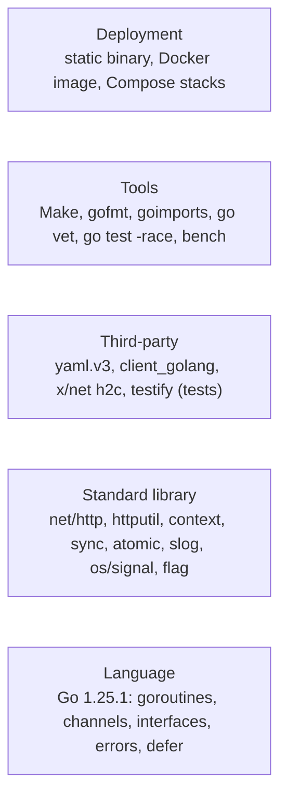

The same picture in plain text:

```
+--------------------------------------------------------------------+
| Deployment:  static binary, Docker image, Docker Compose stacks    |
+--------------------------------------------------------------------+
| Tools:       Make, gofmt, goimports, go vet, go test -race, bench  |
+--------------------------------------------------------------------+
| Third-party: yaml.v3, client_golang, x/net (h2c), testify (tests)  |
+--------------------------------------------------------------------+
| Stdlib:      net/http, httputil, context, sync, sync/atomic, slog, |
|              os/signal, flag, time, hash/fnv, math/rand/v2         |
+--------------------------------------------------------------------+
| Language:    Go 1.25.1: goroutines, channels, interfaces, errors,  |
|              defer, and the few generics that the stdlib provides  |
+--------------------------------------------------------------------+
```

#### The goroutines of the program

This picture shows which goroutines exist and what starts them. Every line comes from the code. The connection goroutines belong to the standard library, and Chapter 4 explains them.

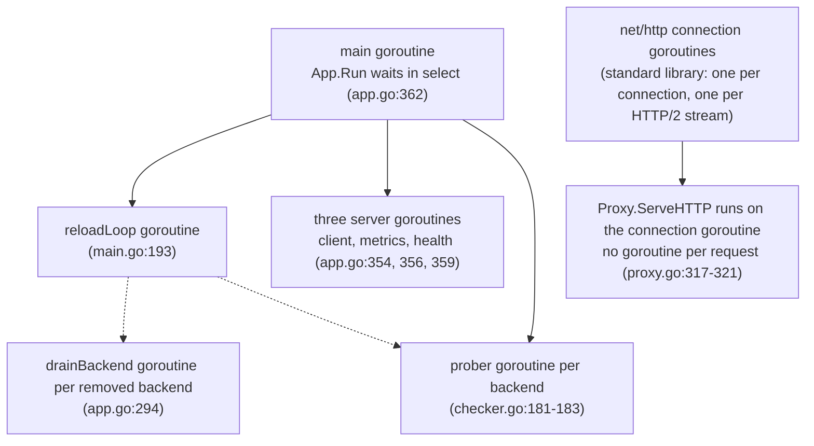

The same picture in plain text:

```
main goroutine                       App.Run waits in select (app.go:362)
|
+-- reloadLoop goroutine             main.go:193
|     +-- drainBackend goroutine     one per removed backend, app.go:294
|     +-- add or remove a prober     app.go:290 and :310
|
+-- server goroutines                app.go:354, :356, :359
|     client, metrics and health servers
|
+-- prober goroutine, one per backend    checker.go:181-183
|     runs a ticker loop (checker.go:343)
|
+-- net/http connection goroutine    one per client connection, one per HTTP/2 stream (standard library)
      +-- Proxy.ServeHTTP            runs here, with no extra goroutine (proxy.go:317-321)
```

Two facts follow. First, the balancer's own goroutines grow with the number of backends, not with the number of requests. The standard library adds one goroutine per client connection, and for HTTP/2 (including h2c) one more per stream, so request count does affect the total. Second, shutdown reaches the probers, the reload loop and the main wait through one context. `signal.NotifyContext` (`main.go:184`) cancels it when SIGINT or SIGTERM arrives.

### What you learned

- Go suits a load balancer because goroutines are cheap, the standard library covers networking, and the binary is static. Its garbage collector and its speed against a mature C proxy are real trade-offs.
- The project is one module. Its library packages sit under `internal/`, which the Go tool keeps private. The entry point is `cmd/l7LoadBalancer`.
- The request path uses `net/http` and `httputil.ReverseProxy`. Frameworks, gateway plugins, Nginx modules and raw TCP were each rejected for a stated reason.
- Interfaces are satisfied implicitly. `balancer.Selector` is the one exception to "define at the consumer", and ADR-0002 gives the reason.
- Errors wrap with `%w`. One sentinel, `balancer.ErrNoHealthyBackends`, is what callers branch on.
- Concurrency uses channels and `select` for signals, mutexes for small shared state, and atomics for counters and whole-value swaps.
- The checks are Make, gofmt, go vet, the testing package with testify, and the race detector. The repository has no CI, so these run only when someone runs `make`.

### Quiz: check yourself

1. Which package provides the reverse proxy the project uses, and which lines create it? Why did the project avoid a web framework?
2. Where is the one exported sentinel error defined, and which line branches on it?
3. Find the three `go serve(...)` lines that start the HTTP servers. Which file and lines are they?
4. The selector is held in an `atomic.Pointer`. Why is that better than a mutex for a value read on every request?
5. Why does `balancer.Selector` live in `internal/balancer`, when the rule says interfaces belong to the consumer?
6. Which command does `make test-race` run?

<details>
<summary>Answers</summary>

1. The package is `net/http/httputil`. The proxy is created at `internal/proxy/proxy.go:198-201`. A framework would hide the request lifecycle (`docs/design-decisions.md:9`), and `AGENTS.md:110` asks for approval before a heavy dependency.
2. It is defined at `internal/balancer/selector.go:27`. The proxy branches on it at `internal/proxy/proxy.go:295`, to choose 503 over 502.
3. They are at `internal/app/app.go:354` (client), `:356` (metrics) and `:359` (health). All three send errors into the buffered channel made at `app.go:352`.
4. Every request reads the selector, and a mutex would make every request queue for the lock, even just to read. An atomic load is one step with no lock, and a reload stores a whole new selector at once (`internal/proxy/proxy.go:215` and `:292`).
5. The selectors and the factory are all in `balancer`, so the interface belongs there too. ADR-0002 (`docs/adr/0002-interface-placement-and-schema-freeze.md:12`) calls this the one exception.
6. It runs `go test -race ./...` (`Makefile:26-27`).

</details>

### Sources

These are the pages this chapter relies on. Points that are our reading are marked in the text.

- The Go FAQ, on goroutines, garbage collection and static binaries: https://go.dev/doc/faq
- Effective Go, on interfaces, goroutines, channels, select and defer: https://go.dev/doc/effective_go
- The Go blog, on passing `context` as the first argument: https://go.dev/blog/context
- The Go blog, on wrapping errors with `%w`, `errors.Is` and `errors.As`: https://go.dev/blog/go1.13-errors
- The `sync/atomic` package: https://pkg.go.dev/sync/atomic
- The Go wiki, "TableDrivenTests": https://go.dev/wiki/TableDrivenTests
- The Go documentation on module layout (`internal/`): https://go.dev/doc/modules/layout
- The `net/http` package: https://pkg.go.dev/net/http
- The `net/http/httputil` package: https://pkg.go.dev/net/http/httputil
- The `golang.org/x/net/http2/h2c` package (deprecation note): https://pkg.go.dev/golang.org/x/net/http2/h2c
- The `log/slog` package and the Go 1.21 release notes: https://pkg.go.dev/log/slog and https://go.dev/doc/go1.21
- Rob Pike's Go proverbs: https://go-proverbs.github.io/
- Caddy documentation: https://caddyserver.com/docs/
- The Prometheus overview: https://prometheus.io/docs/introduction/overview/
- The YAML 1.2.2 specification: https://yaml.org/spec/1.2.2/
- Docker overview and Compose overview: https://docs.docker.com/get-started/docker-overview/ and https://docs.docker.com/compose/

### Next chapter

Chapter 6, "The big picture: packages and glossary", draws the package graph in full, says what each package owns, and defines the project's words in one place. Chapter 5 gave you the tools. Chapter 6 shows how the pieces fit together.


<!-- CHAPTER-5-END -->

<!-- CHAPTER-6-START -->
## Chapter 6: The big picture: packages and glossary

### Why a "big picture" chapter now

Chapters 1 to 5 gave you the concepts and the tools. Chapter 4 followed one request through the whole system, naming each step. From Chapter 7 onward, each chapter zooms into **one** block of the program: the config file, the wiring, the proxy, the registry, a health checker, a circuit breaker, and so on.

Before you zoom in, you need the map. This chapter is that map; keep it open while you read the rest of the book. It has four jobs: draw the whole system on one page with the real package names; tour every package; show the import graph and the one rule the project keeps about it; and collect the project's words in one glossary, so "ejection", "outlier", "trial" and "drain" stop sounding alike.

### The whole system on one page

The picture below shows the running program in three groups: the **request path** (work done for each visitor), the **background workers** (loops on their own timers), and the **control and observability** side (things that change behaviour or report on it). A solid arrow is request-path work; a dotted arrow is a background or control relationship. Mermaid is a text format that many tools draw; if your viewer does not, use the ASCII version (a plain-text drawing).

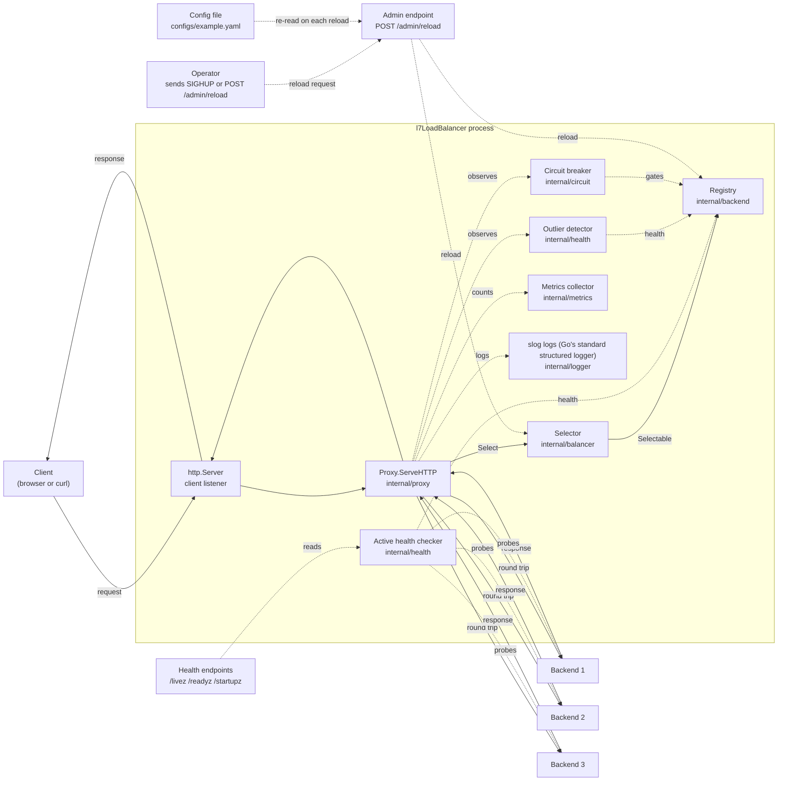

The same picture in plain text, split into the request path and the background side:

```
  REQUEST PATH (solid arrows above) --------------------------------------------------

   +--------+   request    +---------------+  ServeHTTP  +---------------+
   | Client |------------->|  http.Server  |------------>| Proxy         |
   |        |<-------------| client listen |<------------| .ServeHTTP    |
   +--------+   response   +---------------+  response   +-------+-------+
                                                                 |
                                        Select                   | round trip
                                          v                      v
                                  +---------------+   +-------------------+
                                  |   Selector    |   | Backend servers   |
                                  | internal/     |   | 127.0.0.1:9001-3  |
                                  |  balancer     |   +-------------------+
                                  +-------+-------+
                                          | Selectable
                                          v
                                  +---------------+
                                  |   Registry    |
                                  | internal/     |
                                  |  backend      |
                                  +---------------+

  BACKGROUND AND CONTROL (dotted arrows above) --------------------------------------

   Active health checker  --probe-->  Backend servers, and writes health to Registry
   Outlier detector       <--observe-- Proxy, and writes health to Registry
   Circuit breaker        <--observe-- Proxy, and gates selection through Registry
   Metrics collector      <--Proxy and observers-- counters, histograms, gauges
   slog logs              <--every component-- one JSON line per event
   Admin endpoint         <--POST /admin/reload-- asks the app to reload Registry+Selector
   Health endpoints       /livez, /readyz, /startupz  read the checker and the registry
   Config file            re-read on each reload, then applied to Registry + Selector
```

### A reading guide to the picture

Each line below names one block from the picture and points to the chapter that explains it.

1. **The client listener.** `http.Server` accepts connections and parses HTTP. Chapter 9.
2. **The proxy handler.** `Proxy.ServeHTTP` runs the request path. Chapter 10.
3. **The selector.** The pluggable rule that picks a backend. Chapter 12, and the four algorithms in Chapter 21.
4. **The registry and the backend.** The table of servers and each server's live state (health, active requests). Chapter 11.
5. **The backend servers.** The programs that answer the request. Chapter 11 for the model, Chapter 23 for the demo ones.
6. **The active health checker.** Sends test requests on a timer. Chapter 13.
7. **The passive outlier detector.** Watches real traffic for failing backends. Chapter 14.
8. **The circuit breaker.** Gates traffic to a backend that keeps failing. Chapter 15.
9. **Metrics, logs, admin and health endpoints.** Reporting and control surfaces. Chapter 16.
10. **The config file.** The YAML the program reads at startup. Chapter 7.
11. **Reload.** Replacing the backend set and the algorithm while traffic flows. Chapter 18; the algorithm switch alone is Chapter 19.
12. **The whole journey and shutdown.** The request end to end (Chapter 17) and the clean stop (Chapter 20).

### Data plane vs control plane

Two words borrowed from the proxy world describe this split. The Envoy project's documentation, for example, describes a **control plane** that "watches Gateway API and Envoy Gateway-specific resources" and a **data plane** that is "a high-performance proxy that receives and handles live traffic". In plain words, the data plane is the fast lane that does the work for the current request and must not stop; the control plane is the back office that decides which servers exist, whether one is healthy, and which rule chooses between them. It can be slower, because no visitor waits on it directly.

This project never uses the words "data plane". It uses "control plane" only to say that its admin endpoint is *not* a production control plane (`internal/app/admin.go:12`, `docs/adr/0015-reload-architecture.md:48`). The split below is a useful outside lens, not the project's own vocabulary. If we apply the lens anyway, the split is:

| Side | What belongs to it in this project | Where |
|---|---|---|
| Data plane | The proxy handler, the selector, the reverse proxy, the registry lookup, the round trip to the backend | `internal/proxy/proxy.go:287` (`ServeHTTP`), `internal/balancer/selector.go:19` (the `Selector`), `internal/backend/registry.go:51` (the `Registry`) |
| Control plane | The config file, the reload path, the health checker, the outlier detector, the circuit breaker's policy, the metrics collector, the admin endpoint, the health endpoints | `internal/config/config.go:126` (the `Config`), `internal/health/checker.go:61` (the `Checker`), `internal/health/outlier.go:55` (the `OutlierDetector`), `internal/circuit/circuit.go:37` (the `Breaker`), `internal/metrics/metrics.go:66` (the `Collector`), `internal/app/admin.go:96` (`ReloadFrom`) |

The line is not perfectly clean, and it is worth saying so. The circuit breaker's **state** sits on the `Backend` and the data plane reads it on every request; only its **policy** is control-plane. The outlier detector is fed by the data plane but changes the control-plane view of which backends are healthy.

### What goes in and what comes out

Client request path (one request):

| Step | Goes in | Comes out | Where |
|---|---|---|---|
| Accept and parse | TCP connection on `listen`, HTTP bytes | `*http.Request` | `internal/app/app.go:134` (server), `:130-133` (handler) |
| Proxy entry | `*http.Request` | a selected backend, or `ErrNoHealthyBackends` (503) | `internal/proxy/proxy.go:287`; check at `:295` |
| Select | request and the registry's selectable list | one `*backend.Backend` | `internal/balancer/selector.go:19`; `internal/backend/registry.go:141` |
| Round trip | request rewritten for the backend | backend response | `httputil.ReverseProxy` (standard library, no project line) |
| Observe and reply | response status and duration | counters and health updates; response to client | `internal/proxy/proxy.go:132` (observer); `internal/health/outlier.go:110` |

Selector change (SIGHUP or admin request):

| Step | Goes in | Comes out | Where |
|---|---|---|---|
| Trigger | SIGHUP, or `POST /admin/reload` | a reload request | `cmd/l7LoadBalancer/main.go:53`; `internal/app/admin.go:129` |
| Load and check | config file | new `*config.Config`, or a rejection (old config stays) | `internal/app/admin.go:96` (`ReloadFrom`) |
| Build the new selector | new config and the registry | a `balancer.Selector` | `internal/balancer/selector.go:41` (`NewFromConfig`) |
| Swap | new selector | one atomic store; the next request sees it | `internal/proxy/proxy.go:214` (`SetSelector`); called at `internal/app/app.go:277` |
| In-flight requests | a request already dispatched | keeps the old selector | `internal/proxy/proxy.go:160-172` (comment) |

### The package-by-package tour

The program is ten packages: one under `cmd/` and nine under `internal/`. ("Package" means a folder of `.go` files compiled together.) Chapter 5 explained that `internal/` means "private to this module". Each section below gives what the package is for, a small table of its important exported names, how big it is, what it imports, and the one file to open first. Sizes count only non-test `.go` files at commit `53504fc`.

### cmd/l7LoadBalancer

**For.** The entry point: flags, file reading and signals. It is the front door of the building, where you decide which room to walk into. **Read this first:** `cmd/l7LoadBalancer/main.go`.

| Name | Where | Purpose |
|---|---|---|
| `main` | `cmd/l7LoadBalancer/main.go:138` | Parses flags, loads config, builds and runs the app, wires signals |
| `reloadLoop` | `cmd/l7LoadBalancer/main.go:53` | Watches the SIGHUP channel and calls reload |
| `drainSignals` | `cmd/l7LoadBalancer/main.go:70` | Turns a burst of signals into one |
| `probeCommand`, `runProbe` | `cmd/l7LoadBalancer/main.go:91`, `:106` | The container health-check subcommand |
| `version`, `commit` | `cmd/l7LoadBalancer/main.go:24-27` | Build-stamped strings for logs |

**Size:** 1 file, 200 lines. **Imports:** `internal/app`, `internal/config`, `internal/logger` (`cmd/l7LoadBalancer/main.go:15-17`). It is `package main`, so it exports nothing.

### internal/app

**For.** The wiring diagram of the whole program: it builds every subsystem and runs the servers. Think of it as the electrical panel of a building, where all the wires meet in one place. **Read this first:** `internal/app/app.go`.

| Name | Where | Purpose |
|---|---|---|
| `App` | `internal/app/app.go:68` | The assembled system: subsystems built, then served |
| `Build` | `internal/app/app.go:96` | Assembles the whole graph from a validated config |
| `Run` | `internal/app/app.go:342` | Serves the three servers until the context is cancelled |
| `Reload` | `internal/app/app.go:226` | Replaces the backend set and algorithm while traffic flows |
| `Handler`, `Collector`, `Registry`, `LoadedConfig` | `internal/app/app.go:163`, `:167`, `:171`, `:176` | Accessors for the built subsystems |
| `ReloadFrom`, `LastReload`, `ReloadStatus` | `internal/app/admin.go:96`, `:70`, `:45` | The shared SIGHUP and admin reload operation, and its outcome |

**Size:** 3 files, 841 lines (`app.go`, `admin.go`, `drain.go`). **Imports:** `backend`, `balancer`, `circuit`, `config`, `health`, `logger`, `metrics`, `proxy` (`internal/app/app.go:33-40`). It is imported only by `main` and tests.

### internal/proxy

**For.** The request handler: it selects a backend and forwards the request through `httputil.ReverseProxy`. It is the reception desk that every visitor passes, and it decides where to send them. **Read this first:** `internal/proxy/proxy.go`.

| Name | Where | Purpose |
|---|---|---|
| `RoundTripObserver` | `internal/proxy/proxy.go:132` | The one-method interface every observer implements |
| `NewLatencyObserver` | `internal/proxy/proxy.go:152` | Records each round-trip time into the backend's EWMA |
| `Proxy` | `internal/proxy/proxy.go:173` | Wraps `httputil.ReverseProxy` and the per-request state |
| `New` | `internal/proxy/proxy.go:192` | Builds a proxy from a registry and a selector |
| `SetSelector`, `RegisterObserver`, `SetMetrics`, `SetTransport` | `internal/proxy/proxy.go:214`, `:225`, `:238`, `:251` | Install the pluggable parts |
| `ServeHTTP` | `internal/proxy/proxy.go:287` | The whole request path, one request at a time |

**Size:** 2 files, 630 lines (`proxy.go` and `doc.go`). **Imports:** `backend`, `balancer`, `logger`, `metrics` (`internal/proxy/proxy.go:15-18`).

### internal/backend

**For.** The `Backend` type and the `Registry`: the identity, health and active-connection count of each server. It is the personnel file of every server, kept up to date by the request path and the health checkers. **Read this first:** `internal/backend/backend.go`.

| Name | Where | Purpose |
|---|---|---|
| `Backend` | `internal/backend/backend.go:113` | One backend server; unexported state behind methods |
| `IsHealthy`, `MarkHealthy`, `MarkUnhealthy` | `internal/backend/backend.go:134`, `:146`, `:156` | The health flag and its transitions |
| `IncActive`, `DecActive`, `ActiveConns` | `internal/backend/backend.go:162`, `:168`, `:173` | In-flight (currently being handled) request counting |
| `Retire`, `RetiredContext`, `IsRemoved` | `internal/backend/backend.go:205`, `:216`, `:193` | The drain path for a removed backend |
| `RecordLatency`, `EWMALatency` | `internal/backend/backend.go:237`, `:257` | The latency average used by p2c (power of two choices: pick two backends at random and keep the faster) |
| `CircuitOpen`, `CircuitAllow`, `RearmTrial`, `CircuitSuccess`, `CircuitFailure` | `internal/backend/backend.go:299`, `:318`, `:365`, `:393`, `:422` | The circuit state kept on the backend |
| `CircuitGate` | `internal/backend/registry.go:23` | The circuit breaker's view, defined at the consumer |
| `Registry` | `internal/backend/registry.go:51` | Holds the backend set and mediates access |
| `NewRegistry`, `All`, `Version`, `Snapshot`, `SetCircuitGate` | `internal/backend/registry.go:67`, `:102`, `:110`, `:118`, `:127` | Construction and read access |
| `Selectable`, `Allow`, `Apply` | `internal/backend/registry.go:141`, `:156`, `:193` | The selector's list, the circuit gate, and the reload write |

**Size:** 3 files, 713 lines. **Imports:** only `config` (`internal/backend/registry.go:10`). This small import list is the point of the next section.

### internal/balancer

**For.** The `Selector` interface and its four implementations: the pluggable rule that picks a backend. It is the assignment desk that hands each request to a worker by different strategies. **Read this first:** `internal/balancer/selector.go`.

| Name | Where | Purpose |
|---|---|---|
| `Selector` | `internal/balancer/selector.go:19` | The policy interface: `Select(ctx, *http.Request)` |
| `ErrNoHealthyBackends` | `internal/balancer/selector.go:27` | The one fixed error value callers compare against (a "sentinel") |
| `NewFromConfig` | `internal/balancer/selector.go:41` | The factory: config name to selector |
| `RoundRobin` | `internal/balancer/roundrobin.go:21` | Take turns through the list |
| `LeastConnections` | `internal/balancer/leastconn.go:15` | Pick the fewest in-flight requests |
| `ConsistentHashBoundedLoads` | `internal/balancer/consistent_hash.go:42` | Same key to the same backend, with a load cap |
| `PowerOfTwoChoicesEWMA` | `internal/balancer/p2c_ewma.go:25` | Pick the faster of two random backends |

**Size:** 9 files, 595 lines. **Imports:** `backend` and `config` (`internal/balancer/selector.go:9-10`).

### internal/circuit

**For.** The per-backend circuit breaker policy (closed, open, half-open). It is a fuse box: it trips on repeated failures and lets one test request through after a cooldown. **Read this first:** `internal/circuit/circuit.go`.

| Name | Where | Purpose |
|---|---|---|
| `Breaker` | `internal/circuit/circuit.go:37` | The policy; all mutable state lives on `Backend` |
| `New` | `internal/circuit/circuit.go:50` | Builds a breaker from cooldown, log and metrics |
| `Open` | `internal/circuit/circuit.go:62` | Pool eligibility; lazily promotes open to half-open |
| `Allow` | `internal/circuit/circuit.go:77` | Dispatch admission; hands out the one trial |
| `ObserveRoundTrip` | `internal/circuit/circuit.go:103` | Learns from success or failure of a round trip |

**Size:** 2 files, 148 lines. **Imports:** `backend`, `logger`, `metrics` (`internal/circuit/circuit.go:7-9`).

### internal/config

**For.** Loading and validating the YAML config, and diffing two configs for reload. It is the settings binder kept at the front desk: everything the program does starts from here. **Read this first:** `internal/config/config.go`.

| Name | Where | Purpose |
|---|---|---|
| `Config` | `internal/config/config.go:126` | The whole config tree and its sub-structs |
| `Load`, `Parse`, `Validate` | `internal/config/config.go:316`, `:335`, `:429` | Read the file, decode it, check it |
| `AlgorithmRoundRobin`, `AlgorithmLeastConn`, `AlgorithmConsistentHash`, `AlgorithmP2CEWMA` | `internal/config/config.go:25-28` | The four algorithm names |
| `DefaultMetricsListen`, `DefaultHealthEndpointListen`, `DefaultCircuitCooldown`, `DefaultDrainWindow` | `internal/config/config.go:74`, `:78`, `:71`, `:82` | Defaults the loader fills in |
| `BackendDiff`, `DiffBackends`, `NonBackendChanges`, `BackendIdentity` | `internal/config/diff.go:13`, `:26`, `:65`, `:123` | What changed between two configs |

**Size:** 3 files, 779 lines. **Imports:** none. It is a leaf: it depends on nothing in the project.

### internal/health

**For.** Active health checking (periodic probes), passive outlier detection, and the probe endpoint. It is the nurse's station and the monitors by each bed, watching for a server that looks or behaves sick. **Read this first:** `internal/health/checker.go`.

| Name | Where | Purpose |
|---|---|---|
| `Checker` | `internal/health/checker.go:61` | One probe goroutine per backend |
| `New`, `Start`, `Add`, `Remove`, `ProbeRoundComplete` | `internal/health/checker.go:116`, `:142`, `:155`, `:191`, `:207` | Build, run and manage probes |
| `OutlierDetector` | `internal/health/outlier.go:55` | A count window of recent outcomes per backend |
| `NewOutlierDetector`, `Forget`, `ObserveRoundTrip` | `internal/health/outlier.go:88`, `:100`, `:110` | Build, drop and feed the detector |
| `NewHandler` | `internal/health/endpoint.go:67` | The `/livez`, `/readyz`, `/startupz` mux |

**Size:** 4 files, 684 lines. **Imports:** `backend`, `logger`, `metrics` (`internal/health/checker.go:19-21`). Note that this package has two package doc comments, in `doc.go:1` and `checker.go:1`; Go treats both as package comments.

### internal/metrics

**For.** Registering and exposing Prometheus instruments. It is the instrument panel: counters, histograms and gauges that a dashboard reads. **Read this first:** `internal/metrics/metrics.go`. The field and label vocabulary is described in the 29-line comment at `internal/metrics/doc.go:1-29`.

| Name | Where | Purpose |
|---|---|---|
| `Collector` | `internal/metrics/metrics.go:66` | A push-only collector over a private registry |
| `NewCollector` | `internal/metrics/metrics.go:85` | Builds the collector |
| `Registry` | `internal/metrics/metrics.go:125` | The Prometheus registry the `/metrics` handler reads |
| `ObserveRequest`, `RecordProbe`, `SetAlgorithm` | `internal/metrics/metrics.go:139`, `:225`, `:242` | Record requests, probes and the active algorithm |
| `SetBackendHealthy`, `SetCircuitState`, `IncActiveRequests`, `SetActiveRequests` | `internal/metrics/metrics.go:146`, `:177`, `:192`, `:205` | Gauges the components update |

**Size:** 2 files, 277 lines. **Imports:** none. It is a leaf.

### internal/logger

**For.** The `log/slog` setup and the fixed vocabulary of event, reason and field names. It is the shared dictionary that keeps every log line searchable. **Read this first:** `internal/logger/doc.go`, the comment at `internal/logger/doc.go:1-79` that lists every canonical field name.

| Name | Where | Purpose |
|---|---|---|
| `New` | `internal/logger/logger.go:9` | A JSON `slog.Logger` on stdout |
| `EventHealthEjected`, `EventCircuitOpened`, `EventConfigReloaded` | `internal/logger/vocab.go:23`, `:37`, `:56` | Event-name constants for logs |
| `ReasonProbeFailures`, `ReasonOutlierWindow`, `ReasonTrialSuccess` | `internal/logger/vocab.go:78`, `:92`, `:100` | Reason constants paired with events |

**Size:** 3 files, 256 lines. **Imports:** none. It is a leaf, and every other package may import it.

### The dependency graph

Now that you know the packages, here is which one imports which. (An import is one package reaching for another's types or functions.) The graph uses only non-test files.

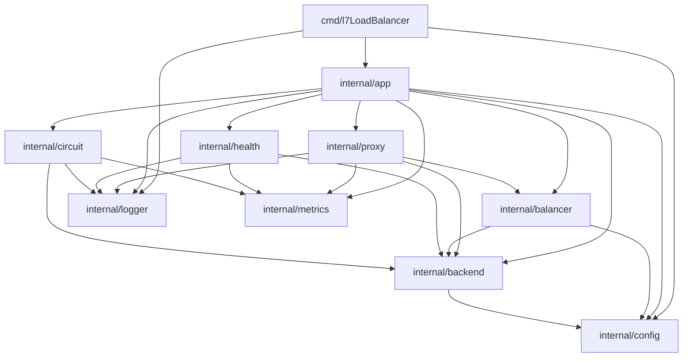

The same graph in plain text. A line `A -> B` means "A imports B":

```
cmd/l7LoadBalancer -> app, config, logger

internal/app       -> proxy, health, circuit, metrics, balancer, backend, config, logger
internal/proxy     -> backend, balancer, logger, metrics
internal/balancer  -> backend, config
internal/health    -> backend, logger, metrics
internal/circuit   -> backend, logger, metrics
internal/backend   -> config
internal/config    -> (leaf: imports no project package)
internal/logger    -> (leaf)
internal/metrics   -> (leaf)
```

Read the picture top to bottom: every arrow points **down** to a lower layer, and no package imports itself. That shape has a name: the graph is **acyclic**, meaning you can never follow the arrows in a circle back to where you started. The project states this in `docs/architecture.md:109`: "The graph has no cycles."

### The rule that keeps the graph acyclic

The project's contributor guide has one rule about this graph, at `AGENTS.md:42`:

> **Rule**: `internal/backend` must not import `internal/balancer`. A `Backend` does not know how it is selected.

The same rule appears in `docs/architecture.md:115`: "**Rule: `backend` does not import `balancer`.** A `Backend` holds identity and live state and does not know how a policy selects it."

The code follows the rule. A search for `internal/balancer` inside `internal/backend/` returns nothing at all. The **only** project package that `internal/backend` imports is `internal/config` (`internal/backend/registry.go:10`).

**Why the rule exists.** Go makes import cycles illegal. The Go specification's "Import declarations" section says: "It is illegal for a package to import itself, directly or indirectly, or to directly import a package without referring to any of its exported identifiers." So if `balancer` imports `backend` (a selector returns a `*backend.Backend`) and `backend` imported `balancer` in return, the compiler would reject the build. One direction must win, and the project chose `balancer -> backend`.

The rule is also about **layering**: keeping low-level details free of high-level policy. `docs/adr/0012-circuit-gate-interface-and-backend-state-methods.md:49` says "The package graph stays acyclic. `circuit` depends only on `backend`", and `internal/circuit/circuit.go:21-24` says the breaker "imports internal/backend and never the reverse, so the package graph stays acyclic".

**Define interfaces at the consumer.** Go has a well-known guideline for cases like this. The Go wiki's Code Review Comments say: "Go interfaces generally belong in the package that uses values of the interface type." The project follows this. The circuit breaker's view of a backend is a tiny interface called `CircuitGate` (`internal/backend/registry.go:23`), and it lives **in `backend`**, the package that calls it, not in `circuit`, the package that implements it. The comment above it (`internal/backend/registry.go:13-15`) says the reason: the interface is "defined here at the consumer because internal/backend must not import internal/circuit (which imports backend)." So `backend` never needs to name `circuit`, and the cycle never forms.

There is one documented exception. The `Selector` interface is the one interface that does **not** sit at its consumer; it lives in `balancer`, the package that implements it, not in `proxy`, the package that calls it. ADR-0002 explains this at `docs/adr/0002-interface-placement-and-schema-freeze.md:12`: "The `Selector` interface is in `internal/balancer`, not `internal/proxy` ... A consumer-side interface would only reverse the import direction and give no isolation. This is the one exception to the rule 'define interfaces at the consumer'." The ADR adds at `:23` that "`balancer` needs the interface locally for its implementations and factory, and an import from `balancer` to `proxy` adds nothing."

**The `internal/` rule, in one more place.** Go's own module-layout guide explains why the library packages sit under `internal/`: "Since other projects cannot import code from our `internal` directory, we're free to refactor its API and generally move things around without breaking external users." This project keeps almost all its code there, so its packages can change freely.

**A tiny worked example.** Suppose someone decided that `Backend` should know its selector, and added `import "github.com/DMJain/l7LoadBalancer/internal/balancer"` to `internal/backend/backend.go`. Two things would happen. First, `balancer` already imports `backend`, so now `backend` imports `balancer` and `balancer` imports `backend`: a cycle, and the Go tool refuses to build the module. Second, even if the cycle were somehow allowed, the `Backend` data type would now carry selection policy. Adding a fifth selection algorithm would mean changing `backend`, which is the data. Tests for `backend` would need the balancer package. The rule prevents all of that by keeping "what a server is" separate from "how we choose a server".

### Non-Go folders

Not everything in the repository is a Go package. Some folders hold configuration, demos, benchmarks or documents. Chapter 1 listed these briefly; here is what each one is actually for, and whether git tracks it.

| Folder | What is inside | Who uses it | Tracked? |
|---|---|---|---|
| `configs/` | `configs/example.yaml` and `configs/docker.yaml` (2 files) | `make run` and the Docker image read them | Tracked |
| `deployments/docker/` | `deployments/docker/docker-compose.yml`, plus three subfolders below | Anyone running the container stack | Tracked (18 files) |
| `deployments/docker/chaos/` | `circuit.sh`, `eviction.sh`, `README.md` | Scripts that force a circuit-open and an ejection to watch the balancer react | Tracked |
| `deployments/docker/dummy-backend/` | `main.go`, two test files, `Dockerfile`, `README.md` | The small fake server the compose stack and Chapter 1's quick start use | Tracked |
| `deployments/docker/observability/` | `docker-compose.yml`, `smoke.sh`, `README.md`, `prometheus/prometheus.yml`, `prometheus/prometheus-stack.yml`, a Grafana dashboard `grafana/dashboards/l7loadbalancer.json`, and Grafana provisioning files | The Prometheus and Grafana monitoring stack | Tracked |
| `demo/` | `acceptance.sh`, `configs/lb.yaml`, `docker-compose.yml`, `README.md`, a Grafana dashboard, a Prometheus config, plus `control-service/` and `traffic-generator/` (each with its own Go `main.go`, tests and `Dockerfile`) | The local live demo. All ports bind to `127.0.0.1` | Tracked (15 files) |
| `bench/` | `README.md`, `run.sh`, `repro.sh`, `generate-results.sh`, `generate-results_test.sh`, `docker-compose.yml`, and the folders `configs/`, `nginx/`, `vegeta/`, `testdata/`, `results/` | The benchmark harness that compares this balancer with Nginx under `vegeta` (a load-testing tool) | Tracked (306 files) |
| `docs/` | `architecture.md`, `design-decisions.md`, `what-id-do-differently.md`, and `docs/adr/` | Readers and maintainers | Tracked (30 files) |
| `docs/adr/` | `INDEX.md` plus `0000-template.md` through `0025-demo-control-service-model.md` (the template `0000-template.md`, 25 decision records, and the index) | Anyone changing a documented design | Tracked |
| `scripts/` | `scripts/generate-cert.sh` and `scripts/.gitkeep` | Generates the local TLS certificate and key | Tracked |
| `test/chaos/` | 13 `*_test.go` files (a test-only package of chaos tests, which inject failures) | The end-to-end and soak tests (long runs under steady load) run by `make e2e` and `make soak` | Tracked |

A few of these paths are **generated** or **ignored by git**, which is worth knowing so you do not hunt for a file that is not in the repository. The `.gitignore` file spells out the rules:

- `/bin/` (the `make build` output), `*.exe`, `*.test`, `*.out` and `coverage.*` are ignored (`.gitignore:2`, `:3`, `:4`, `:5`, `:8`).
- `/certs/` is ignored (`.gitignore:21`). It is written by `scripts/generate-cert.sh` and holds a local TLS certificate and key for HTTPS testing.
- Inside `bench/`, the scratch folders `bench/tmp/` and `bench/results/.tmp/` are ignored (`.gitignore:24`, `:26`). But `bench/results/` itself **is** tracked: the comment at `.gitignore:23` says "Benchmark artifacts (raw outputs kept intentionally in `bench/results/`)".
- `/vendor/` is ignored (`.gitignore:29`).
- The tooling folders for coding assistants are ignored: `/.agents/` (`.gitignore:33`), `/.opencode/skills` (`.gitignore:36`) and `/.opencode/commands` (`.gitignore:37`). These hold the repo's skill definitions and commands, not the balancer.

`.claude/` is another tool folder. It is not tracked by git and not listed in `.gitignore`, so `git status` shows it as untracked.

So if a `path:line` reference seems to point at a missing file, check the list above: it may be generated (a binary in `bin/`, a certificate in `certs/`, a scratch file under `bench/`).

### Who owns what state

This program runs many goroutines at once. (A **goroutine** is a function running at the same time as others; Chapter 5 covers them.) Where more than one goroutine touches the same data, the code must say how it is protected. The project's convention at `AGENTS.md:85` is a comment at the top of every file with shared state that describes its concurrency model (the code labels it "Concurrency:"): read one and you know the whole safety story for that file. The table below is the state map; "owner" is the package that creates and controls the object, and "protected" is the mechanism.

| Shared object | Owner | Readers | Writers | Protected by | Concurrency comment |
|---|---|---|---|---|---|
| `Registry` and its backend snapshot | `backend` | every selector, the proxy | the reload loop (`Apply`) | `atomic.Pointer` to one immutable snapshot | `internal/backend/registry.go:43-50` |
| The selector pointer | `proxy` | every request goroutine | reload (`SetSelector`) | `atomic.Pointer` | `internal/proxy/proxy.go:160-175` |
| `Breaker` | `circuit` | selectors and proxy | none after construction | immutable; state lives on `Backend` | `internal/circuit/circuit.go:33-36` |
| Each `Backend`'s state | `backend` | health, selectors, proxy | health checker, proxy, circuit | atomics (and a compare-and-swap, or CAS, loop for latency) | `internal/backend/backend.go:91` |
| `Checker` | `health` | the endpoint handler | one goroutine per backend | mutex-guarded prober map plus an atomic latch | `internal/health/checker.go:53-60` |
| `OutlierDetector` windows | `health` | the detector itself | every request goroutine | one mutex, held only for the window update | `internal/health/outlier.go:50-54` |
| `metrics.Collector` | `metrics` | the `/metrics` handler | many goroutines | Prometheus instruments are goroutine-safe | `internal/metrics/metrics.go:62-66` |
| `App` and the reload | `app` | the admin endpoint, `main` | the reload path | one mutex plus an atomic pointer for the last outcome | `internal/app/admin.go:5-9` |
| `RoundRobin` counter | `balancer` | request goroutines | `Select` only | one atomic increment per call | `internal/balancer/roundrobin.go:15-20` |
| `PowerOfTwoChoicesEWMA` | `balancer` | request goroutines | none | holds no mutable state of its own | `internal/balancer/p2c_ewma.go:19-24` |
| The consistent-hash `ring` | `balancer` | consistent-hash `Select` | none | immutable after construction | `internal/balancer/ring.go:31` and `internal/balancer/consistent_hash.go:38` |
| A drain | `app` | the reload path | its own goroutine | one goroutine per drain, no shared mutable state | `internal/app/drain.go:12-17` |

Two rows deserve a plain sentence. The **Registry** is the busiest shared object yet needs almost no locking: the whole backend set sits behind one `atomic.Pointer`, replaced whole by a reload, and readers never block (`internal/backend/registry.go:43-50`). The **selector pointer** works the same way (`internal/proxy/proxy.go:160-175`), which is why switching algorithms at runtime (Chapter 19) costs no per-request lock.

### The three network listeners

The program opens three ports, each with its own job. (A **port** is a numbered door on a computer; Chapter 1 introduced the idea.) All three are built in `Build` and started together by `Run`.

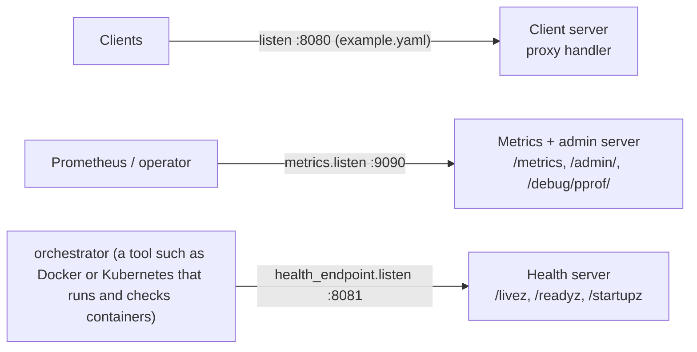

The same picture in plain text:

```
  Clients -----------> :8080  Client server        proxy handler
  Prometheus/ops -----> :9090  Metrics + admin      /metrics, /admin/, /debug/pprof/
  Orchestrator -------> :8081  Health server        /livez, /readyz, /startupz
```

| Server | Config key | Default address | What it serves | Where it is built |
|---|---|---|---|---|
| Client-facing | `listen` (`internal/config/config.go:127`) | none: required, and empty is rejected (`internal/config/config.go:434`) | The proxy handler, or the h2c wrapper in h2c mode (`internal/app/app.go:130-133`) | `buildClientServer` at `internal/app/app.go:432`, assigned at `:134` |
| Metrics | `metrics.listen` (`internal/config/config.go:197`) | `:9090` (`internal/config/config.go:74`) | `/metrics`, `/admin/`, `/debug/pprof/*` via `buildMetricsHandler` at `internal/app/app.go:470` | Server struct at `internal/app/app.go:153-157` |
| Health endpoint | `health_endpoint.listen` (`internal/config/config.go:206`) | `:8081` (`internal/config/config.go:78`) | `/livez`, `/readyz`, `/startupz` via `health.NewHandler` at `internal/health/endpoint.go:67` | Server struct at `internal/app/app.go:147-151` |

`pprof` is Go's built-in profiler endpoint set.

Each server gets its own goroutine, started in `Run` at `internal/app/app.go:354` (client), `:356` (metrics) and `:359` (health). The `serve` helper picks TLS or plain serving at `internal/app/app.go:400-412`. Chapter 9 covers the client server, Chapter 16 the metrics and admin side.

### The project's glossary

This is the same vocabulary the project writes down in `CONTEXT.md`, in one table with a pointer to the code and the chapter that uses it. The meanings are shortened faithfully from `CONTEXT.md`; when in doubt, that file is the authority.

| Term | Meaning in plain English | In the code | Explained in |
|---|---|---|---|
| **Backend** | A server the balancer can send requests to. The registry keeps its identity, health and active-connection count. | `type Backend struct`, `internal/backend/backend.go:113` | Chapter 11 |
| **Selector** | The pluggable policy that chooses the backend for a request. | `type Selector interface`, `internal/balancer/selector.go:19` | Chapters 12, 21 |
| **Selectable** | A backend that can take traffic now: it is healthy **and** its circuit is not open. | `func (r *Registry) Selectable`, `internal/backend/registry.go:141` | Chapter 11 |
| **Ring** | The sorted structure of ring positions that consistent-hash selection walks. Internal to `balancer`, not a selector. | `type ring struct`, `internal/balancer/ring.go:38` | Chapter 21 |
| **Virtual node** | One of the 150 ring positions of one backend, each the hash of `backend.Name` plus a replica index. | `type vnode struct`, `internal/balancer/ring.go:22` | Chapter 21 |
| **Hash key** | The string hashed to find a ring position: the client IP from `r.RemoteAddr`, without the port. Behind another proxy, this is that proxy's IP. | `requestHashKey`, `internal/balancer/hashkey.go:26` | Chapter 21 |
| **Hot key** | A hash key with a very large share of requests; bounded loads moves the excess to the next backends. | comment at `internal/balancer/consistent_hash.go:28` | Chapter 21 |
| **Load** (bounded loads) | The current in-flight request count of a backend (`ActiveConns()`), not a running total. | `func (b *Backend) ActiveConns`, `internal/backend/backend.go:173` | Chapter 21 |
| **Capacity** (bounded loads) | The most load a candidate may have: `max(1, ceil(avg_load * (1 + epsilon)))`, with epsilon 0.25. | `capacityFor`, `internal/balancer/consistent_hash.go:156` | Chapter 21 |
| **EWMA latency** (p2c-ewma) | A running average of round-trip time where recent samples count more; from dispatch to response headers. | `func (b *Backend) RecordLatency`, `internal/backend/backend.go:237` | Chapter 21 |
| **Probe** (active health check) | One out-of-band GET from the checker to the backend; only 2xx is success. | `func (c *Checker) probe`, `internal/health/checker.go:364` | Chapter 13 |
| **Outlier** (passive health check) | A backend whose recent live requests fail too often; a 5xx or a transport failure counts. | `type OutlierDetector struct`, `internal/health/outlier.go:55` | Chapter 14 |
| **Ejection** (passive health check) | Marking a backend unhealthy after 5 failures in its last 10 outcomes; selection stops at once. | `eject` is set to `MarkUnhealthy`, `internal/health/outlier.go:90`; threshold `outlierFailuresBeforeEject`, `outlier.go:29` | Chapter 14 |
| **Circuit breaker** | A per-backend gate with three states (Closed, Open, Half-Open) that stops traffic to a failing backend. | `type Breaker struct`, `internal/circuit/circuit.go:37` | Chapter 15 |
| **Cooldown** | How long a circuit stays Open before it can go Half-Open; the `circuit.cooldown` field, default 30 s. | `DefaultCircuitCooldown`, `internal/config/config.go:71` | Chapter 15 |
| **Trial** | The one request a Half-Open circuit admits; success closes the circuit, failure reopens it. | `func (br *Breaker) Allow`, `internal/circuit/circuit.go:77` | Chapter 15 |
| **Client cancellation** | The client disconnects before a response arrives; not a backend failure. Status 499 is recorded internally. | `statusClientClosedRequest = 499`, `internal/proxy/proxy.go:39` | Chapters 10, 17 |
| **Reload** | Replacing the backend set and algorithm from a config file, without a restart and without dropping in-flight requests. | `func (a *App) Reload`, `internal/app/app.go:226` | Chapter 18 |
| **Backend identity** | The (name, URL) pair. Two configs name the same backend only when both match. | `BackendIdentity`, `internal/config/diff.go:123` | Chapter 18 |
| **Unchanged / added / removed backend** | The three results of a reload diff by identity. There is no "updated". | `type BackendDiff struct`, `internal/config/diff.go:13` | Chapter 18 |
| **Draining** | The state of a removed backend that still has in-flight requests; it is never selected again. | `drainBackend`, `internal/app/drain.go:43` | Chapters 18, 20 |
| **Drain window** | The maximum time a draining backend may keep in-flight requests; `reload.drain_window`, default 30 s. | `DefaultDrainWindow`, `internal/config/config.go:82` | Chapter 18 |
| **No-op reload** | A reload where all backends are unchanged; measures the bare cost of the reload path. | Bench scripts only, e.g. `bench/generate-results.sh:332` | Chapter 23 |
| **Competitor** | The proxy under test in one benchmark run: this balancer or Nginx. | Bench scripts only, e.g. `bench/generate-results.sh:184` | Chapter 23 |
| **Matched** | A comparison where both proxies use the same algorithm; round-robin and least-connections are matched. | Not found in Go code | Chapter 23 |
| **Nearest-equivalent** | A comparison against a close-but-not-identical Nginx config; the gap is always stated. | Nginx configs only, e.g. `bench/nginx/h2/consistent-hash.conf:3` | Chapter 23 |
| **Peak** | The highest sustained request rate of a proxy in one benchmark. | Bench scripts only, e.g. `bench/generate-results.sh:184` | Chapter 23 |
| **Rig-limited** | A peak that shows the limit of the load generator or test machine, not of the proxy. | Not in Go code. Defined in `CONTEXT.md:121` and used in `docs/design-decisions.md:166` | Chapter 23 |

The last six terms are the benchmark vocabulary. They live in `CONTEXT.md` and in the benchmark scripts, not in the balancer's Go code, which is why their "in the code" column points at shell scripts or says "not found".

> **Words that look similar but mean different things.** The glossary is only useful if you keep these apart.
>
> - **Unhealthy vs selectable.** `IsHealthy()` is one fact; selectable is two. A backend is selectable when it is healthy **and** its circuit is not open. A backend can be healthy and still not selectable, because its circuit is open.
> - **Three ways a backend can be out of rotation.** **Ejection** is the passive detector marking a backend unhealthy after too many 5xx answers or transport failures. **Circuit open** is the breaker refusing traffic after repeated round-trip failures (the backend may still be "healthy"). **Draining** is a backend removed by a reload finishing its in-flight requests; it is never selected again, but it is not failing. They look alike from the client's side, but the causes and the recovery paths differ.
> - **Probe vs trial.** A **probe** is an out-of-band test request the health checker sends. A **trial** is a real client request admitted by a half-open circuit. They both "test" a backend, but only a probe changes health.
> - **Selector vs algorithm.** The **Selector** is the interface (the pluggable slot). An **algorithm** is one policy that fills it (round-robin, least-connections and so on). `CONTEXT.md` asks for "algorithm" in prose about behaviour, and "Selector" for the interface itself.

### House rules of the codebase

The project keeps a short list of conventions in `AGENTS.md`. You will see each one in the code you read next, so here they are with one real example apiece.

| Rule | What it means | One real example |
|---|---|---|
| Wrap errors with `%w` | Add context, keep the original error in the chain | `internal/config/config.go:319`: `fmt.Errorf("config: load %s: %w", path, err)` |
| `context.Context` first | Request-scoped functions take the context as the first argument | `internal/balancer/roundrobin.go:37`: `Select(ctx context.Context, r *http.Request)`; also `internal/health/checker.go:142` |
| One branchable sentinel | Only `balancer.ErrNoHealthyBackends` is for callers to branch on | `internal/balancer/selector.go:27`; checked at `internal/proxy/proxy.go:295` |
| Structured logging with `slog` | Log as key-value pairs, using the field names in `internal/logger/doc.go` | `internal/app/app.go:346-350`: `a.log.Info("health checker started", "probe_interval", ...)` |
| Define interfaces at the consumer | Interfaces live where they are used, unless documented | `CircuitGate` at `internal/backend/registry.go:23`; `Selector` is the exception (ADR-0002) |
| Concurrency comment | Each file with shared state opens with a comment describing its concurrency model (the code labels it "Concurrency:") | `internal/backend/registry.go:43-50` |
| Tests first | Tests are written and committed with, or before, the code | A table-driven test: `internal/balancer/roundrobin_test.go:65` |
| Conventional Commits | Commit messages use `feat:`, `fix:`, `refactor:` and so on, imperative, lowercase | The project's history, e.g. a `feat(config): ...` message |

Two of these deserve a little more. The **structured logging** rule is why every log line is a JSON object with named fields a machine can search, using the vocabulary fixed in `internal/logger/doc.go`. The **tests-first** rule is why the test count is larger than the production count, which the next table shows.

### How big is it?

Counting only `cmd/` and `internal/`, and reading each folder's own `.go` files, the project looks like this. "Non-test" means the code that ships; "test" means `_test.go` files.

| Package | Non-test files | Non-test lines | Test files | Test lines |
|---|---|---|---|---|
| `cmd/l7LoadBalancer` | 1 | 200 | 3 | 700 |
| `internal/app` | 3 | 841 | 12 | 2416 |
| `internal/backend` | 3 | 713 | 2 | 893 |
| `internal/balancer` | 9 | 595 | 11 | 1899 |
| `internal/circuit` | 2 | 148 | 3 | 518 |
| `internal/config` | 3 | 779 | 7 | 1718 |
| `internal/health` | 4 | 684 | 6 | 1404 |
| `internal/logger` | 3 | 256 | 2 | 227 |
| `internal/metrics` | 2 | 277 | 1 | 327 |
| `internal/proxy` | 2 | 630 | 4 | 1822 |
| **Total** | **32** | **5123** | **51** | **11924** |

So there are 32 production files and 51 test files: more test code than production code, as the tests-first rule asks. Separately, `test/chaos/` is a test-only package of 13 `*_test.go` files (2331 lines) outside `cmd/` and `internal/`. The counts come from `find <dir> -maxdepth 1 -name '*.go' ! -name '*_test.go' -exec cat {} + | wc -l` and the matching `*_test.go` command. (The demo and dummy-backend programs have their own Go files too, outside this count.)

### What you learned

- The program is ten packages: one command under `cmd/`, nine libraries under `internal/`. `internal/app` wires them all together; `internal/proxy` runs the request path.
- The **data plane** (the request path) and the **control plane** (config, health, circuit policy, metrics, admin) are a useful outside lens. The project never says "data plane", and it says "control plane" only to name what its admin endpoint is not.
- The import graph is **acyclic**: every arrow points down, and no package imports itself. `internal/backend` imports only `internal/config`.
- The project's one hard graph rule is `internal/backend` must not import `internal/balancer`, because a `Backend` does not know how it is selected. Interfaces such as `CircuitGate` are defined at the consumer to keep the rule true. `balancer.Selector` is the documented exception (ADR-0002).
- Shared state is documented file by file with "Concurrency:" comments. The busiest object, the `Registry`, is protected by a single `atomic.Pointer` swap rather than a lock.
- Three listeners serve three audiences: the client on `listen`, metrics and admin on `:9090`, and health endpoints on `:8081`.
- The glossary keeps near-miss words apart: healthy vs selectable, and the three different ways a backend can be out of rotation (ejection, circuit open, draining).
- The codebase is small and heavily tested: 32 production files and 51 test files in `cmd/` and `internal/`.

### Quiz: check yourself

1. Which package wires every subsystem together, and which package runs the request path?
2. In one sentence, what is the difference between a *selectable* backend and a merely *healthy* one?
3. What is the project's rule about `internal/backend` and `internal/balancer`, and why does the rule matter twice: once for the compiler and once for layering?
4. Open `internal/balancer/selector.go` and find the `Selector` interface and the sentinel error. Which lines are they on?
5. Name the three network listeners, their default addresses (where they have one), and one thing each serves.
6. Open `internal/backend/registry.go` and find the "Concurrency:" comment. What mechanism protects the backend set, and what does the comment say about writers?

<details>
<summary>Answers</summary>

1. `internal/app` wires everything (`Build`, `internal/app/app.go:96`). `internal/proxy` runs the request path (`ServeHTTP`, `internal/proxy/proxy.go:287`).
2. A **healthy** backend just passes health checks. A **selectable** backend is healthy **and** its circuit is not open. Healthy is one fact; selectable is two (`CONTEXT.md`, and `Registry.Selectable` at `internal/backend/registry.go:141`).
3. `internal/backend` must not import `internal/balancer` (`AGENTS.md:42`); a `Backend` does not know how it is selected. For the compiler: if both imported each other, Go would reject the build, because the spec makes import cycles illegal. For layering: it keeps the data type free of selection policy, so a new algorithm never forces a change to `backend`.
4. The `Selector` interface is at `internal/balancer/selector.go:19`. The sentinel `ErrNoHealthyBackends` is at `internal/balancer/selector.go:27`.
5. The client server on the `listen` address (required, no default). The metrics and admin server on `:9090`. The health-endpoint server on `:8081`. The metrics server serves `/metrics`, `/admin/` and `/debug/pprof/`; the health server serves `/livez`, `/readyz`, `/startupz`.
6. The comment is at `internal/backend/registry.go:43-50`. The backend set is one immutable snapshot behind an `atomic.Pointer`, replaced whole by `Apply`. Readers load the pointer once and never lock; `Apply` is the single writer, called by one goroutine at a time (the reload loop).

</details>

### Sources

- Go module layout, on `internal/`, `cmd/` and packages: https://go.dev/doc/modules/layout
- The Go specification, "Import declarations" (import cycles are illegal): https://go.dev/ref/spec
- Effective Go, on interfaces (small interfaces; unexported types that only implement an interface): https://go.dev/doc/effective_go
- The Go wiki, Code Review Comments, on interfaces belonging to the consumer and implementers returning concrete types: https://go.dev/wiki/CodeReviewComments
- Envoy Gateway concepts (control plane and data plane): https://gateway.envoyproxy.io/latest/concepts/

### Next chapter

Chapter 7, "YAML config", opens the first box in the picture: the config file. It shows the fields, the defaults and the strict parsing that catches a typo at startup.
<!-- CHAPTER-6-END -->

<!-- CHAPTER-7-START -->
## Chapter 7: YAML config

Chapter 6 showed you the map of the project. This chapter starts the tour of the architecture itself, and it starts here because nothing in the balancer runs before the config is read. The config file is the list of decisions an operator makes: where to listen, which backends to use, how long to wait, which selection algorithm to run. Everything else in the system is built from that file.

The chapter follows one config from bytes on disk to a live, validated `Config` struct, and then to the moment a reload turns a new file into a running change. Along the way you will see the strict decoder that catches typos, the validation rules and their exact error messages, and the two functions that decide whether a reload is allowed. You will also see, honestly, a few places where the documentation and the code disagree.

Read this chapter with `internal/config/config.go`, `internal/config/diff.go` and `configs/example.yaml` open next to you. Every `file:line` is from commit `53504fc`, the commit the rest of this book uses.

### Why a config file at all, and why YAML

**Config is what changes between deploys.** The twelve-factor methodology says an app's config is "everything that is likely to vary between deploys (staging, production, developer environments, etc)", and that "config varies substantially across deploys, code does not". This is the direct reason the backend list and the timeout values live in a file and not in Go code. A new server is a new line in the file, not a new build. A different timeout in staging is a different value in a different file.

That matters especially for a load balancer, because the backend list is the whole point. If adding or removing a backend needed a code change and a rebuild, you could not react to a backend going down. The file is the seam between the operator's decisions and the running program.

**Why YAML rather than JSON or a bespoke format.** YAML is a text format people read and write by hand. Two properties make it a good fit for config:

- **Comments.** A YAML comment starts with `#`. This project's example file uses comments heavily to explain each key in place, which you cannot do in JSON.
- **Plain nesting.** YAML shows structure with indentation instead of braces, so a nested section like `transport:` reads like an outline.

YAML 1.2 was designed to be a strict superset of JSON, so a JSON document is also valid YAML (the YAML 1.2.2 spec says so in its "YAML History" section, 1.2, listed in Sources). That compatibility is not why this project chose YAML. The reason is readability and comments.

### A tiny YAML primer

A YAML document is a tree of three kinds of node:

- A **mapping** is a set of key/value pairs, like a dictionary. In YAML 1.2 the keys of a mapping are unordered and must be unique.
- A **sequence** is an ordered list. The content of a sequence node is an ordered series of zero or more nodes.
- A **scalar** is a single value: a piece of text, a number, or a boolean such as `true`.

Three rules carry most of the weight:

- **Indentation shows nesting.** Only spaces, never tabs. The YAML 1.2 spec is blunt: "tab characters must not be used in indentation." A line indented under a key belongs to that key.
- **`- ` starts a list item.** Each dash begins one element of a sequence.
- **`#` starts a comment.** Everything from `#` to the end of the line is ignored by the decoder.

Here is a small example, written for this book rather than copied from the project:

```yaml
# This line is a comment
listen: ":8080"          # a scalar value
backends:                # a mapping key whose value is a sequence
  - name: api-1          # each "- " starts one mapping in the list
    url: http://10.0.0.1:9000
  - name: api-2
    url: http://10.0.0.2:9000
```

The `backends:` key holds a sequence of two mappings. The indentation under `- name: api-1` is what tells you that `url:` belongs to the first list item, not the second.

**Duration strings.** Several keys in this project hold a duration, written as a Go duration string such as `"5s"`. `time.ParseDuration` describes a duration string as "a possibly signed sequence of decimal numbers, each with optional fraction and a unit suffix, such as `300ms`, `-1.5h` or `2h45m`". The valid units are `ns`, `us` (or `µs`), `ms`, `s`, `m`, and `h`, and the package also accepts the incorrect but common `u` for micro. So `"5s"` means five seconds, `"1h30m"` means ninety minutes, and a bare `5` is not a duration at all because a unit is required. The decoder turns the string into a `time.Duration`.

### The whole example config

`configs/example.yaml` is the documented reference file, and the validation tests load and check it directly. Here it is in full:

```yaml
# Example configuration for l7LoadBalancer.

# Address the load balancer listens on.
listen: ":8080"

# Backend selection algorithm. One of:
#   round_robin      - rotate across healthy backends
#   least_conn       - pick the healthy backend with fewest active connections
#   consistent_hash  - bounded-load consistent hashing
#   p2c_ewma         - power-of-two-choices with EWMA latency
# Defaults to round_robin if omitted.
algorithm: "round_robin"

# Health endpoint. Always-on; serves orchestrator probe paths on this address.
# `listen` is optional and defaults to ":8081".
health_endpoint:
  listen: ":8081"

# Zero-downtime reload. `drain_window` bounds how long a backend removed by a
# SIGHUP reload may keep its in-flight requests before they are cancelled.
# Optional; defaults to "30s". Not reloadable: changing it rejects the reload.
reload:
  drain_window: "30s"

# Client-facing HTTP server. `read_timeout` bounds reading a full request
# including the body, so a slow-loris client cannot pin a server goroutine; it
# also bounds idle keep-alive connections (net/http derives the idle timeout
# from it when IdleTimeout is unset). Optional; defaults to "60s". Not
# reloadable: changing it rejects the reload.
# WriteTimeout is deliberately NOT exposed: the stdlib's WriteTimeout spans the
# entire response body copy, so a slow-but-healthy upstream would trip it. Do
# not add it without revisiting that reasoning.
server:
  read_timeout: "60s"

# Upstream transport. Replaces http.DefaultTransport for backend connections.
# `dial_timeout` bounds dialing a backend (default "5s"); a non-accepting
# address fails fast instead of pinning a request. `response_header_timeout`
# bounds how long a backend may take to start answering headers (default
# "30s"); a backend that never answers becomes a failure. `max_idle_conns_per_host`
# is the per-host idle pool size (default 100); the total pool is sized from
# this and the backend count, so it is not silently capped by the stdlib
# default. `idle_conn_timeout` recycles idle keep-alives (default "90s").
#
# Backend protocol is scheme-driven: an `https://` URL negotiates HTTP/2 via
# ALPN, an `http://` URL uses HTTP/1.1, and both may be mixed in one backends
# list for incremental migration. `force_http2` (default true) is the only
# switch — set it false to force HTTP/1.1 to backends for debugging.
# `tls_skip_verify` (default false) disables verification of a backend's TLS
# certificate and is required only for self-signed backend certs in
# test/staging; leaving it false is the production-correct default.
# All optional; not reloadable: changing any of them rejects the reload.
transport:
  force_http2: true
  tls_skip_verify: false
  dial_timeout: "5s"
  response_header_timeout: "30s"
  max_idle_conns_per_host: 100
  idle_conn_timeout: "90s"

# Upstream backends. At least one required. Names must be unique.
#
# Backend URLs support `${VAR}` environment interpolation. A reference is
# resolved from the process environment at load time, so a credential or token
# stays out of this file, version control, and the baked image config:
#   url: "http://${BACKEND_HOST}:9001"
#   url: "http://${USER}:${PASS}@${HOST}:9001"  # several vars, incl. credentials
#   url: "http://api-${SUFFIX}:${PORT}/v1"      # adjacent to literal text
#
# Syntax: `${VAR}`, where VAR is `[A-Za-z_][A-Za-z0-9_]*`. There is no default
# syntax — `${VAR:-fallback}` is not parsed and is rejected as malformed. Only
# backend URLs are templated; a `${...}` in any other field passes through
# untouched. The resolved URL is what validation checks, and interpolation
# re-runs on every load, so a SIGHUP reload picks up a changed environment (a
# changed expansion is one removed plus one added backend — ADR-0015).
#
# Failure: an unset or empty variable fails the load naming the backend and the
# variable; an unterminated `${`, an empty `${}`, or an invalid variable name
# fails the load naming the backend. Error messages never contain the resolved
# value.
#
# This file's own URLs are literal, so it runs with no environment set.
backends:
  - name: "backend-a"
    url: "http://127.0.0.1:9001"
  - name: "backend-b"
    url: "http://127.0.0.1:9002"
  - name: "backend-c"
    url: "http://127.0.0.1:9003"
```

**What each line maps to in Go.** The config package mirrors this tree with one Go struct per YAML section. The top-level `Config` struct is declared at `internal/config/config.go:126-148`; there are no flat top-level keys for the subsystems, so each subsystem is a nested section. The tags line up like this (the tag lines are where the `yaml:"..."` string sits):

| YAML line | Content | Go field / tag | Tag line |
|---|---|---|---|
| 4 | `listen: ":8080"` | `Config.Listen` | `internal/config/config.go:127` |
| 12 | `algorithm: "round_robin"` | `Config.Algorithm` | `internal/config/config.go:139` |
| 16 | `health_endpoint:` | `Config.HealthEndpoint` | `internal/config/config.go:143` |
| 17 | `  listen: ":8081"` | `HealthEndpointConfig.Listen` | `internal/config/config.go:206` |
| 22 | `reload:` | `Config.Reload` | `internal/config/config.go:144` |
| 23 | `  drain_window: "30s"` | `ReloadConfig.DrainWindow` | `internal/config/config.go:289` |
| 33 | `server:` | `Config.Server` | `internal/config/config.go:145` |
| 34 | `  read_timeout: "60s"` | `ServerConfig.ReadTimeout` | `internal/config/config.go:231` |
| 53 | `transport:` | `Config.Transport` | `internal/config/config.go:146` |
| 54 | `  force_http2: true` | `TransportConfig.ForceHTTP2` | `internal/config/config.go:255` |
| 55 | `  tls_skip_verify: false` | `TransportConfig.TLSSkipVerify` | `internal/config/config.go:261` |
| 56 | `  dial_timeout: "5s"` | `TransportConfig.DialTimeout` | `internal/config/config.go:264` |
| 57 | `  response_header_timeout: "30s"` | `TransportConfig.ResponseHeaderTimeout` | `internal/config/config.go:269` |
| 58 | `  max_idle_conns_per_host: 100` | `TransportConfig.MaxIdleConnsPerHost` | `internal/config/config.go:274` |
| 59 | `  idle_conn_timeout: "90s"` | `TransportConfig.IdleConnTimeout` | `internal/config/config.go:277` |
| 83 | `backends:` | `Config.Backends` | `internal/config/config.go:147` |
| 84-85 | `- name` / `url` | `BackendConfig.Name`, `.URL` | `internal/config/config.go:294-295` |
| 86-87 | `- name` / `url` | same | `internal/config/config.go:294-295` |
| 88-89 | `- name` / `url` | same | `internal/config/config.go:294-295` |

The struct tag is how the YAML decoder knows which key fills which field: the text before the first comma in `yaml:"listen"` is the key. With no key in the tag, the field name is lowercased; only exported fields (ones whose name starts with a capital letter) are filled at all. The library this project uses is `gopkg.in/yaml.v3` (`internal/config/config.go:15`), declared as a direct dependency in `go.mod:10`.

Notice what the example file does **not** contain. There is no `tls:`, no `h2c:`, no `health:`, no `circuit:` and no `metrics:` section. The optional sections it does set are `transport` (`configs/example.yaml:53-59`), `health_endpoint`, `reload` and `server`. It also sets `backends`, which is required. The rest are filled from defaults during validation. Only `configs/example.yaml` and `configs/docker.yaml` exist in `configs/`; the other sample configs live under `bench/configs/` and `demo/configs/`.

**Environment variables in backend URLs.** Only the `url` field of a backend is templated. `${VAR}` in a URL is replaced with the value of the environment variable `VAR` at load time, so a credential can stay out of the file and out of version control. The variable name must match `^[A-Za-z_][A-Za-z0-9_]*$` (`internal/config/config.go:49`), and there is deliberately no `${VAR:-default}` syntax. A `${...}` in any other field passes through untouched. Because interpolation re-runs on every load, a SIGHUP reload picks up a changed environment. We will see exactly how this runs in "Loading step by step".

### Loading step by step

Three functions do the loading, and they share one decoder. `Load` reads a file, `Parse` reads any reader, and `decode` is the single strict decode they both call. `Load` is at `internal/config/config.go:316-328`. Its steps are:

1. **Open the file.** `os.Open(path)` at `internal/config/config.go:317`. If that fails, `Load` returns `fmt.Errorf("config: load %s: %w", path, err)` at `internal/config/config.go:319`. The `%w` verb wraps the operating-system error rather than hiding it, so a caller can still ask `errors.Is(err, os.ErrNotExist)` to find out whether the file was simply missing.
2. **Schedule the close.** `defer f.Close()` at `internal/config/config.go:321` runs last, when `Load` returns, so the file closes even if decoding fails.
3. **Decode it.** `decode(f)` at `internal/config/config.go:323`. A decode error is wrapped the same way at `internal/config/config.go:325`.
4. **Return the config unvalidated.** `internal/config/config.go:327`. This is important and easy to miss: **`Load` does not validate and does not apply defaults.** Its doc comment says it returns the config "unvalidated (callers must call Validate)" (`internal/config/config.go:300`). The tests pin this: an omitted algorithm is left empty by `Load`, and omitted health and circuit durations are left `nil`, until `Validate` runs.

`Parse` is `Load` for a config that is not a file (`internal/config/config.go:335-341`). It calls the same `decode`, and it wraps errors as `config: parse %s: %w` naming a `source` string instead of a path (`internal/config/config.go:338`). The reload admin endpoint uses it to read a YAML request body, since there is no path to name.

`decode` is where the strictness lives (`internal/config/config.go:346-357`):

1. It makes a decoder: `dec := yaml.NewDecoder(r)` at `internal/config/config.go:348`.
2. It turns on strict mode: `dec.KnownFields(true)` at `internal/config/config.go:349`.
3. It decodes into the struct: `dec.Decode(&cfg)` at `internal/config/config.go:350`.
4. It expands `${VAR}` in backend URLs: `expandBackendURLs(&cfg)` at `internal/config/config.go:353`.

**What `KnownFields(true)` actually does.** The library's own doc says: "KnownFields ensures that the keys in decoded mappings to exist as fields in the struct being decoded into." In plain words, if the YAML contains a key that has no matching field in the Go struct, decoding fails with an error instead of silently ignoring the key. That is the whole point: a typo like `listn: ":8080"` for `listen`, or `helth_endpoint:` for `health_endpoint`, becomes a loud error at startup instead of a mysteriously ignored setting. The doc comment in the code says exactly this: strictness "rejects unknown fields at decode time, so typos like `listn` fail here rather than being silently ignored", and `yaml.Unmarshal` is deliberately not used (`internal/config/config.go:302-304`). There is no separate `UnmarshalStrict` function; `KnownFields(true)` is the mechanism.

The reload admin endpoint's body path is held to the same rule because it also goes through `decode`. A file and a request body can never be held to different standards (`internal/config/config.go:343-345`).

**Error wrapping prefixes.** Every error out of `Load` and `Parse` carries a prefix that says where it came from:

| Trigger | Message shape | Line |
|---|---|---|
| file open fails | `config: load %s: %w`, wrapping the OS error | `internal/config/config.go:319` |
| decode or expand fails | `config: load %s: %w`, wrapping the decode/expand error | `internal/config/config.go:325` |
| unknown key | the library's error naming the bad key, inside `config: load <path>: ...` | `internal/config/config.go:349-351` |
| malformed YAML | the library's syntax error, inside `config: load <path>: ...` | `internal/config/config.go:350-351` |
| `${VAR}` failure | `backend "...": ...` inside `config: load <path>: ...` | `internal/config/config.go:392,396,400` |

The prefix is what tells an operator whether the problem was finding the file, parsing it, or resolving a variable. The tests check the prefixes: a missing file wraps `os.ErrNotExist` and contains `config: load` (`internal/config/config_load_test.go:35-40`), and an unknown top-level field `listn` is rejected with the field named (`internal/config/config_load_test.go:48-52`).

**The `${VAR}` expansion, in detail.** `expandBackendURLs` walks `cfg.Backends`, calls `expandEnv(name, url)` and writes the expanded URL back in place (`internal/config/config.go:363-372`). `expandEnv` is careful about failure modes (`internal/config/config.go:380-410`):

- A string with no `${` is returned unchanged (`internal/config/config.go:381-383`).
- An unterminated `${...}` gives `backend %q has an unterminated ${...} reference in its url` (`internal/config/config.go:392`).
- A name that does not match the pattern gives `backend %q has a malformed ${...} reference %q in its url` (`internal/config/config.go:396`).
- An unset or empty variable gives `backend %q references environment variable %q which is not set or is empty` (`internal/config/config.go:400`).

Every one of those errors names the backend and never the resolved value, so a secret that came from the environment cannot leak into the logs through this path (`internal/config/config.go:377-379`). A test proves it: an error over a URL that already expanded a valid password does not contain the password (`internal/config/config_interpolate_test.go:107-114`).

### Every config key

This table is the complete key reference. The "reloadable?" column comes from `NonBackendChanges`: **yes** means the key belongs to the backend list or the algorithm, which a reload may change; **no** means a reload that changes it is rejected whole (see "Reload-related config logic").

| YAML key | Go field | Type | Default (constant, line) | Meaning | Reloadable? |
|---|---|---|---|---|---|
| `listen` | `Config.Listen` | `string` | none — required (`internal/config/config.go:434-436`) | client-facing listen address | no |
| `tls.cert_file` | `TLSConfig.CertFile` | `string` | none — required when `tls:` present (`internal/config/config.go:445-447`) | PEM certificate or chain | no |
| `tls.key_file` | `TLSConfig.KeyFile` | `string` | none — required when `tls:` present (`internal/config/config.go:448-450`) | PEM private key | no |
| `h2c` | `Config.H2C` | `bool` | `false` | cleartext HTTP/2 mode | no |
| `algorithm` | `Config.Algorithm` | `string` | `round_robin` (`AlgorithmRoundRobin`, `internal/config/config.go:25`; applied `:430-432`) | selector choice | **yes** |
| `health.probe_interval` | `HealthConfig.ProbeInterval` | `*time.Duration` | `5s` (`DefaultProbeInterval`, `internal/config/config.go:63`) | how often backends are probed | no |
| `health.probe_timeout` | `HealthConfig.ProbeTimeout` | `*time.Duration` | `2s` (`DefaultProbeTimeout`, `internal/config/config.go:68`) | bound on a single probe | no |
| `circuit.cooldown` | `CircuitConfig.Cooldown` | `*time.Duration` | `30s` (`DefaultCircuitCooldown`, `internal/config/config.go:71`) | Open → Half-Open cooldown | no |
| `metrics.listen` | `MetricsConfig.Listen` | `*string` | `:9090` (`DefaultMetricsListen`, `internal/config/config.go:74`) | Prometheus exposition address | no |
| `health_endpoint.listen` | `HealthEndpointConfig.Listen` | `*string` | `:8081` (`DefaultHealthEndpointListen`, `internal/config/config.go:78`) | probe endpoint address | no |
| `reload.drain_window` | `ReloadConfig.DrainWindow` | `*time.Duration` | `30s` (`DefaultDrainWindow`, `internal/config/config.go:82`) | how long a removed backend drains | no |
| `server.read_timeout` | `ServerConfig.ReadTimeout` | `*time.Duration` | `60s` (`DefaultReadTimeout`, `internal/config/config.go:87`) | bound on reading a full request; plain HTTP mode only (TLS and h2c modes set it to 0, see `internal/config/config.go:225-230`) | no |
| `server.idle_timeout` | `ServerConfig.IdleTimeout` | `*time.Duration` | `90s` (`DefaultIdleTimeout`, `internal/config/config.go:96`) | bound on an idle keep-alive | no |
| `transport.force_http2` | `TransportConfig.ForceHTTP2` | `*bool` | `true` (`DefaultForceHTTP2`, `internal/config/config.go:118`) | negotiate HTTP/2 to `https://` backends | no |
| `transport.tls_skip_verify` | `TransportConfig.TLSSkipVerify` | `bool` | `false` (zero value) | skip backend cert verification | no |
| `transport.dial_timeout` | `TransportConfig.DialTimeout` | `*time.Duration` | `5s` (`DefaultDialTimeout`, `internal/config/config.go:100`) | bound on dialing a backend | no |
| `transport.response_header_timeout` | `TransportConfig.ResponseHeaderTimeout` | `*time.Duration` | `30s` (`DefaultResponseHeaderTimeout`, `internal/config/config.go:104`) | bound on time to first header | no |
| `transport.max_idle_conns_per_host` | `TransportConfig.MaxIdleConnsPerHost` | `*int` | `100` (`DefaultMaxIdleConnsPerHost`, `internal/config/config.go:108`) | per-host idle pool size | no |
| `transport.idle_conn_timeout` | `TransportConfig.IdleConnTimeout` | `*time.Duration` | `90s` (`DefaultIdleConnTimeout`, `internal/config/config.go:112`) | recycle idle keep-alives | no |
| `backends[].name` | `BackendConfig.Name` | `string` | none — required | backend identity, part 1 | **yes** |
| `backends[].url` | `BackendConfig.URL` | `string` | none — required | backend identity, part 2 | **yes** |

Every `Default...` constant lives in the block `internal/config/config.go:60-119`. The algorithm default, `AlgorithmRoundRobin`, is at `internal/config/config.go:25`. They are exported so the tests, the docs and the consuming packages (health, circuit) reference one value rather than restating the number in several places.

**Why so many fields are pointers.** A duration field is a `*time.Duration`, not a `time.Duration`. This is deliberate and the code explains it (`internal/config/config.go:168-172`): a pointer lets `Validate` tell "key omitted" (`nil`) from "key present but zero" (non-nil and `0`). With a plain value both collapse to `0`, and validation would have to choose between silently defaulting an explicitly-invalid `0` and wrongly rejecting an omitted key. The same trick is used for the two listen addresses. `transport.tls_skip_verify` is a plain `bool` because its default is `false`, which is already the zero value, so omission needs no special handling (`internal/config/config.go:256-261`). `force_http2` is a pointer precisely because its default is `true`, so `nil` must be distinguishable from an explicit `false`.

### Validation

`Load` gives you an unchecked struct. `Validate` is the function that turns it into something the rest of the program can trust. It is declared as `func (c *Config) Validate() error` at `internal/config/config.go:429-487`. Two properties define it:

- **It is fail-fast.** It returns the *first* problem it finds, not a list. A config with three mistakes reports one, you fix it, and the next run reports the second. This is common for startup checks: the operator wants one clear thing to fix, and re-running is cheap.
- **It normalizes as it validates.** Before checking, it mutates the struct to fill in defaults. An empty `Algorithm` becomes `round_robin` (`internal/config/config.go:430-432`), and later every omitted duration and listen pointer is filled from its constant. The doc comment justifies the mutation: "After Validate returns nil, every field is populated and valid, so downstream consumers never re-check or re-default" (`internal/config/config.go:420-423`). This is why there is no separate `Normalize` step; the mutation is small and living next to its checks is simpler.

The documented order is `Listen → listener mode → backends count → per-backend name/URL → name uniqueness → algorithm → health/circuit/reload/server/transport durations → metrics/health_endpoint listen` (`internal/config/config.go:425-428`). Here are the rules in the order the code runs them. Inside group 2 the loop checks each backend in turn (name, then URL), so a bad URL on the first backend is reported before a bad name on the second. Duplicate names are checked only after every backend has passed.

**Group 1: the listener and its mode.**

| # | Rule | Exact error | Line |
|---|---|---|---|
| 1 | `listen` must not be empty | `config: listen must not be empty` | `internal/config/config.go:434-436` |
| 2 | `listen` must be a valid host:port | `config: listen %q is not a valid host:port: %w` / `config: listen %q has an invalid port: %w` | `internal/config/config.go:437-439`, `:588-597` |
| 3 | `tls` and `h2c` cannot both be set | `config: h2c and tls are mutually exclusive; remove one` | `internal/config/config.go:441-443` |
| 4 | `tls.cert_file` must not be empty | `config: tls cert_file must not be empty` | `internal/config/config.go:445-447` |
| 5 | `tls.key_file` must not be empty | `config: tls key_file must not be empty` | `internal/config/config.go:448-450` |

The host:port check is syntactic only. `validateHostPort` uses `net.SplitHostPort` and a 16-bit port parse, and it never binds or resolves anything, because availability depends on runtime state and belongs to `http.Server.ListenAndServe` (`internal/config/config.go:581-597`). So `"foobar"` fails the split, and `":99999"` fails the 16-bit parse.

**Group 2: the backend list.**

| # | Rule | Exact error | Line |
|---|---|---|---|
| 6 | at least one backend | `config: at least one backend is required` | `internal/config/config.go:453-455` |
| 7 | each backend name non-empty | `config: backend name must not be empty` | `internal/config/config.go:599-601` |
| 8 | each backend name matches `^[a-zA-Z0-9_-]+$` | `config: backend name %q is invalid: must match ^[a-zA-Z0-9_-]+$` | `internal/config/config.go:603-604` |
| 9 | each backend URL starts with lowercase `http://` or `https://` | `config: backend %q url must use http or https scheme` | `internal/config/config.go:625-626` |
| 10 | each backend URL parses | `config: backend %q has an invalid url` | `internal/config/config.go:629-630` |
| 11 | each backend URL has a host | `config: backend %q url must include a host` | `internal/config/config.go:632-633` |
| 12 | each backend URL has no query string | `config: backend %q url must not include a query string` | `internal/config/config.go:635-636` |
| 13 | each backend URL has no fragment | `config: backend %q url must not include a fragment` | `internal/config/config.go:638-639` |
| 14 | backend names are unique | `config: duplicate backend name %q` | `internal/config/config.go:471` |

The name pattern is deliberately narrow. The comment says it is "the intersection of what is safe in every downstream context: Prometheus label values, structured log field values, grep targets, and future admin UIs. No escaping needed" (`internal/config/config.go:41-44`). A name like `backend.primary` is rejected because a dot is not in that safe set.

The URL check has a subtle ordering rule. The scheme is checked against the **raw string** before `url.Parse`, because `url.Parse` lowercases the scheme it reports, so an uppercase `HTTP://host` would otherwise pass a post-parse comparison against `"http"` (`internal/config/config.go:615-617`). Only duplicate *names* are rejected; the same URL under two different names is allowed. Every URL error names the backend and the field but never the raw URL, in case environment interpolation put a secret in it, and `url.Parse`'s own error is deliberately not wrapped because it echoes the raw URL (`internal/config/config.go:619-623`).

**Group 3: the algorithm.**

| # | Rule | Exact error | Line |
|---|---|---|---|
| 15 | `algorithm` must be in `implementedAlgorithms` | `config: unsupported algorithm %q` | `internal/config/config.go:476-478` |

The accepted names are `round_robin`, `least_conn`, `consistent_hash` and `p2c_ewma` (`internal/config/config.go:25-28`), held in the set `implementedAlgorithms` (`internal/config/config.go:34-39`). The check is a map lookup, and it is **case-sensitive**: `Round_Robin` is rejected (ADR-0004 decision 1).

**Group 4: durations, the boolean and listen addresses.**

| # | Rule | Exact error | Line |
|---|---|---|---|
| 16 | omitted duration → default; explicit `<= 0` rejected | `config: %s must be positive, got %s` | `internal/config/config.go:550-558` |
| 17 | omitted int → default; explicit `<= 0` rejected | `config: %s must be positive, got %d` | `internal/config/config.go:564-572` |
| 18 | `metrics.listen` omitted → default; explicit empty rejected; else host:port | `config: metrics listen must not be empty` | `internal/config/config.go:535-545` |
| 19 | `health_endpoint.listen` same shape | `config: health_endpoint listen must not be empty` | `internal/config/config.go:535-545`, `:486` |

`normalizeAndValidateDefaults` calls the duration helper once per field, in a fixed order, so the error always names the first offending field (`internal/config/config.go:492-525`). The `%s` in the message is a human-readable field name such as `health probe_interval` or `transport dial_timeout`, which is why an error tells you exactly which duration was wrong.

### Bad configs and the errors you will see

The left column is a change you can make to a copy of `configs/example.yaml`. The right column is the error text the code will produce. These are the messages built into `Validate`; the tests assert substrings of each (the `internal/config/*_test.go` files, mainly `internal/config/config_validate_test.go`).

| You change | Error you get |
|---|---|
| Rename `listen` to `listn` | an unknown-field error naming `listn`, inside `config: load <path>: ...` (`internal/config/config_load_test.go:48-52`) |
| Delete the `listen:` line | `config: listen must not be empty` (`internal/config/config.go:435`) |
| Set `listen: "127.0.0.1"` (no port) | `config: listen "127.0.0.1" is not a valid host:port: ...` (`internal/config/config.go:591`) |
| Add both a `tls:` block and `h2c: true` | `config: h2c and tls are mutually exclusive; remove one` (`internal/config/config.go:442`) |
| Add `tls:` with an empty `cert_file` | `config: tls cert_file must not be empty` (`internal/config/config.go:446`) |
| Remove all backends | `config: at least one backend is required` (`internal/config/config.go:454`) |
| Name a backend `backend.primary` | `config: backend name "backend.primary" is invalid: must match ^[a-zA-Z0-9_-]+$` (`internal/config/config.go:604`) |
| Give two backends the name `a` | `config: duplicate backend name "a"` (`internal/config/config.go:471`) |
| Use `url: "HTTP://backend:9001"` | `config: backend "backend-a" url must use http or https scheme` (`internal/config/config.go:626`) |
| Use `url: "http://127.0.0.1:90%zz"` | `config: backend "backend-a" has an invalid url` (the raw URL is not echoed) (`internal/config/config.go:630`) |
| Set `algorithm: "Round_Robin"` | `config: unsupported algorithm "Round_Robin"` (`internal/config/config.go:477`) |
| Set `health.probe_interval: "0s"` | `config: health probe_interval must be positive, got 0s` (`internal/config/config.go:556`) |
| Set `transport.max_idle_conns_per_host: -5` | `config: transport max_idle_conns_per_host must be positive, got -5` (`internal/config/config.go:570`) |
| Set `reload.drain_window: "abc"` | a decode error containing `cannot unmarshal`, at load time (`internal/config/config_load_test.go:202-206`) |
| Reference an unset `${NOPE}` in a backend URL | `backend "backend-a" references environment variable "NOPE" which is not set or is empty` (`internal/config/config.go:400`) |

One honest note about leak safety: for a URL failure after interpolation, the error names only the backend and the field, never the URL string, so a resolved secret cannot appear in the message (`internal/config/config.go:619-623`).

### Defaults versus required fields, and why the constants exist

A **default** is used when the operator leaves a key out. A **required field** has no sensible default, so the program refuses to start without it. In this project:

- **Required:** `listen` (Group 1, rule 1) and `backends` (Group 2, rule 6). Each backend entry also needs its own `name` and `url`.
- **Everything else is optional.** Most optional keys are filled by `Validate` from a named constant (`internal/config/config.go:60-119`, and `AlgorithmRoundRobin` at `:25`). Three use a zero value instead: `h2c` (false), `transport.tls_skip_verify` (false), and `tls:` (absent means plain HTTP).

The defaults live in named, exported constants — `DefaultProbeInterval`, `DefaultDialTimeout`, and so on — rather than inline literals, and the code says why: they are exported "so that tests, docs, and the packages that consume them (health, circuit) reference one value instead of restating it" (`internal/config/config.go:51-53`). If the default probe interval changed, there would be exactly one line to change and no risk of a test or a doc drifting from it.

There is a design decision tucked in here worth naming. Some tuning values are config and some are hard-coded, and the split is not arbitrary. ADR-0011 decision 10 is why the probe interval, probe timeout and circuit cooldown are config while the consecutive-failure/success thresholds, the passive-outlier window size and threshold, and the circuit's failure-to-open threshold stay Go constants (`internal/config/config.go:55-59`): "cadence and cooldown plausibly differ per deployment, algorithm-shaped tuning values do not." In other words, an operator might want a faster probe in one environment, but the shape of the outlier algorithm should stay fixed so behaviour does not silently vary across environments.

The lesson generalizes: put the rule in validation, not in the decoder. The YAML decoder does not know which keys are required; only `Validate` does.

### Backends in config, and what a backend's identity means

A backend entry is small. `BackendConfig` at `internal/config/config.go:293-296` has exactly two fields:

| YAML key | Go field | Type |
|---|---|---|
| `name` | `Name` | `string` |
| `url` | `URL` | `string` |

That is the whole shape. This is worth stating plainly because it surprises people who expect more knobs: **there is no `weight` field and no per-backend timeout in this package.** A search for `weight` in the config package returns nothing. The example file suggests three equal backends, and the selection algorithms in Chapter 21 decide among them without any per-backend weight. (A `weight` knob is a common feature of load balancers, but it is not in this one at this commit.) Global timeouts such as health probe intervals and transport timeouts apply to every backend equally. The comment at `internal/config/config.go:163-166` explains the choice: today's backends are homogeneous, and per-backend overrides can be added later without changing the shape.

**Identity is the pair `(name, url)`.** This is the concept that makes reload work, and it is defined in one line: `BackendIdentity(b) = b.Name + "\x00" + b.URL` at `internal/config/diff.go:123-125`. The `\x00` is a NUL byte separator that cannot appear in a validated name or URL, so the pair cannot be faked by clever naming (`internal/config/diff.go:121-122`). ADR-0015 decision 2 states the rule and the reason: "A name kept with a new URL is one removed backend plus one added backend. State learned about one host must never apply to a different host."

So when a reload compares two configs:

- A backend whose `(name, url)` pair is unchanged is **unchanged**, and keeps everything the balancer learned about it: health, circuit state, active requests and latency.
- A backend whose `(name, url)` pair is new is **added**.
- A backend whose `(name, url)` pair has disappeared is **removed**.
- A backend that kept its name but changed its URL is **one removal plus one addition** — never an in-place update. There is no "updated" category at all. The reason: a new host might be a completely different machine, so carrying learned state across would be wrong.
- **Order is not identity.** Reordering the same backends diffs to "all unchanged" (`internal/config/diff.go:23-25`). Order does matter for the round-robin rotation and the least-connections tie-break, which ADR-0015 decision 3 notes, but it is not part of who a backend *is*.

"Changes in place" only means: the reload does not restart the process, and unchanged backends keep their identity and state. For the exact mechanics of what the registry does with added and removed backends, see Chapter 17, "One request, end to end", and Chapter 18, "Hot reload without downtime".

### Reload-related config logic

Two functions in `internal/config/diff.go` do the reload comparison. `NonBackendChanges` decides whether a reload is allowed; `DiffBackends` decides what changes. Both are pure: they read two configs and return data, and they never log, return an error, or touch runtime state (`internal/config/diff.go:6-8`). Because they hold no state, they are safe to call from any goroutine.

**`DiffBackends`** (`internal/config/diff.go:26-44`) answers "which backends changed?". Its signature is `func DiffBackends(oldCfg, newCfg *Config) BackendDiff`, and its result has three lists:

| Field | Meaning | Order preserved |
|---|---|---|
| `Added` | backends in the new config whose identity was not in the old | new config's order |
| `Removed` | backends in the old config whose identity is not in the new | old config's order |
| `Unchanged` | backends present in both, by identity | new config's order |

The algorithm is a set comparison (`internal/config/diff.go:31-42`). First it builds the identity set of each side, then it walks the new backends: an identity that is in the old set is `Unchanged`, otherwise `Added`. Then it walks the old backends: an identity not in the new set is `Removed`. There is no fourth category.

**`NonBackendChanges`** (`internal/config/diff.go:65-105`) answers "which settings outside the backend list and the algorithm changed?". Its signature is `func NonBackendChanges(oldCfg, newCfg *Config) []string`, and it returns the **section names** that differ, in a fixed order (`internal/config/diff.go:46-52`):

| Section name returned | Fields compared | Line |
|---|---|---|
| `listen` | `Listen` | `internal/config/diff.go:67-69` |
| `tls` | both nil, or both present with equal cert/key | `internal/config/diff.go:70-72`, `:111-116` |
| `h2c` | `H2C` | `internal/config/diff.go:73-75` |
| `health` | `ProbeInterval`, `ProbeTimeout` | `internal/config/diff.go:76-79` |
| `circuit` | `Cooldown` | `internal/config/diff.go:80-82` |
| `metrics` | `Listen` | `internal/config/diff.go:83-85` |
| `health_endpoint` | `Listen` | `internal/config/diff.go:86-88` |
| `reload` | `DrainWindow` | `internal/config/diff.go:89-91` |
| `server` | `ReadTimeout`, `IdleTimeout` | `internal/config/diff.go:92-95` |
| `transport` | `ForceHTTP2`, `TLSSkipVerify`, `DialTimeout`, `ResponseHeaderTimeout`, `MaxIdleConnsPerHost`, `IdleConnTimeout` | `internal/config/diff.go:96-103` |

A section with any differing sub-field is named once by its section name (`internal/config/diff.go:51-52`). Notice what is **not** in that list: **`backends` and `algorithm` are the two reloadable things, and `algorithm` is deliberately not named**, because a reload swaps the selector in place rather than rejecting the change (ADR-0015 decision 18). The comment on the function spells this out (`internal/config/diff.go:49-51`).

**Why non-backend changes are rejected as a whole, not applied one field at a time.** The reason is that consumers of these settings hold *derived state* — a running poller scheduled at the old probe interval, a drain timer armed for the old drain window — and a partial apply is riskier than a clear refusal. ADR-0015 decision 4 puts it directly: "Their consumers hold derived state, for example a probe interval in a running ticker or an armed drain timer. A partial apply is more dangerous than a clear refusal. The old config keeps serving, and the log names the changed fields." `reload.drain_window` is non-reloadable for the sharpest version of that reason: "a running drain's timer is already armed" (ADR-0016, decision 1).

Other load balancers solve the reload problem differently, which shows that "all-or-nothing" is a choice, not the only option. nginx's documented reload sends a HUP signal to the master process, which "first checks the syntax validity, then tries to apply new configuration", and "if this fails, it rolls back changes and continues to work with old configuration" — all-or-nothing, like this project, but by starting new worker processes rather than swapping in place. Envoy takes a different route: it receives dynamic configuration at runtime over a family of APIs known collectively as xDS (CDS for clusters, EDS for endpoints, RDS for routes, LDS for listeners) from a separate control-plane server, instead of re-reading a file on a signal. This project's in-process SIGHUP swap is the simplest of the three, and the reason it can be simple is that the backend list and the algorithm — the only two things that change often — are exactly the two things the diff is built for.

One more precondition matters for correctness: **both configs must already be validated** before you call these functions. `Validate` materializes every default, so an omitted field and an explicit default compare equal. The comment says it plainly (`internal/config/diff.go:60-64`), and the test "omitted fields equal explicit defaults" pins it (`internal/config/diff_test.go:242-254`). Without validation, `nil` versus a filled-in default would look like a change.

The call sites are in `internal/app` and `cmd/l7LoadBalancer`. Both triggers enter through `ReloadFrom` (`internal/app/admin.go:96-102`), which takes the reload mutex (a lock so only one reload runs at a time) and calls `loadValidateApply` (`internal/app/admin.go:104-123`). That function loads the config, calls `cfg.Validate()` (`internal/app/admin.go:114-121`), and then calls `reloadLocked`. The SIGHUP trigger is `reloadLoop`, which passes `config.Load(configPath)` into that call (`cmd/l7LoadBalancer/main.go:62-64`). The admin trigger passes `config.Parse` (`internal/app/admin.go:156-158`). Inside `reloadLocked`, the code loads the current config (`internal/app/app.go:236`), calls `NonBackendChanges` (`internal/app/app.go:238`), and rejects the reload if the result is non-empty with `app: reload rejected: non-backend fields changed: %v` (`internal/app/app.go:238-245`). Only then does it build the new selector if the algorithm changed (`internal/app/app.go:250-261`), call `DiffBackends` (`internal/app/app.go:263`) and apply the diff (`internal/app/app.go:264`).

### The config life cycle

One config object is produced at startup and then produced again on every reload. The picture below shows both paths. At startup the config goes to `Build`; at runtime a new config is loaded, validated, diffed and applied while the old one keeps serving.

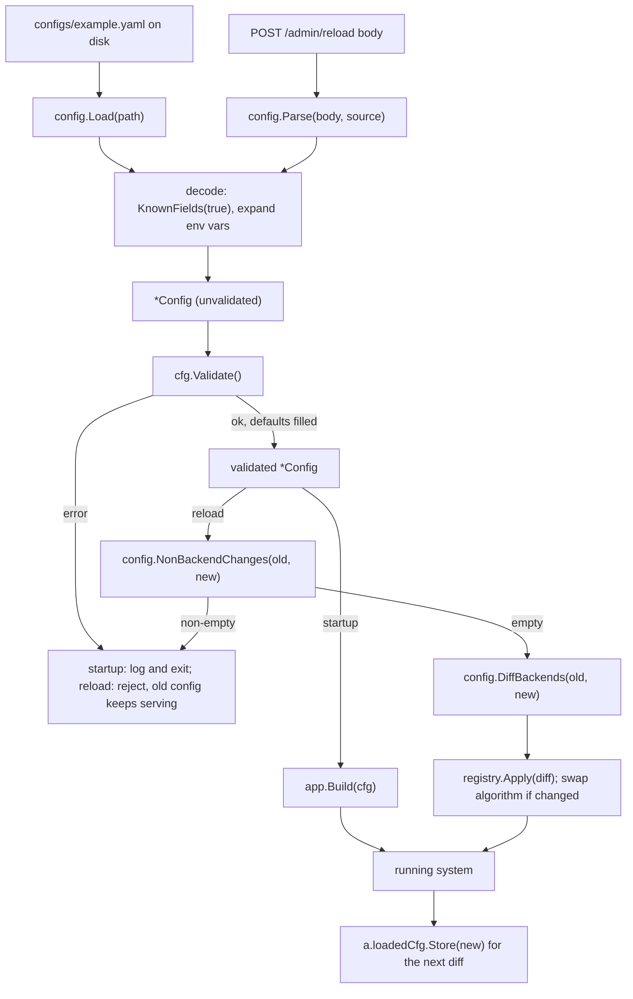

The same picture in plain text, boxes top to bottom:

```
  configs/example.yaml          POST /admin/reload body
         |                                  |
         v                                  v
   config.Load(path)                config.Parse(body, source)
         \                                 /
          \                               /
           v                             v
     decode: KnownFields(true), expand ${VAR}
                    |
                    v
            *Config (unvalidated)
                    |
                    v
             cfg.Validate()
              |            \
         error             ok (defaults filled)
              |            |
              v            v
  startup: exit            validated *Config
  reload: reject           |
  (old keeps serving)      |
                      +----+------------------------+
                      |                             |
                      v                             v
               app.Build(cfg)          NonBackendChanges(old, new)
                      |                             |
                      |                non-empty: reject
                      |                             |
                      |                empty: continue
                      |                             v
                      |                 DiffBackends(old, new)
                      |                             |
                      |                             v
                      |                 registry.Apply(diff); swap algorithm
                      |                             |
                      |                             |
               running system <---------------------+
                      |
                      v
           a.loadedCfg.Store(new)
```

The loop on the right is what makes successive reloads compose: each reload diffs against the *currently loaded* config, not the startup config. `internal/app/app.go:285` stores the new config only after the apply succeeds, so the record never names a config the registry has not published.

### Where documentation and code disagree

Honesty matters more than tidiness, so here are the mismatches found while checking this chapter. A student who trusts one document without checking the other will get it wrong.

1. **"All keys other than `backends` are optional" (README) versus the code.** `README.md:177` says "All keys other than `backends` are optional." That is wrong: `listen` is also required. An absent or empty `listen` fails with `config: listen must not be empty` (`internal/config/config.go:434-436`), and zero backends fail with `config: at least one backend is required` (`internal/config/config.go:453-455`). `docs/architecture.md:433` has it right — "All sections except `listen` and `backends` are optional" — and marks `listen` as `# required` at `docs/architecture.md:436`. So the README and the architecture page disagree, and the code sides with the architecture page.

2. **The `read_timeout` comment in `configs/example.yaml` is stale.** The comment at `configs/example.yaml:25-29` says `read_timeout` "also bounds idle keep-alive connections (net/http derives the idle timeout from it when IdleTimeout is unset)." But the code now has a dedicated `server.idle_timeout` with default `90s` (`internal/config/config.go:96`), always filled in by `Validate` (`internal/config/config.go:512-514`), so `IdleTimeout` is never unset and the derivation the comment describes never happens. The Go doc comment on the field describes the real behaviour instead (`internal/config/config.go:232-237`). Here the example file and the code disagree with each other.

3. **The README's minimal example omits keys** that exist in the code and schema: `health_endpoint`, `server`, `transport` and `h2c`. This is stated to be a minimal example, so it is an omission, not a contradiction.

4. **The schema block in `docs/architecture.md:431-472` matches the code.** Every key it lists exists with a matching tag and a matching default, and its line `docs/architecture.md:472` — that durations and listen fields are pointers so `Validate` can tell omitted from explicit zero — matches `internal/config/config.go:168-172`. No key was found in the code that the schema block is missing.

### Try it yourself

These three experiments use a copy of `configs/example.yaml`. The expected results are **derived from reading the code at commit `53504fc`**, not captured run output. Run them if you like, but read the "why" column so the result teaches you something.

**Experiment 1 — break a key.** Change `listen:` to `listn:` and run the balancer with `-config` pointing at your copy. The flag is defined at `cmd/l7LoadBalancer/main.go:151` and defaults to `configs/example.yaml`.

- *Expected:* startup fails during load, before validation, with an error that names `listn` (the strict decoder's unknown-field error), wrapped in `config: load <path>: ...`.
- *Why:* `decode` calls `dec.KnownFields(true)` at `internal/config/config.go:349`, so a key with no matching struct field is rejected; `yaml.Unmarshal` is deliberately not used (`internal/config/config.go:302-304`). The same mistake in a reload body is rejected by `config.Parse` (`internal/config/config.go:335-341`).
- *Lesson:* strict decoding turns a silent typo into a loud error.

**Experiment 2 — remove `listen`.** Delete the `listen: ":8080"` line entirely and run again.

- *Expected:* load succeeds, but `Validate` fails with `config: listen must not be empty`, and the process exits.
- *Why:* `listen` has no default and is checked at `internal/config/config.go:434-436`, the first rule in `Validate`.
- *Lesson:* some fields are required, and validation (not the decoder) is where that is enforced. Note the two-phase split: `Load` returns an unchecked config, then `main` calls `cfg.Validate()` separately (`cmd/l7LoadBalancer/main.go:154-162`).

**Experiment 3 — use an unknown algorithm.** Set `algorithm: "roundrobin"` (no underscore) and run.

- *Expected:* load succeeds; `Validate` fails with `config: unsupported algorithm "roundrobin"`.
- *Why:* `implementedAlgorithms` contains only the four exact strings (`internal/config/config.go:34-39`), and the lookup at `internal/config/config.go:476-478` is case-sensitive and exact. `roundrobin` is not `round_robin`.
- *Lesson:* config values are code, and the accepted set is a deliberate whitelist, not a free string. ADR-0004 explains why: a name that parses but has no selector should fail at validation, not later at build.

### What goes in and what comes out, in order

The task of this section is to place the config block precisely in the request path and in the reload path. The first table shows the request path, and it contains an honest surprise: the config package itself does not run per request.

**(a) When a client request arrives**

The config package is *not on the request path*. `Load` and `Validate` run once at startup (or on a reload), and the values they produced are wired into the server, the selector and the transport by `app.Build`. What the request path sees is the *result* of that wiring — the built objects — not the config block. So the table below lists the config-derived values each consumer already holds, names the block before it (which produced the value) and after it (what the request path does), and marks the config step that happened earlier.

| Step | Input (from whom) | What it does | Output (to whom) | `path:line` |
|---|---|---|---|---|
| Config load (startup only, not per request) | YAML bytes from the operator's file | strict decode, expand `${VAR}`, validate, fill defaults | a validated `*Config` | `internal/config/config.go:316-328`, `:429-487` |
| Server accept | a TCP connection on `listen`, from the OS | the `http.Server` built from this config binds the `listen` address | a goroutine reading a request | `internal/config/config.go:127` (the value), `internal/app/app.go:434` (the bind) |
| Server timeouts | `server.idle_timeout` from config, and `server.read_timeout` in plain HTTP mode only | the server enforces these on each connection (`read_timeout` is left at 0 in TLS and h2c modes, `internal/app/app.go:446-456`) | a parsed `*http.Request` | `internal/config/config.go:231`, `:237` |
| Select | `algorithm` from config, via the selector built at startup | the selector chooses one backend | a `*backend.Backend` or `ErrNoHealthyBackends` | `internal/config/config.go:139` (the value); see Chapter 4, step 4 |
| Round trip | `transport.*` timeouts from config, installed on the transport | the transport dials and reads within the configured bounds | the backend's response | `internal/config/config.go:264`, `:269` (the values) |

For the full request walk, see Chapter 4. The point here is that config is an *input* to startup, not a participant in every request. (The one exception is a request to `POST /admin/reload`, which does call `config.Parse` and `Validate` — that is a control request, not a normal client request; see Chapter 16 and Chapter 18.)

**(b) When the selection algorithm is changed (config reload with a different `algorithm`)**

Here the config block *does* take part. A SIGHUP or an admin reload produces a new config, and `algorithm` is one of the two things a reload may change. The config side of that flow:

| Step | Input (from whom) | What it does | Output (to whom) | `path:line` |
|---|---|---|---|---|
| Load and parse | the file (SIGHUP) or the request body (admin) | `Load`/`Parse` strict-decode and expand `${VAR}` | an unvalidated `*Config` | `internal/config/config.go:316-328`, `:335-341`; the callers are `cmd/l7LoadBalancer/main.go:62-64` and `internal/app/admin.go:156-158` |
| Validate the new algorithm | the new `algorithm` string | rejects empty by defaulting to `round_robin`; rejects any value outside the four accepted names | a validated algorithm string | `internal/config/config.go:430-432`, `:476-478`; called for both triggers from `internal/app/admin.go:114-121` |
| Decide reloadability | old and new configs | `NonBackendChanges` deliberately does **not** name `algorithm`, so the change does not block the reload | an empty/reduced changed-fields list | `internal/config/diff.go:49-51`, `:65-105` |
| (What config does **not** do) | — | config does not build or swap the selector; that is `internal/app` calling `balancer.NewFromConfig` and `proxy.SetSelector` | — | `internal/app/app.go:250-261`, `:276-279` |

So the config block's whole job in an algorithm change is to *accept and expose* the new value; the actual swap is the app's. That division matches Chapter 19, "Switching the selector algorithm at runtime", and Chapter 17.

### What you learned

- A config file exists because config varies between deploys; the backend list and timeouts should not need a code change.
- YAML is a tree of mappings, sequences and scalars, with indentation for nesting, `#` for comments, and duration strings like `"5s"` for time values.
- `Load` reads a file, `Parse` reads any reader, and both share `decode`, whose `KnownFields(true)` rejects any key with no matching struct field — typos fail loudly.
- `Load` does not validate or default; `Validate` does both, fail-fast, and mutates the struct so that after it returns nil every field is populated.
- Required fields are `listen` and at least one `backends` entry; everything else has a named default constant, exported so tests and consumers share one value.
- A backend's identity is the `(name, url)` pair; a name kept with a new URL is one removal plus one addition, never an update.
- `DiffBackends` classifies backends and `NonBackendChanges` names the non-reloadable sections; a non-empty result rejects the whole reload. Only `backends` and `algorithm` are reloadable.
- The config package is off the request path: it runs at startup and on reload, and the objects it produces (server, selector, transport) are what handle requests.

### Quiz: check yourself

1. What does `KnownFields(true)` do, and why is it better than silently ignoring a mistyped key?
2. Does `Load` apply defaults? If not, which function does, and what is the first thing it does?
3. A reload keeps a backend's name but changes its URL. What does `DiffBackends` report for it, and why is it not an in-place update?
4. Which two things may a reload change, and why is `algorithm` not named by `NonBackendChanges`?
5. Open `internal/config/config.go` and find the validation rule that rejects a `listen` value with no port. What function does it call, and what is the exact error message shape?
6. Open `configs/example.yaml` and find the comment about `server.read_timeout`. Does it agree with the current code? Name the key that changed the behaviour.

<details>
<summary>Answers</summary>

1. It makes the strict decoder reject any YAML key that has no matching field in the Go struct being decoded into, so a typo like `listn` fails at load instead of being ignored and silently leaving a default in place (`internal/config/config.go:349`, and the comment at `:302-304`).
2. No. `Load` returns the config "unvalidated (callers must call Validate)" (`internal/config/config.go:300`). `Validate` first sets an empty algorithm to `round_robin` (`internal/config/config.go:430-432`), then checks that `listen` is not empty (`internal/config/config.go:434-436`). `main` calls it right after `Load` (`cmd/l7LoadBalancer/main.go:154-162`).
3. One removal plus one addition — never `Unchanged`, never an "updated" entry. Identity is the `(name, url)` pair (`internal/config/diff.go:123-125`), and ADR-0015 decision 2 says state learned about one host must never apply to a different host.
4. `backends` and `algorithm`. `algorithm` is reloadable, so decision 4 lists it as reloadable and leaves it out of the rejection list. A reload swaps the selector in place rather than rejecting the change (ADR-0015 decisions 4 and 18); the comment is at `internal/config/diff.go:49-51`.
5. Rule 2 in `Validate`, at `internal/config/config.go:437-439`, calls `validateListen` → `validateHostPort` (`internal/config/config.go:588-597`). The message shape is `config: listen %q is not a valid host:port: %w` (from `net.SplitHostPort`) or `config: listen %q has an invalid port: %w` (from a 16-bit port parse).
6. No. The comment at `configs/example.yaml:25-29` says `read_timeout` bounds idle keep-alive connections because `net/http` derives the idle timeout from it when `IdleTimeout` is unset. But the code added a dedicated `server.idle_timeout` (default `90s`, `internal/config/config.go:96`), always filled by `Validate` (`internal/config/config.go:512-514`), so `IdleTimeout` is never unset and the derivation never happens.

</details>

### Sources

These are the pages this chapter relies on. Only pages whose content was read directly are listed.

- YAML 1.2.2 specification (mappings, sequences, indentation with spaces only, comments): https://yaml.org/spec/1.2.2/
- `gopkg.in/yaml.v3` package documentation (struct tags, exported fields, `KnownFields`): https://pkg.go.dev/gopkg.in/yaml.v3
- `gopkg.in/yaml.v3` `Decoder.KnownFields` (strict unknown-key rejection): https://pkg.go.dev/gopkg.in/yaml.v3#Decoder.KnownFields
- Go `time.ParseDuration` (duration-string grammar and units): https://pkg.go.dev/time#ParseDuration
- The Twelve-Factor App, "Config" (config varies between deploys): https://12factor.net/config
- nginx, "Controlling nginx" (HUP reload checks syntax, applies, or rolls back): https://nginx.org/en/docs/control.html
- Envoy, "Dynamic configuration" (xDS: CDS, EDS, RDS, LDS, SDS, ADS): https://www.envoyproxy.io/docs/envoy/latest/intro/arch_overview/operations/dynamic_configuration

### Next chapter

Chapter 8, "App wiring and startup", takes the validated config this chapter produced and shows how `app.Build` turns it into a running system: the registry, the selector, the health checker, the three servers, and the order they come up.
<!-- CHAPTER-7-END -->

<!-- CHAPTER-8-START -->
<!-- CHAPTER-8-END -->

<!-- CHAPTER-9-START -->
<!-- CHAPTER-9-END -->

<!-- CHAPTER-10-START -->
<!-- CHAPTER-10-END -->

<!-- CHAPTER-11-START -->
<!-- CHAPTER-11-END -->

<!-- CHAPTER-12-START -->
<!-- CHAPTER-12-END -->

<!-- CHAPTER-13-START -->
<!-- CHAPTER-13-END -->

<!-- CHAPTER-14-START -->
<!-- CHAPTER-14-END -->

<!-- CHAPTER-15-START -->
<!-- CHAPTER-15-END -->

<!-- CHAPTER-16-START -->
<!-- CHAPTER-16-END -->

<!-- CHAPTER-17-START -->
<!-- CHAPTER-17-END -->

<!-- CHAPTER-18-START -->
<!-- CHAPTER-18-END -->

<!-- CHAPTER-19-START -->
<!-- CHAPTER-19-END -->

<!-- CHAPTER-20-START -->
<!-- CHAPTER-20-END -->

<!-- CHAPTER-21-START -->
<!-- CHAPTER-21-END -->

<!-- CHAPTER-22-START -->
<!-- CHAPTER-22-END -->

<!-- CHAPTER-23-START -->
<!-- CHAPTER-23-END -->

<!-- CHAPTER-24-START -->
<!-- CHAPTER-24-END -->

<!-- CHAPTER-25-START -->
<!-- CHAPTER-25-END -->
