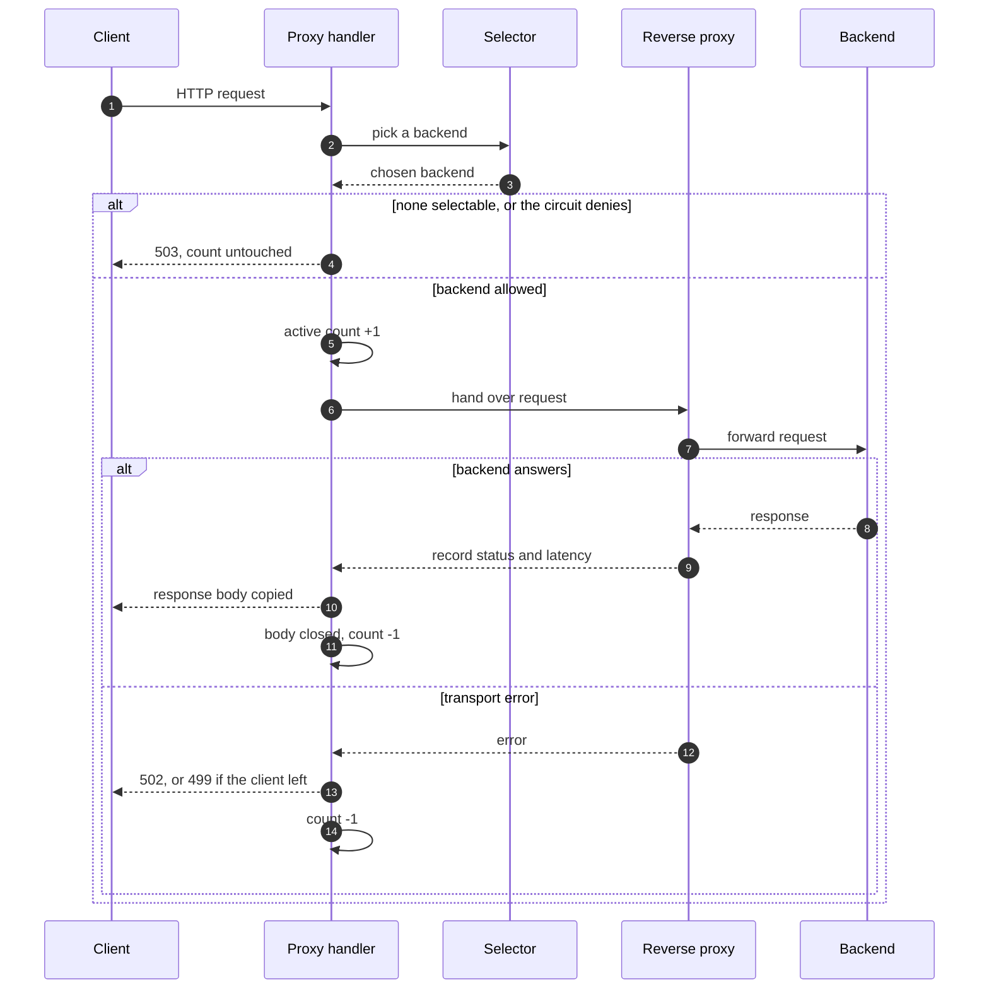
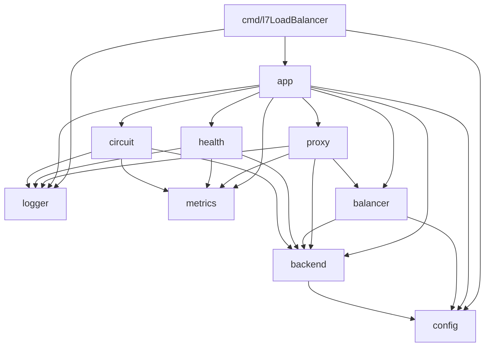

# Architecture

l7LoadBalancer is a Layer 7 HTTP load balancer in Go. It reads each HTTP request before it chooses a backend. The request path uses only the standard library (`net/http`, `net/http/httputil`), with one exception: cleartext HTTP/2 (h2c) uses `golang.org/x/net/http2/h2c`.

The project puts a pluggable backend-selection policy on top of `httputil.ReverseProxy`, which already handles hop-by-hop headers, `X-Forwarded-For`, buffering and flushing. The project code is the selection layer, the concurrency model, the resilience patterns and the lifecycle. These patterns are defensible, but the project is not hardened against hostile traffic ([ADR-0005](adr/0005-scope-of-production-grade.md)).

## Request path



The path is the same for every algorithm.

1. `proxy.Proxy.ServeHTTP` loads the current selector (one atomic load) and calls `Select`. `Director` cannot do this, because it has no `ResponseWriter` and cannot answer 503.
2. `ErrNoHealthyBackends` gives a 503. Any other selection error gives a 502.
3. `Registry.Allow(b)` asks the circuit gate again at the moment of use, because the circuit can open after `Select`. A denial gives a 503 and a WARN line `request denied by circuit breaker`, with no `IncActive`.
4. The proxy calls `IncActive()`. It makes an outbound context with `context.WithCancelCause` and joins it to the backend's retired context with `context.AfterFunc`, so a drain can cancel the request ([ADR-0016](adr/0016-drain-lifecycle.md)).
5. A per-request `reqState` in the context holds the backend, the status, a `sync.Once`, the dispatch start time and the client's own context (`clientCtx`).
6. `Director` sets only `req.URL.Scheme` and `req.URL.Host`, and stamps the dispatch start.
7. `ModifyResponse` records `resp.StatusCode`, sends the outcome (`success = status < 500`) to every `RoundTripObserver`, and wraps `resp.Body`.
8. When the body wrapper closes, `reqState.release()` calls `DecActive()` exactly once. `ErrorHandler` also calls it on a failure.
9. A deferred hook writes one `request complete` line and the request metrics on every exit path.

The decrement is on the body wrapper because a response can stream. "Done" means that the client finished reading the body or gave up. The proxy reads the status from `resp.StatusCode` and does not wrap the `ResponseWriter`, so the flush and hijack behavior of `ReverseProxy` stays ([ADR-0007](adr/0007-proxy-request-lifecycle-and-exactly-once-decrement.md)).

### Observers

Three observers get every round-trip outcome, in this order:

1. `proxy.NewLatencyObserver()` updates the backend's EWMA latency.
2. `health.OutlierDetector` does passive outlier detection.
3. `circuit.Breaker` drives the circuit state.

Recording is unconditional, also for a half-open trial. A request that `Allow` denies makes no round trip, so it records nothing. If a reload removed the backend, the proxy skips all observers for it ([ADR-0011](adr/0011-health-passive-outlier-and-circuit-breaker-composition.md) decision 9, [ADR-0015](adr/0015-reload-architecture.md) decision 8).

### Failed round trips

`ErrorHandler` puts each failure into exactly one tier, in this order. The discriminator is `reqState.clientCtx` ([ADR-0017](adr/0017-client-gone-classification-and-trial-rearm.md)).

| Tier | Test | Result |
|---|---|---|
| Drain cancellation | The cause is `backend.ErrDrainWindowExpired` | WARN, reason `window_expired`, 502, no observer |
| Client gone | `clientCtx.Err() != nil` | INFO, reason `client_canceled`, recorded as 499 (`status_class="4xx"`), no observer, no EWMA sample, `Backend.RearmTrial()` |
| Transport failure | All other errors | WARN, 502, observers get a failure with the fixed 2s penalty duration |

The 499 tier keeps client churn out of the 5xx class. A response-header timeout is a transport failure. `RearmTrial()` frees a half-open trial that a client cancelled, so a live backend cannot stay stuck behind it.

If a backend dies after it sends the headers, the body wrapper sees a non-EOF read error. It logs WARN `backend died mid-response` with `bytes_copied`. The success recorded at header time stays, and no observer gets a second event, because that would corrupt the outlier window. A mid-body death does not eject the backend by itself.

The load balancer never retries a request ([ADR-0018](adr/0018-no-retry-ever.md)).

## Packages and dependency graph



An arrow from A to B means that A imports B. The graph has no cycles. `config`, `logger` and `metrics` import no other project package. To show the real edges, run:

```
go list -f '{{.ImportPath}} {{join .Imports " "}}' ./cmd/... ./internal/...
```

**Rule: `backend` does not import `balancer`.** A `Backend` holds identity and live state and does not know how a policy selects it. Otherwise a policy change could force a change to the data that the policy reads.

| Package | Responsibility |
|---|---|
| `cmd/l7LoadBalancer` | Entry point. Parses `-config`, calls `config.Load` and `Validate`, then `app.Build` and `app.Run` on a `signal.NotifyContext` for SIGINT and SIGTERM. Runs the SIGHUP `reloadLoop` on a separate channel. Owns the `probe` subcommand and the startup line. Any startup failure is fatal (exit 1). |
| `internal/app` | The whole wiring graph behind `Build` and `Run`. Production, the chaos harness and the tests all build the system through it. Owns the loaded config, `Reload`/`ReloadFrom`, the admin endpoint and the drain goroutines. |
| `internal/proxy` | Wraps `httputil.ReverseProxy`. Owns the request lifecycle, the 503/502/499 paths, active-connection accounting, the request log line and request metrics. |
| `internal/balancer` | The `Selector` interface, `ErrNoHealthyBackends`, the four selectors and the `NewFromConfig` factory. |
| `internal/backend` | `Backend` (identity plus atomic state, accessed only through methods) and `Registry` (an ordered, versioned snapshot behind one atomic pointer). |
| `internal/health` | The active `Checker`, the passive `OutlierDetector`, and the `/livez`, `/readyz`, `/startupz` handler. |
| `internal/circuit` | `Breaker`, the circuit policy. It is the registry's `CircuitGate` and an observer. |
| `internal/config` | Strict YAML loading, validation, defaults, `${VAR}` interpolation, and the pure reload diff. |
| `internal/metrics` | The Prometheus `Collector` on a private registry. Push-only. |
| `internal/logger` | `log/slog` JSON setup and the closed log field vocabulary. |

## Interface contracts

### Selector

```go
// internal/balancer/selector.go
type Selector interface {
    Select(ctx context.Context, r *http.Request) (*backend.Backend, error)
}

var ErrNoHealthyBackends = errors.New("balancer: no healthy backends")

func NewFromConfig(cfg *config.Config, reg *backend.Registry) (Selector, error)
```

`Selector` lives in `balancer`, not in its consumer `proxy`, because all four implementations live there and the proxy only calls `Select`. A consumer-side interface would force `balancer` to import from `proxy` or copy the interface. This is the one exception to "define interfaces at the consumer" ([ADR-0002](adr/0002-interface-placement-and-schema-freeze.md)).

`NewFromConfig` lives in `balancer` because the string-to-type mapping belongs there. It accepts exactly the identifiers that `config.Validate` accepts. An unknown or empty value returns an error, not a default. Every selector has a compile-time check `var _ Selector = (*X)(nil)`. A selector reads `ActiveConns()` but never changes it.

### Backend

`Backend` has exported identity fields and unexported atomic state. Code outside the package uses only these methods:

| Method | Purpose |
|---|---|
| `IsHealthy()`, `MarkHealthy()`, `MarkUnhealthy()` | Health flag |
| `IncActive()`, `DecActive()`, `ActiveConns()` | Requests in flight |
| `RecordLatency(d)`, `EWMALatency()` | EWMA round-trip latency |
| `CircuitOpen(cooldown)`, `CircuitAllow(cooldown)`, `CircuitSuccess()`, `CircuitFailure(threshold)`, `RearmTrial()` | Circuit state. The mutators return a `CircuitTransition` (`NoChange`, `Opened`, `Reopened`, `Closed`, `HalfOpened`). |
| `IsRemoved()` | Set once by `Registry.Apply` when a reload removes the backend |
| `Retire()`, `RetiredContext()` | Drain cancellation |

`Registry` methods: `NewRegistry`, `All()`, `Version()`, `Snapshot()`, `Selectable()`, `SetCircuitGate(g)`, `Allow(b)` and `Apply(diff, backends)`. `Selectable()` returns backends that are healthy and whose circuit is not open.

```go
// internal/backend/registry.go
type CircuitGate interface {
    Open(b *Backend) bool
    Allow(b *Backend) bool
}
```

`Selectable` calls only `Open`. It must never call `Allow`, because in half-open state `Allow` hands out the single trial ([ADR-0012](adr/0012-circuit-gate-interface-and-backend-state-methods.md)).

### Round-trip observer

```go
// internal/proxy/proxy.go
type RoundTripObserver interface {
    ObserveRoundTrip(b *backend.Backend, d time.Duration, success bool)
}
```

`health.OutlierDetector` and `circuit.Breaker` satisfy this interface by method shape. They do not import `proxy`. `Proxy.RegisterObserver` adds an observer.

### Errors

Errors are wrapped with `fmt.Errorf("<pkg>: %w", err)`. `balancer.ErrNoHealthyBackends` is the only exported sentinel that a caller branches on: the proxy uses `errors.Is` to choose 503 over 502. `config` has no exported validation sentinels, because callers only print the message. `backend.ErrDrainWindowExpired` is also exported, but it is a comparison value for `context.Cause`, not a branch condition. It must cross from `backend` to `proxy` to be comparable ([ADR-0016](adr/0016-drain-lifecycle.md) decision 2).

## Selection algorithms

### Algorithm identifier table

| Config string | Constant | Selector type |
|---|---|---|
| `round_robin` | `config.AlgorithmRoundRobin` | `balancer.RoundRobin` |
| `least_conn` | `config.AlgorithmLeastConn` | `balancer.LeastConnections` |
| `consistent_hash` | `config.AlgorithmConsistentHash` | `balancer.ConsistentHashBoundedLoads` |
| `p2c_ewma` | `config.AlgorithmP2CEWMA` | `balancer.PowerOfTwoChoicesEWMA` |

An omitted `algorithm` becomes `round_robin` in `Validate`. `Validate` rejects all other strings ([ADR-0004](adr/0004-reject-unimplemented-algorithms-in-validate.md)).

### Round-robin and least-connections

`RoundRobin` rotates over `Selectable()` with an `atomic.Uint64` counter and no mutex. `LeastConnections` picks the backend with the lowest `ActiveConns()`. On a tie, the first backend in registry order wins.

### Consistent hash with bounded loads

The hash key is the client IP from `r.RemoteAddr`, without the port. Behind another proxy, this is that proxy's IP. The selector does not read `X-Forwarded-For`.

An unexported, immutable `ring` puts 150 virtual nodes on the ring for each backend ([ADR-0008](adr/0008-consistent-hash-ring-pipeline-and-vnode-layout.md)). The ring gives an ordered walk of distinct backends from the key's position. The selector admits the first candidate that is healthy, not removed, and below the capacity:

```
capacity = max(1, ceil(avg_active * 1.25))
```

`avg_active` is the mean `ActiveConns()` over the selectable set. Thus a hot key moves past a backend that already has its share of the load. The unwired `naiveConsistentHash` comparator exists only for the hot-key test that proves this property ([ADR-0009](adr/0009-consistent-hash-bounded-loads-capacity-and-evidence.md)).

The ring is cached with the registry snapshot version. When the version changes, the next `Select` builds a new ring and stores it with a CAS. Thus no reload code needs to know that a ring exists ([ADR-0015](adr/0015-reload-architecture.md) decision 9).

### Power of two choices with EWMA

`PowerOfTwoChoicesEWMA` takes two different random backends from the selectable set and returns the one with the lower `EWMALatency()`. The latency observer records every round trip, for every algorithm, from dispatch to response headers. A failure records a fixed 2s penalty. The EWMA uses alpha 0.1 and updates with a CAS loop. The first sample is stored directly. A backend with no sample reads zero, so it wins its next comparison, gets a real sample, and stops reading zero ([ADR-0010](adr/0010-p2c-ewma-backend-latency-state-cold-start-and-failure-penalty.md)).

## Health checking

### Active checks

`health.Checker` runs one goroutine per backend on the process context. Each probe is a plain GET to the backend's configured URL, with its own `http.Client` and timeout. The client does not follow redirects (`CheckRedirect` returns `http.ErrUseLastResponse`), and only a 2xx is a success. `ReverseProxy` sends redirects to clients unchanged, so a backend that redirects is not usable.

- 3 consecutive failures (`probeFailuresBeforeUnhealthy`) call `MarkUnhealthy`.
- 2 consecutive successes (`probeSuccessesBeforeHealthy`) call `MarkHealthy`.

The thresholds are Go constants, not config. `health.probe_interval` (default 5s) and `health.probe_timeout` (default 2s) are config. The reinstatement test is `successes >= 2`, not `==`. Passive detection can eject a backend whose success count is already past the threshold, and an `==` test would then never fire again.

Each genuine transition writes one log line and one `lb_backend_healthy` value from the same guard, so the log and the gauge always agree. `Checker.ProbeRoundComplete()` is a one-way latch. It becomes true after the first round in which every backend answered at least one probe. `Add` and `Remove` start and stop the prober for a backend on reload ([ADR-0011](adr/0011-health-passive-outlier-and-circuit-breaker-composition.md), [ADR-0013](adr/0013-observability-metrics-logging-and-integration.md)).

### Passive outlier detection

`OutlierDetector` keeps a count-based sliding window of the last 10 outcomes for each backend, under one mutex. When 5 failures are in the window, it calls `MarkUnhealthy()` once for the episode and logs `reason=outlier_window`. A failure is a 5xx response or a transport failure. Both kinds count in the same window. Both numbers are unexported constants.

The detector never calls `MarkHealthy`. Only an active probe can prove that a backend is healthy again. Thus there are two ways in (active or passive) and one way out (active). `Forget` removes the state of a backend that a reload removed.

### Health endpoint

A separate `http.Server` on `health_endpoint.listen` (default `:8081`) serves three JSON paths ([ADR-0014](adr/0014-health-endpoint-contract-and-probe-semantics.md)):

| Path | 200 when | Else |
|---|---|---|
| `/livez` | Always | A deadlock shows as a timeout |
| `/readyz` | Config loaded, first probe round complete, and at least one selectable backend (checked on each request) | 503 that names the failed check |
| `/startupz` | Config loaded and first probe round complete. Stays 200 after that. | 503 |

Probes never enter the proxy path, so they do not change `lb_requests_total`. The endpoint counts its own probes in `lb_health_probe_total`. Use `/livez` for a Docker `HEALTHCHECK`, `/readyz` for a Fly.io HTTP check, and all three for Kubernetes. The runtime image has no shell or `curl`, so the binary has a `probe` subcommand: `/l7lb probe http://127.0.0.1:8081/livez`.

## Circuit breaker

`circuit.New(cooldown, log, collector)` makes a `Breaker` that holds only policy: `circuitFailuresBeforeOpen` (3, a constant) and `circuit.cooldown` (default 30s). The state lives on `Backend` as one immutable `atomic.Pointer[circuitSnapshot]`, which the code replaces with `CompareAndSwap`. The snapshot holds the state (closed, open, half-open), the consecutive-failure count, the trial flag and the open time. Thus each compound transition is one atomic step, and `backend` does not import `circuit` ([ADR-0012](adr/0012-circuit-gate-interface-and-backend-state-methods.md)).

- 3 consecutive failures open the circuit. Any success resets the count.
- There is no timer. A read after the cooldown promotes the circuit from open to half-open.
- A half-open backend stays in `Selectable()`. Only the CAS on the trial flag in `Allow` admits the single trial.
- One trial success closes the circuit. One trial failure opens it again.
- Outcomes that arrive while the circuit is open are ignored, so a late response cannot skip the cooldown.

The `Breaker` logs and writes `lb_circuit_state` from the returned `CircuitTransition`. A failure while the circuit is already open gives `NoChange`, so it writes nothing. One gap is accepted: if a `Selectable()` read wins the half-open promotion CAS, nobody logs it and the gauge stays at `open` ([ADR-0013](adr/0013-observability-metrics-logging-and-integration.md) decision 13).

## Observability

`internal/metrics` is a leaf, push-only `Collector` on its own `prometheus.NewRegistry()`, so tests can make separate instances and run in parallel. Subsystems push values at the place where their log lines fire.

The metrics server listens on `metrics.listen` (default `:9090`) and serves:

- `/metrics` through `promhttp.HandlerFor`.
- `/debug/pprof/` (index, `cmdline`, `profile`, `symbol`, `trace`).
- `POST /admin/reload` and `GET /admin/reload/last` (see [Config and hot reload](#config-and-hot-reload)).

`app.Build` seeds every backend's series (`lb_backend_healthy=1`, `lb_circuit_state=closed`, `lb_active_requests=0`) at start. Thus the first scrape shows a full dashboard. The request hook counts every exit path: a no-healthy 503 has `backend=""`, and a circuit-denied 503 or a 502 carries the real backend name.

### Metric name and label

| Metric | Type | Labels |
|---|---|---|
| `lb_requests_total` | counter | `backend`, `method`, `status_class`, `protocol` |
| `lb_request_duration_seconds` | histogram | `backend`, `method`, `status_class` |
| `lb_backend_healthy` | gauge | `backend` |
| `lb_circuit_state` | gauge | `backend`, `state` |
| `lb_active_requests` | gauge | `backend` |
| `lb_health_probe_total` | counter | `endpoint`, `status` |
| `lb_algorithm_info` | gauge | `algorithm` |

Label rules:

- `status_class` is `2xx`, `4xx`, `5xx` and so on. It is never `status_code`, because raw backend codes have no upper limit on cardinality.
- `protocol` is the client-side wire protocol: `http/1.1`, `h2` (HTTP/2 over TLS) or `h2c`. A dashboard can use it to prove that HTTP/2 is in use and has not fallen back. The histogram keeps three labels.
- `state` is `closed`, `open` or `half_open`. The setter always sets the two other states to 0.
- `lb_health_probe_total` uses `endpoint` (`/livez`, `/readyz`, `/startupz`) and `status` (a status class). It has no `backend` or `method`, so the request and probe counters never share a label set.
- `lb_algorithm_info` is 1 for the current algorithm. A reload that changes the algorithm moves the 1 from the old value to the new one.

A reload deletes the series of a removed backend and seeds the series of an added one. The histogram buckets (seconds) are provisional:

```
.005, .01, .025, .05, .1, .25, .5, 1, 2.5, 5, 10
```

### Log field vocabulary

All logs use `log/slog` JSON. Field names come from `internal/logger/doc.go`. The values of `event` and `reason` are closed sets of Go constants in `internal/logger/vocab.go`.

| Scope | Fields |
|---|---|
| Request | `backend`, `method`, `status`, `latency_ms`, `remote_addr`, `path`, `backend_proto` |
| Process (startup line) | `gomaxprocs`, `go_version` |
| Transition | `backend`, `event`, `reason` |
| Reload | `event`, `reason`, `added`, `removed`, `unchanged`, `algorithm`, `previous_algorithm`, `fields` |
| Drain | `event`, `reason`, `cancelled` |
| Mid-body death | `backend`, `path`, `bytes_copied`, `reason` |

`backend_proto` is the protocol of the LB-to-backend leg (`resp.Proto`, for example `HTTP/2.0`). It is absent when no backend response arrived. The vocabulary has no `err` field on the request line. The 502 and 499 paths log the cause on a separate line.

| `event` | `reason` values |
|---|---|
| `health_ejected` | `probe_failures`, `outlier_window` |
| `health_reinstated` | `probe_recovered`, `initial_probe` |
| `circuit_opened` | `consecutive_failures`, `trial_failure` |
| `circuit_closed` | `trial_success` |
| `circuit_half_opened` | `cooldown_elapsed` |
| `config_reloaded` | none |
| `config_reload_failed` | `parse_error`, `validation_error`, `non_backend_change`, `apply_error` (defensive) |
| `backend_drained` | `idle`, `window_expired` |

The `backend round-trip failed` line uses `reason` without an `event`: `window_expired` (WARN) or `client_canceled` (INFO). A mid-body death logs `backend_died_mid_response` (WARN).

Example lines:

```json
{"level":"INFO","msg":"request complete","method":"GET","path":"/api/widgets","backend":"backend-a","status":200,"latency_ms":12.4,"backend_proto":"HTTP/1.1"}
{"level":"INFO","msg":"config reloaded","event":"config_reloaded","added":1,"removed":1,"unchanged":2}
{"level":"WARN","msg":"config reload failed","event":"config_reload_failed","reason":"non_backend_change","fields":["listen"]}
{"level":"INFO","msg":"backend drained","event":"backend_drained","backend":"backend-b","reason":"idle","cancelled":0}
{"level":"INFO","msg":"backend round-trip failed","backend":"backend-a","reason":"client_canceled","path":"/api/widgets"}
{"level":"WARN","msg":"backend died mid-response","backend":"backend-a","path":"/api/widgets","bytes_copied":12,"reason":"backend_died_mid_response"}
```

`config reloaded` is WARN when `unchanged` is 0, because that reload has a short window with no selectable backend. A reload that changes the algorithm also carries `previous_algorithm` and `algorithm`. `backend drained` is WARN when the reason is `window_expired`.

## Config and hot reload

### Loading and validation

`config.Load(path)` and `config.Parse(r, source)` decode YAML with `KnownFields(true)`, so an unknown field is an error. After the decode, they expand `${VAR}` in each backend URL from the process environment. `VAR` must match `[A-Za-z_][A-Za-z0-9_]*`. There is no `${VAR:-default}` syntax. An unset or empty variable, an unterminated `${`, an empty `${}` or a bad name fails the load. The error names the backend, and the variable if the reference has one. An error never contains the resolved value. Other fields are not interpolated.

`Validate` stops at the first error. It sets every omitted value to its default, so later code never checks or defaults again. The order is: listen, listener mode, backend count, each backend name and URL, unique names, algorithm, durations, then the metrics and health listen addresses.

### Reload triggers

There are two triggers. Both call one operation, `App.ReloadFrom` (load, `Validate`, apply, record), under one mutex. Thus the registry has one writer at a time.

- **SIGHUP.** `main` listens for SIGHUP on its own channel with a buffer of 1, separate from the shutdown context. `reloadLoop` empties the queued signals first, so a burst gives one reload. It then reads the config file again.
- **`POST /admin/reload`** on the metrics listener applies a YAML body (max 1 MiB). It answers 200 on success, 422 on a rejection, 413 for a large body, and 503 before `Run` starts. `GET /admin/reload/last` returns the last result (`none`, `success` or `rejected`), its time and the error. The endpoint is for the demo and tests and has no authentication, so do not publish the metrics port. After a body reload, the file on disk is not the truth until the next SIGHUP.

A parse or validation failure logs `config_reload_failed`. The old config keeps serving.

### What a reload changes

`config.NonBackendChanges` compares the resolved configs. A change to any of `listen`, `tls`, `h2c`, `health`, `circuit`, `metrics`, `health_endpoint`, `reload`, `server` or `transport` rejects the whole reload, and the log names the fields. Only `backends` and `algorithm` are reloadable.

- **Backend identity is `(name, URL)`.** `config.DiffBackends` gives added, removed and unchanged backends. A name with a new URL is one removal plus one addition, so state from the old host never moves to a new host. A changed environment variable diffs the same way.
- **The registry swaps a snapshot.** `Registry.Apply` keeps the same `Backend` instance for each unchanged identity, so health, circuit, active count and EWMA stay. It makes a new instance for each added identity and marks removed backends before the swap.
- **Admission is asymmetric.** A backend present at startup starts healthy. A backend that a reload adds starts unhealthy until its first successful probe (reason `initial_probe`). Thus a blue/green reload has a short window with no selectable backend.
- **The algorithm is reloadable.** The reload builds the new selector first, so a failure changes nothing. Then it applies the backend diff and stores the selector in the proxy with one atomic store. A request in flight keeps its backend, and the next request uses the new algorithm. The new selector starts warm, because EWMA and active counts live on the backends.

The loaded config is one `atomic.Pointer[config.Config]` on `App`. The reload stores it last, after the apply succeeds, and the next reload diffs against it ([ADR-0015](adr/0015-reload-architecture.md)).

## Drain and shutdown

### Drain on reload

`App.Reload` starts one goroutine per removed backend ([ADR-0016](adr/0016-drain-lifecycle.md)):

1. It polls `ActiveConns()` every 100ms until the count is 0 or `reload.drain_window` (default 30s) ends.
2. If the window ends first, it calls `Backend.Retire()`. That cancels the retired context with cause `ErrDrainWindowExpired`. Each in-flight request joined that context with `context.AfterFunc`, so it stops with a 502. The join costs no goroutine and no lock on the request path.
3. It waits for the slots to release, then logs one `backend drained` line with `cancelled`.

A drain belongs to the removed instance, not to its name. It runs independently of later reloads. Active-connection accounting is not an observer, so a removed backend still releases its slots. Process shutdown stops a drain early.

### Shutdown

`app.Run` starts the checker and three servers on the process context: client, metrics and health endpoint. When the context ends (SIGINT or SIGTERM), or a server fails, `Run` shuts down the client, metrics and health servers in that order. All three share one 10s timeout. The checker uses the same context, so probing also stops.

## HTTP/2 and TLS

### Client side

The listener mode depends on the config:

| Mode | Config | Protocols |
|---|---|---|
| Plain | no `tls`, `h2c: false` | HTTP/1.1 |
| TLS | `tls: {cert_file, key_file}` | HTTP/1.1 and HTTP/2 through ALPN |
| h2c | `h2c: true` | Cleartext HTTP/2 (prior knowledge and HTTP/1.1 `Upgrade`) and HTTP/1.1 |

The presence of the `tls:` block is the TLS switch, so no separate mode field can disagree with it. `tls` and `h2c` together fail validation. The TLS block has no version or cipher knobs, because the `crypto/tls` defaults are secure.

In h2c mode, `app.Build` wraps the proxy in `h2c.NewHandler`, outermost, because it must see the raw connection preface. The standard library's cleartext HTTP/2 detects only the prior-knowledge preface. The `Upgrade` handshake needs `x/net/http2/h2c`, which is deprecated but is the only implementation of both modes.

Server timeouts:

- `ReadHeaderTimeout` is 5s on all three servers.
- `server.idle_timeout` (default 90s) applies in every mode.
- `server.read_timeout` (default 60s) applies in plain mode only. It limits slow-loris clients.
- In TLS and h2c mode, `ReadTimeout` is 0. It covers the whole connection and would stop every multiplexed stream. `IdleTimeout` is the connection limit there.
- `WriteTimeout` is not set in any mode. It covers the whole response copy, so a slow but healthy backend would trip it.

The metrics and health servers are always plain HTTP.

### Backend side

`app.Build` makes one `*http.Transport` from the `transport:` section and uses it in place of `http.DefaultTransport`:

| Key | Default | Effect |
|---|---|---|
| `dial_timeout` | 5s | Dial limit. An address that does not accept fails fast. |
| `response_header_timeout` | 30s | A backend that sends no headers in time is a failure. |
| `max_idle_conns_per_host` | 100 | Per-host idle pool. `MaxIdleConns` is this value times the backend count, so the stdlib total of 100 does not cap it. |
| `idle_conn_timeout` | 90s | Closes idle keep-alive connections. |
| `force_http2` | true | Sets `ForceAttemptHTTP2`. |
| `tls_skip_verify` | false | Skips backend certificate checks. Use only for self-signed certificates in test or staging. |

The URL scheme sets the backend protocol. An `https://` backend negotiates HTTP/2 through ALPN. An `http://` backend uses HTTP/1.1. One backend list can mix both. A custom `TLSClientConfig` turns off Go's automatic HTTP/2, so the explicit `ForceAttemptHTTP2` keeps HTTP/2 on when `tls_skip_verify` is set. Set `force_http2: false` to force HTTP/1.1 for debugging. The `backend_proto` log field shows the result.

## YAML schema

Field names are lowercase snake_case. All sections except `listen` and `backends` are optional.

```yaml
listen: ":8080"              # required
algorithm: "round_robin"     # round_robin | least_conn | consistent_hash | p2c_ewma
# tls:                       # TLS mode; mutually exclusive with h2c
#   cert_file: "/path/cert.pem"
#   key_file: "/path/key.pem"
h2c: false                   # cleartext HTTP/2 mode

health:
  probe_interval: "5s"
  probe_timeout: "2s"
circuit:
  cooldown: "30s"
metrics:
  listen: ":9090"            # /metrics, pprof, admin reload
health_endpoint:
  listen: ":8081"            # /livez, /readyz, /startupz
reload:
  drain_window: "30s"
server:
  read_timeout: "60s"        # plain HTTP mode only
  idle_timeout: "90s"
transport:
  force_http2: true
  tls_skip_verify: false
  dial_timeout: "5s"
  response_header_timeout: "30s"
  max_idle_conns_per_host: 100
  idle_conn_timeout: "90s"

backends:                    # at least one; names unique
  - name: "backend-a"
    url: "http://127.0.0.1:9001"
  - name: "backend-b"
    url: "https://${BACKEND_B_HOST}:9443"   # ${VAR} only in backend URLs
```

Durations must be positive. Duration and listen fields are pointers in Go, so `Validate` can tell an omitted key (use the default) from an explicit zero (an error). `configs/example.yaml` documents every key. `configs/docker.yaml` is the config in the container image and uses no interpolation.

## Concurrency ownership

| State | Writer | Readers | Mechanism |
|---|---|---|---|
| `Backend.healthy` | `NewRegistry` (initial), `Checker` and `OutlierDetector` through `MarkHealthy`/`MarkUnhealthy` | Selectors, registry, health endpoint | `atomic.Bool`, only through methods |
| `Backend.active` | Proxy: `IncActive` before dispatch, `DecActive` once through `reqState.release()` | `LeastConnections`, `ConsistentHashBoundedLoads`, drain goroutines | `atomic.Int64`, only through methods |
| `Backend` EWMA latency | Latency observer through `RecordLatency` | `PowerOfTwoChoicesEWMA` through `EWMALatency()` | `atomic.Int64` with a CAS loop |
| `Backend` circuit state | `Breaker` through `CircuitSuccess`/`CircuitFailure`; `Registry.Allow` through `CircuitAllow`; proxy through `RearmTrial` | `Registry.Selectable()` through `CircuitOpen`, proxy through `Registry.Allow` | `atomic.Pointer[circuitSnapshot]`, replaced by CAS. Policy (threshold, cooldown) is passed per call. |
| `Backend.removed` | `Registry.Apply`, before the snapshot swap | Proxy observer fan-out, `ConsistentHashBoundedLoads` | `atomic.Bool`, set once, never reset. A re-added identity is a new `Backend`. |
| `Backend.retiredCtx` | `Backend.Retire()` at drain-window expiry | Proxy (one `context.AfterFunc` per request) | `context.WithCancelCause` made at construction. Cause `ErrDrainWindowExpired`. |
| `Registry` backend set | `NewRegistry`; `Registry.Apply` (single writer, under the reload mutex) | `All`, `Selectable`, `Version`, `Snapshot`, all selectors | One `atomic.Pointer` to an immutable `(version, []*Backend)` snapshot. Readers never lock. |
| `RoundRobin` counter | `RoundRobin.Select` | none | `atomic.Uint64` |
| Consistent-hash ring cache | `ConsistentHashBoundedLoads.Select` on a version change | Same | Atomic pointer to `(version, ring)`, replaced by CAS. The ring is immutable. |
| Proxy selector | `Proxy.SetSelector` (construction, algorithm reload) | `ServeHTTP`, one load per request | `atomic.Pointer` |
| Proxy `reqState` | `ServeHTTP`, on the request goroutine | `Director`, `ModifyResponse`, `ErrorHandler`, body wrapper, on the same goroutine | No lock. `ReverseProxy` runs a request synchronously. `sync.Once` guards the release. |
| Outlier windows | `OutlierDetector.ObserveRoundTrip` | Same | One `sync.Mutex`, held only for the window update |
| `App` loaded config | `Build`; reload stores it last | `LoadedConfig()`, reload | `atomic.Pointer[config.Config]` |
| Reload operation | SIGHUP loop, `POST /admin/reload` | none | `App.reloadMu` mutex. Last result in one atomic pointer, read without a lock. |
| Drain goroutines | `Reload`, one per removed backend | none | No shared state of their own. They use the atomics, collector and logger above, which are safe for concurrent use. They stop on the process context. |
| `Checker` probers | One goroutine per backend | `ProbeRoundComplete()` | Counters are owned by one goroutine. The round-complete latch is an `atomic.Bool`. |

## Packaging, tests and benchmarks

- **Container.** A multi-stage `Dockerfile` builds a static binary (`CGO_ENABLED=0`) into a digest-pinned `gcr.io/distroless/static-debian12:nonroot` image. It exposes 8080, 8081 and 9090, bakes `configs/docker.yaml` to `/etc/l7lb/config.yaml`, and uses `probe` for its `HEALTHCHECK` ([ADR-0019](adr/0019-deployment-target.md)). The root `docker-compose.yml` starts the load balancer, three dummy backends, Prometheus and Grafana.
- **Soak.** `make soak` runs `TestChaosSoakConnectionLifecycle` (default 1h, `-soak-duration` to shorten) with load, cancellations, backend deaths and reloads. Limits: goroutines at most baseline + 10, post-GC `HeapAlloc` at most baseline + 8 MB. `make soak-race` checks only goroutines. The one-hour run: 59.66M requests, 7,175 cancellations, 2,789 failures, 12 reloads. Goroutines went from 35 to 30, and heap from 930 KB to 804 KB.
- **OS-boundary e2e.** `make e2e` runs `TestChaosSighupReloadZeroDrop1000`. It builds the binary, holds 1000 concurrent requests, rewrites the config and sends a real SIGHUP. All 1000 requests must return 200, the removed backend must get no new requests, and the process must exit 0 on SIGTERM.
- **Benchmarks.** See [bench/README.md](../bench/README.md) and [RESULTS.md](../RESULTS.md).
- **Demo.** See [demo/README.md](../demo/README.md).

## Decisions

The [ADR index](adr/INDEX.md) lists every decision with a summary. These features are not built: SO_REUSEPORT handoff for zero-downtime binary upgrades, gRPC pass-through, rate limiting, and WebSocket upgrade checks. Request retry is absent by design ([ADR-0018](adr/0018-no-retry-ever.md)).
